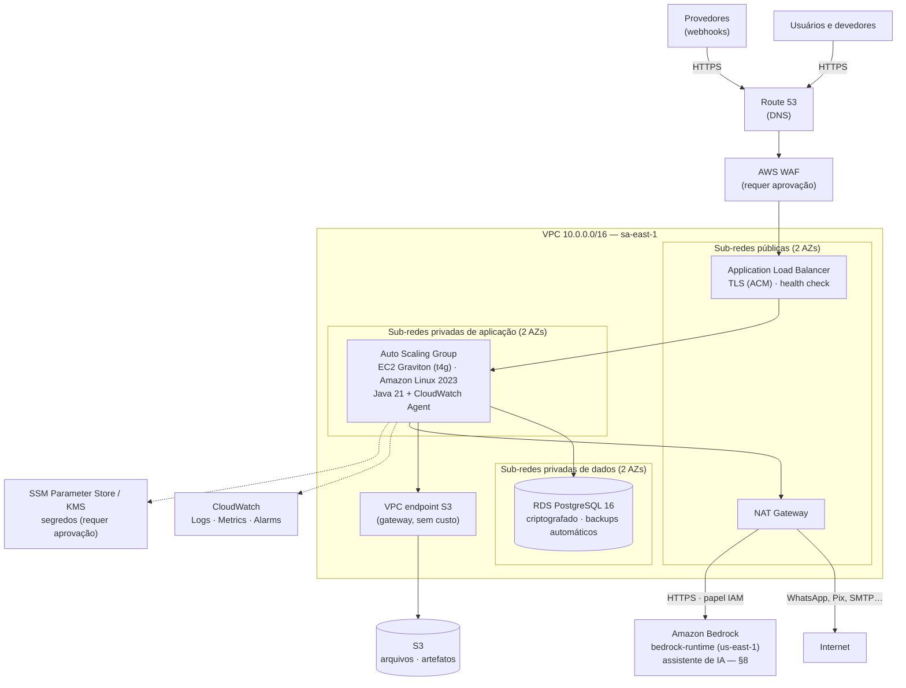
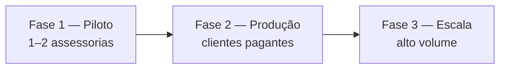

# Estrutura recomendada na AWS

Objetivo: começar com **custo operacional baixo** e crescer **por configuração, não por reescrita**, à medida que entram assessorias, carteiras e volume de mensagens. Toda a estrutura será descrita em Terraform (`infra/terraform`), de modo que cada fase seja uma mudança de variáveis revisada por pull request.

Premissas do projeto: aplicação em EC2 Linux com balanceamento de carga, PostgreSQL no RDS, arquivos no S3 e observabilidade no CloudWatch. Serviços adicionais aparecem marcados como **requer aprovação**.

## 1. Região

**Recomendação: São Paulo (`sa-east-1`).** Menor latência para os usuários e devedores, e dados pessoais mantidos no Brasil, o que simplifica a análise de LGPD e os contratos com credores.

A região custa mais que as dos EUA — por exemplo, um `db.t4g.medium` PostgreSQL sai por cerca de US$ 100/mês em São Paulo contra US$ 47/mês na Virgínia ([Bytebase](https://www.bytebase.com/dbcost/rds/instance/db.t4g.medium/)). A diferença deve ser avaliada pelo jurídico contra a exigência contratual dos credores antes de optar por outra região.

## 2. Arquitetura alvo

### Componentes

| Componente | Configuração inicial | Por quê |
| --- | --- | --- |
| VPC | 2 zonas de disponibilidade; sub-redes públicas, privadas de aplicação e privadas de dados | Separação de camadas; o banco nunca tem rota para a internet |
| ALB | HTTPS (TLS 1.2+), redireciona 80→443, health check em `/actuator/health/readiness`; `X-Forwarded-For` em modo `append` (o IP real fica **à direita**) | Único ponto de entrada; distribui carga e substitui instâncias doentes |
| EC2 / Auto Scaling Group | `t4g.medium` (2 vCPU, 4 GiB), Amazon Linux 2023, IMDSv2 obrigatório, sem chave SSH | Graviton custa menos por desempenho; o ASG garante substituição automática e crescimento |
| Acesso às instâncias | AWS Systems Manager Session Manager | Elimina bastion e porta 22 aberta; toda sessão fica auditada |
| RDS PostgreSQL 16 | `db.t4g.medium`, gp3 50 GiB com autoscaling de armazenamento, criptografia KMS, backups 14 dias, deletion protection, `rds.force_ssl=1` | Banco gerenciado com recuperação ponto-a-ponto |
| S3 | Bloqueio de acesso público, criptografia SSE, versionamento, *lifecycle* (Standard-IA após 90 dias, Glacier para arquivos de evidência antigos) | Arquivos com custo decrescente ao envelhecer |
| CloudWatch | 3 grupos de log com retenções distintas, métricas `GestorCobranca`, painel operacional e alarmes | Observabilidade exigida pelo projeto |
| NAT Gateway | 1 unidade (em uma AZ) na fase inicial | Saída para provedores externos sem expor as instâncias |

### Grupos de segurança (cadeia de confiança)

| Grupo | Entrada permitida | Saída |
| --- | --- | --- |
| `sg-alb` | 443 e 80 da internet (ou do WAF) | 8080 para `sg-app` |
| `sg-app` | 8080 somente de `sg-alb` | 5432 para `sg-db`; 443 para internet via NAT; S3 via endpoint; 587 (SMTP com STARTTLS) para o provedor de e-mail |
| `sg-db` | 5432 somente de `sg-app` | nenhuma |

### Perfil IAM das instâncias (menor privilégio)

- `s3:GetObject/PutObject/DeleteObject` apenas no bucket da aplicação (prefixo `tenants/*`) e leitura do prefixo de artefatos de deploy (e dos scripts de bootstrap).
- `logs:CreateLogStream/PutLogEvents` nos três grupos de log e no grupo da saída do Run Command; `cloudwatch:PutMetricData` restrito aos namespaces `GestorCobranca` (aplicação) e `GestorCobranca/Host` (memória e disco, CloudWatch Agent).
- `ssm:GetParameter(s)` e `kms:Decrypt` somente nos segredos de **runtime** `/gestor-cobranca/<ambiente>/app/*` — ou, enquanto o SSM não for aprovado, `s3:GetObject` em `s3://<bucket de segredos>/<ambiente>/app/*`.
- Os segredos de **migração** (`.../migration/*`, senha de `app_owner`, dono do schema) **não** são legíveis pelo papel em execução: uma falha na aplicação não pode virar `ALTER TABLE ... DISABLE ROW LEVEL SECURITY` em todas as assessorias. `scripts/deploy/migrate.sh` (pipeline/operador) cria no papel, só durante a execução, a política inline temporária `migration-window`, que permite ler `migration/*` **apenas** da instância escolhida para a migração (`ec2:SourceInstanceARN`) e **até** o fim da janela (`aws:CurrentTime`, 75 min), e a remove ao terminar. Quem executa o deploy precisa de `iam:PutRolePolicy`/`iam:DeleteRolePolicy` no papel das instâncias. Com `db_admin_access = true` (temporário) o papel também lê `migration/*`, usado por `db-admin.sh` para criar e rotacionar a senha de `app_owner`.
- `secretsmanager:GetSecretValue` no segredo da senha mestre do RDS **somente** enquanto `db_admin_access = true` (criação de papéis e rotação de senhas; desligado no restante do tempo).
- `AmazonSSMManagedInstanceCore` para o Session Manager e o Run Command (execução das migrations).
- **Assistente de IA (Amazon Bedrock, com `assistant_bedrock_enabled`)**: somente `bedrock:InvokeModel` (a Converse API é autorizada por essa ação; não existe ação IAM `bedrock:Converse`) nos ARNs dos perfis de inferência configurados (`arn:aws:bedrock:<região>:<conta>:inference-profile/us.anthropic.claude-haiku-5-5` e `…sonnet-5-5`) e nos modelos base em cada região de destino **somente por meio desses perfis** (condição `bedrock:InferenceProfileArn`); sem perfil `global.*` configurado, nega explicitamente o roteamento global (`aws:RequestedRegion = unspecified`). Nenhuma permissão de AWS Marketplace no papel (§8).

### IP do cliente e proxies confiáveis

A aplicação só interpreta `X-Forwarded-For`/`-Proto`/`-Port` de conexões vindas das sub-redes públicas do ALB (saída `public_subnet_cidrs` do módulo de rede → `APP_HTTP_TRUSTED_PROXIES`; obrigatório no perfil `prod`). O `X-Forwarded-For` é lido da direita para a esquerda e o primeiro salto fora dessas sub-redes é o cliente; valores à esquerda (escritos pelo cliente) e o cabeçalho `Forwarded` são ignorados. O ALB não remove `Forwarded` (não há ação de listener para isso) — a aplicação o descarta. O limite de taxa do WAF agrega pelo **IP de origem da conexão** (`aggregate_key_type = "IP"`), nunca pelo `X-Forwarded-For`, que sem CDN confiável à frente é escolhido pelo cliente.

Nenhuma chave de acesso AWS fica em arquivo ou variável de ambiente: o SDK usa as credenciais temporárias do perfil da instância.

## 3. Logs no CloudWatch

| Grupo de log | Origem | Retenção sugerida | Uso |
| --- | --- | --- | --- |
| `/gestor-cobranca/<env>/technical` | `technical.log` | 30 dias | Diagnóstico e desempenho (Logs Insights por rota, tenant, requestId) |
| `/gestor-cobranca/<env>/business` | `business.log` | 13 meses | Análises operacionais; cópia permanente também na tabela `shared.business_event` |
| `/gestor-cobranca/<env>/access` | `access.log` | 13 meses + exportação mensal para S3/Glacier por 5 anos | Rastreabilidade de acesso; cópia também em `shared.access_log` |
| `/gestor-cobranca/<env>/run-command` | saída do SSM Run Command | 13 meses | Quem executou migrations e operações de banco, quando e com que resultado |

Retenção curta no CloudWatch e arquivamento no S3 reduzem o custo de armazenamento de log, que cresce rapidamente com o volume.

### Alarmes iniciais

| Alarme | Condição |
| --- | --- |
| Erros 5xx no ALB | > 1% das requisições em 5 min |
| Latência p95 | > 1,5 s por 10 min |
| Instâncias não saudáveis | ≥ 1 por 5 min |
| CPU do RDS / conexões | > 80% por 15 min |
| Espaço livre no RDS | < 20% |
| Jobs em DEAD (`jobs.dead`) | > 0 |
| Eventos pendentes (`events.publications.incomplete`) | crescimento contínuo por 15 min |
| Falha ao gravar log de acesso (`access.log.write_failures`) | > 0 |
| Falhas de selagem da auditoria (`audit.seal.failures`) | > 0 |
| Picos de login negado (`access.events{type=LOGIN_FAILURE}`) | acima do padrão histórico |
| SLA da caixa de entrada (`communication.inbox.sla.breaches`) | soma > `inbox_sla_breaches_threshold` (padrão 10) em 15 min |
| Tempo real da caixa de entrada (`communication.realtime.listener.failures`) | > 3 em 5 min (ADR-0008) |

Tempo real da caixa de entrada (ADR-0008): conexões SSE atravessam o ALB sem configuração especial — o *heartbeat* de 20 s fica abaixo do `idle_timeout` (120 s); cada instância mantém uma conexão a mais com o RDS (fora do pool) para o `LISTEN`; nenhum serviço adicional.

## 4. Fases de crescimento

A aplicação é *stateless*: todo o estado está no PostgreSQL e no S3. Por isso escalar é aumentar o número ou o tamanho das instâncias, sem mudança de código.

### Fase 1 — Piloto (custo mínimo com segurança completa)

| Item | Configuração |
| --- | --- |
| EC2 | ASG mínimo 1, máximo 3, `t4g.medium` |
| RDS | `db.t4g.medium` **Single-AZ** |
| NAT | 1 NAT Gateway |
| Ambientes | produção + homologação (homologação desligada fora do horário comercial por agendamento) |

Com mínimo de 1 instância, uma falha causa indisponibilidade de alguns minutos até o ASG substituí-la. Aceitável em piloto; se não for, usar mínimo 2 desde o início.

### Fase 2 — Produção com clientes pagantes

| Item | Mudança |
| --- | --- |
| EC2 | ASG mínimo 2 (uma por AZ), máximo 6; escala por CPU (alvo 60%) e por requisições por instância |
| RDS | **Multi-AZ** (failover automático); `db.t4g.large` ou `db.m7g.large` conforme carga |
| Custos | Compute Savings Plan de 1 ano e instância reservada do RDS (economia típica de 30% a 40% sobre on-demand) |
| Segurança | AWS WAF com regras gerenciadas e limite de taxa; GuardDuty (ambos requerem aprovação) |
| NAT | um NAT Gateway por AZ, se a disponibilidade da saída para provedores for crítica |

### Fase 3 — Escala

| Gatilho | Ação |
| --- | --- |
| Jobs e campanhas competindo com a API | Segundo ASG da mesma aplicação em modo *worker* (sem tráfego do ALB), escalando pela métrica `jobs.pending` |
| Relatórios pesados afetando a operação | Réplica de leitura do RDS dedicada ao módulo `analytics` |
| Banco no limite vertical | Migração para Aurora PostgreSQL (compatível; troca de endpoint) |
| Volume de jobs muito alto | Trocar a fila PostgreSQL por Amazon SQS (a fila é uma porta de saída no código) |
| Frontend com muitos acessos | Servir o Angular por S3 + CloudFront |

## 5. Estimativa de custo mensal (ordem de grandeza)

Valores aproximados em US$, on-demand, `sa-east-1`, sem impostos. O único valor confirmado em fonte é o do RDS `db.t4g.medium` ([Bytebase](https://www.bytebase.com/dbcost/rds/instance/db.t4g.medium/)); os demais são estimativas e **devem ser recalculados no [AWS Pricing Calculator](https://calculator.aws/) antes da contratação**.

| Item | Fase 1 | Fase 2 |
| --- | --- | --- |
| EC2 `t4g.medium` (1 → 2 instâncias) | 40–55 | 80–110 |
| Application Load Balancer | 25–35 | 30–50 |
| NAT Gateway (1 → 2) + tráfego | 50–70 | 100–140 |
| RDS `db.t4g.medium` Single-AZ → Multi-AZ, gp3 50 GiB | 110–120 | 210–240 |
| S3 (até ~100 GiB) | 3–5 | 5–15 |
| CloudWatch (logs, métricas, alarmes) | 15–40 | 40–100 |
| WAF | — | 15–30 |
| **Total aproximado** | **~US$ 245–325** | **~US$ 480–685** |

Maiores alavancas de economia, em ordem: Savings Plans/instâncias reservadas na fase 2; desligar homologação fora do horário; *lifecycle* do S3 e retenção curta de logs no CloudWatch; tamanho das instâncias ajustado pelas métricas reais após 30 dias de operação.

## 6. Implantação

1. O pipeline gera o JAR e o pacote do frontend, executa testes e publica no S3 (`artifacts/<versão>/`).
2. Uma nova versão do *launch template* aponta para o artefato.
3. *Instance refresh* do ASG substitui as instâncias gradualmente (mínimo 90% saudáveis), com o ALB drenando conexões.
4. Migrations Flyway são executadas uma única vez, antes do refresh, por um passo dedicado com o papel `app_owner` (o mesmo JAR em modo `migrate`, executado numa instância do ASG via SSM Run Command, sem abrir portas), com a senha de `app_owner` legível só durante a janela de migração e só por essa instância; as instâncias de aplicação conectam com `app_runtime_login`, que não altera schema.
5. Reversão: voltar o *launch template* à versão anterior (migrations são sempre compatíveis com a versão anterior).

## 7. Backup e recuperação

| Item | Política |
| --- | --- |
| RDS | Backups automáticos de 14 dias (restauração ponto-a-ponto) + snapshot manual mensal mantido por 12 meses |
| S3 | Versionamento; replicação para outra região na fase 2 se exigida contratualmente |
| Infraestrutura | Recriável por Terraform |
| Objetivo inicial | RPO ≤ 5 min (logs de transação do RDS); RTO ≤ 1 h (fase 1) e ≤ 15 min (fase 2, Multi-AZ) |

Implementação em Terraform, scripts de implantação e procedimentos (primeira implantação, rotação de segredos, rollback): [`infra/terraform/README.md`](../../infra/terraform/README.md).

## 8. Amazon Bedrock (assistente de IA)

Aprovado pelo responsável em 25/10/2026 (issue #12): modelos **Claude Haiku 5.5** (nível padrão) e **Claude Sonnet 5.5** (nível avançado: negociação, proposta, aceite e Pix) pela Converse API. Desenho e residência de dados: [`docs/tecnico/desenho/assistente.md`](../tecnico/desenho/assistente.md) §6.5–6.7.

**Região.** Os dois modelos **não estão disponíveis em `sa-east-1`** na própria região nem por perfil geográfico; São Paulo só chama o perfil **global** (processamento em qualquer região comercial). Padrão configurado (mais conservador): endpoint `us-east-1` com os perfis geográficos `us.*` (processamento só em regiões dos EUA). As duas opções são transferência internacional (LGPD art. 33) e dependem da aprovação do responsável **[revisar]**; o Terraform recusa `assistant_bedrock_enabled = true` sem `bedrock_international_transfer_approved = true`, e a aplicação recusa subir sem `ASSISTANT_BEDROCK_INTERNATIONAL_TRANSFER_APPROVED=true`.

**Rede.** As instâncias chamam o endpoint público `bedrock-runtime.<região>.amazonaws.com` (HTTPS 443) pela saída NAT já liberada no `sg-app`. VPC endpoint de interface (PrivateLink, custo por hora/AZ, requer aprovação) só atende a região da própria VPC, isto é, a opção com endpoint em São Paulo (`app.assistant.bedrock.endpoint-override`).

**Variáveis do Terraform** (ambiente): `assistant_bedrock_enabled` (padrão `false`), `bedrock_region` (`us-east-1`), `bedrock_standard_model_id` (`us.anthropic.claude-haiku-5-5`), `bedrock_advanced_model_id` (`us.anthropic.claude-sonnet-5-5`), `bedrock_international_transfer_approved` (`false`). Chegam à aplicação como `ASSISTANT_BEDROCK_*`; os preços ficam no `application.yml` (`app.assistant.bedrock.<nível>.pricing`) e **precisam ser conferidos na conta**.

### Como habilitar o acesso aos modelos na conta (uma vez por conta, por um administrador)

1. Console da AWS, região do endpoint escolhido (`us-east-1` no padrão) → **Amazon Bedrock** → **Model catalog** → *Anthropic* → **Claude Haiku 5.5** e **Claude Sonnet 5.5**. Os modelos Anthropic exigem o **formulário de caso de uso** uma única vez (pelo console — ex.: ao abrir o modelo no *Playground* — ou pela API `PutUseCaseForModelAccess`; numa organização, enviado pela conta de gerenciamento vale para as contas-membro). Aceitar os termos (EULA) do modelo de terceiros.
2. Os modelos de terceiros são cobrados pelo **AWS Marketplace**: a assinatura é criada na **primeira invocação** por um principal com `aws-marketplace:Subscribe`. Faça essa primeira chamada **com o usuário administrador** (o *Playground* do console basta), não com o papel das instâncias, que não tem permissão de Marketplace. Erro `INVALID_PAYMENT_INSTRUMENT` = forma de pagamento da conta (cartão como padrão ou perfil de pagamento em USD para o Marketplace).
3. Confira os perfis: `aws bedrock list-inference-profiles --region us-east-1` deve listar `us.anthropic.claude-haiku-5-5` e `us.anthropic.claude-sonnet-5-5`.
4. **Registro de invocação do Bedrock** (*Settings → Model invocation logging*): manter **desligado** — se ligado, grava prompts e respostas completos em CloudWatch/S3, fora da retenção e da cifragem da trilha do assistente.
5. **Cotas**: *Service Quotas → Amazon Bedrock*: conferir tokens e requisições por minuto dos dois perfis na região; o adaptador sempre envia `maxTokens` (a cota é reservada por entrada + `maxTokens`). Pedir aumento antes da produção, se preciso.
6. **SCP** da organização (se houver): permitir as regiões de destino do perfil (`us-east-1`, `us-east-2`, `us-west-1`, `us-west-2`…) para `bedrock:InvokeModel`; com perfil global, permitir `aws:RequestedRegion = unspecified`.
7. **Custos**: os modelos aparecem no Cost Explorer sob o provedor do modelo (Marketplace), não sob "Amazon Bedrock". Crie um orçamento (AWS Budgets) para eles.

### Como ligar em homologação

1. Conclua os passos acima e registre a aprovação da transferência internacional e da opção de região.
2. `envs/homologacao/terraform.tfvars`: `assistant_bedrock_enabled = true`, `bedrock_international_transfer_approved = true` (e, na opção São Paulo, `bedrock_region = "sa-east-1"` com os ids `global.*`). `terraform plan` deve mostrar só a política `app-least-privilege` (novos `BedrockInvoke*`) e uma nova versão do *launch template*; `terraform apply`.
3. O *instance refresh* recria as instâncias com `ASSISTANT_BEDROCK_*` no `app.env`. Siga o roteiro de homologação do desenho (§6.7): subida, fumaça pela CLI, negação do global, política sombra com o nível por etapa, cache, custo e erros.
4. Só depois: política `SHADOW` em carteira piloto (decisão 362: `ADVANCED_ONLY` no piloto) e as fases de `docs/negocio/assistente-ia.md` §8.

## 9. Chat de suporte com IA (módulo `helpdesk`)

Chat para o usuário interno com **Claude Haiku 5.5** no Amazon Bedrock (mesmo provedor aprovado no §8) e chamados como issues no GitHub. Desenho: [`docs/tecnico/desenho/chat-suporte.md`](../tecnico/desenho/chat-suporte.md).

**Bedrock.** Mesmo endpoint (`bedrock_region`) e **a mesma aprovação de transferência internacional** do assistente (`bedrock_international_transfer_approved`); o Terraform recusa `helpdesk_bedrock_enabled = true` sem ela e a aplicação recusa subir sem `HELPDESK_BEDROCK_INTERNATIONAL_TRANSFER_APPROVED=true`. O papel das instâncias ganha `bedrock:InvokeModel` só no perfil do chat (`helpdesk_bedrock_model_id`, padrão `us.anthropic.claude-haiku-5-5`) e no modelo base por meio dele; o roteamento global continua negado sem perfil `global.*`. Ligado sozinho (sem o assistente), o papel não alcança o Sonnet. Variáveis: `HELPDESK_BEDROCK_ENABLED`, `HELPDESK_BEDROCK_REGION`, `HELPDESK_BEDROCK_MODEL_ID`, `HELPDESK_BEDROCK_INTERNATIONAL_TRANSFER_APPROVED`; preços em `app.helpdesk.bedrock.model.pricing` (conferir na conta).

**GitHub.** Token no segredo de runtime `/gestor-cobranca/<ambiente>/app/helpdesk-github-token` (Parameter Store `SecureString`; ou `s3://<bucket de segredos>/<ambiente>/app/helpdesk-github-token` enquanto o SSM não for aprovado). O papel das instâncias já lê `app/*` (nenhuma permissão nova); a inicialização só lê esse segredo com `helpdesk_tickets_enabled = true` e o entrega como `HELPDESK_GITHUB_TOKEN` no `secrets.env` (0600). Sem o segredo, a abertura de chamados fica indisponível e o chat continua. Variáveis: `helpdesk_github_repository` (padrão `marcoskapp/gestor_cobranca`) e `helpdesk_github_require_private_repository` (trava "só repositório privado", **desligada** até a migração do repositório).

### Como configurar o token do GitHub e ligar em homologação

1. **Token** (no GitHub, com a conta dona do repositório): *Settings → Developer settings → Personal access tokens → Fine-grained tokens → Generate new token*. Nome `gestor-cobranca-helpdesk-homologacao`; validade de até 90 dias (anote a data de rotação); *Resource owner* `marcoskapp`; *Repository access* → **Only select repositories** → `gestor_cobranca`; *Permissions → Repository permissions* → **Issues: Read and write** (o *Metadata: Read-only* entra sozinho). Nenhuma outra permissão.
2. **Rótulo**: confira que o rótulo `suporte` existe em *Issues → Labels* (crie-o se não existir; o token só de Issues aplica rótulos existentes).
3. **Segredo** (com o perfil administrador de segredos do ambiente, nunca o papel das instâncias): `scripts/ops/provision-secrets.sh --env homologacao set app/helpdesk-github-token`, colando o token na entrada padrão e finalizando com Ctrl-D. O script grava no destino do ambiente (Parameter Store `SecureString` com a chave KMS do ambiente, ou bucket de segredos), aceita só token *fine-grained* (`github_pat_…`) e o lista como opcional no `check`. Não cole o token em arquivo, issue ou chat. Roteiro completo, testes de aceitação e problemas comuns: [`ativacao-aws.md`](../tecnico/operacao/ativacao-aws.md) §7.5.
4. **Bedrock**: com o acesso ao Haiku 5.5 já habilitado na conta (§8, passos 1–3) e a transferência internacional aprovada, em `envs/homologacao/terraform.tfvars`: `helpdesk_bedrock_enabled = true`, `bedrock_international_transfer_approved = true`, `helpdesk_tickets_enabled = true` (e `helpdesk_github_require_private_repository = false` até o repositório ficar privado). `terraform plan` deve mostrar só a política `app-least-privilege` (perfil do Haiku) e uma nova versão do *launch template*; `terraform apply`.
5. O *instance refresh* recria as instâncias com `HELPDESK_*` no `app.env` e o token no `secrets.env`. No log técnico: `Provedor de IA do chat de suporte: Amazon Bedrock` e `Chamados de suporte no GitHub habilitados`.
6. **Fumaça**: na interface, botão "Chat de suporte" → "Como uso esta tela?" (resposta do manual); com um operador de escopo restrito, peça um devedor de outro credor (não encontra); peça para abrir um chamado com um CPF no relato, confira a máscara no texto exibido, confirme e confira a issue no GitHub (rótulo `suporte`, e-mail, aviso de retorno por e-mail, nenhum dado de devedor). Confirmar de novo devolve a mesma issue.
7. **Migração para privado** (quando decidida): torne o repositório privado, depois `helpdesk_github_require_private_repository = true` e `terraform apply`. Com a trava ligada e o repositório público, nenhum chamado é aberto (`helpdesk.ticket.repository_not_private`).
8. **Rotação do token**: gere um novo token, grave-o com o mesmo `set` (sobrescreve) e faça um *instance refresh*; revogue o anterior no GitHub.
