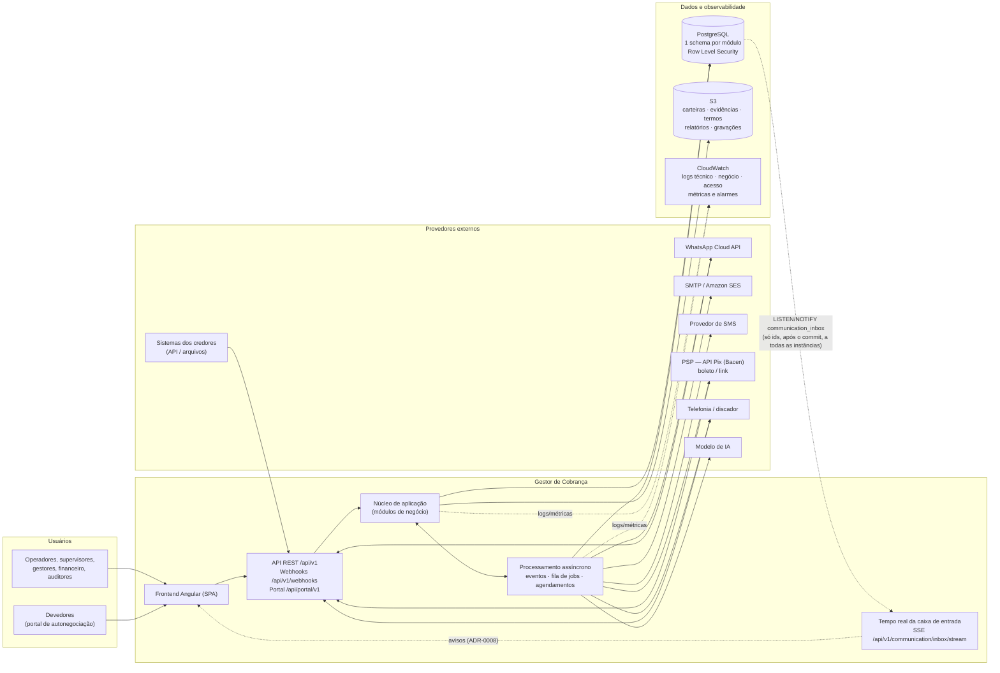
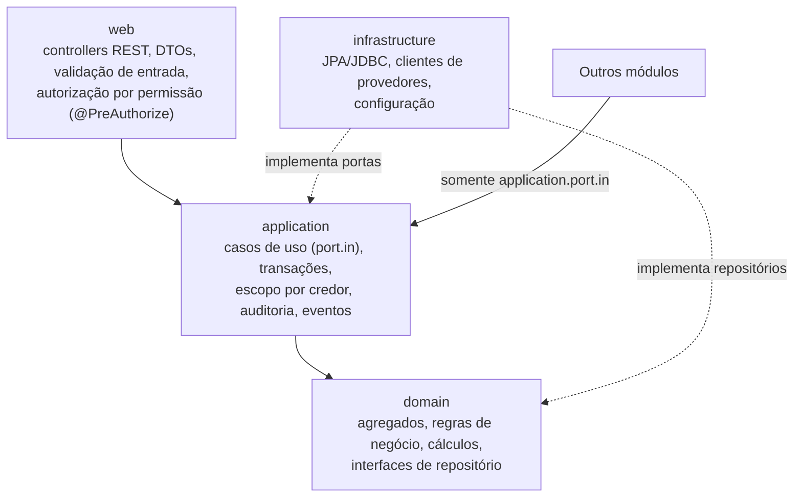
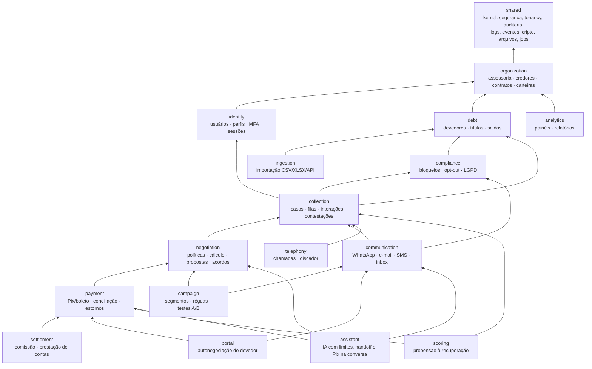
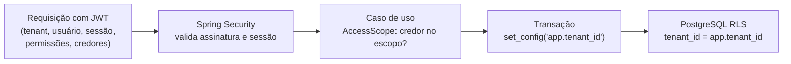
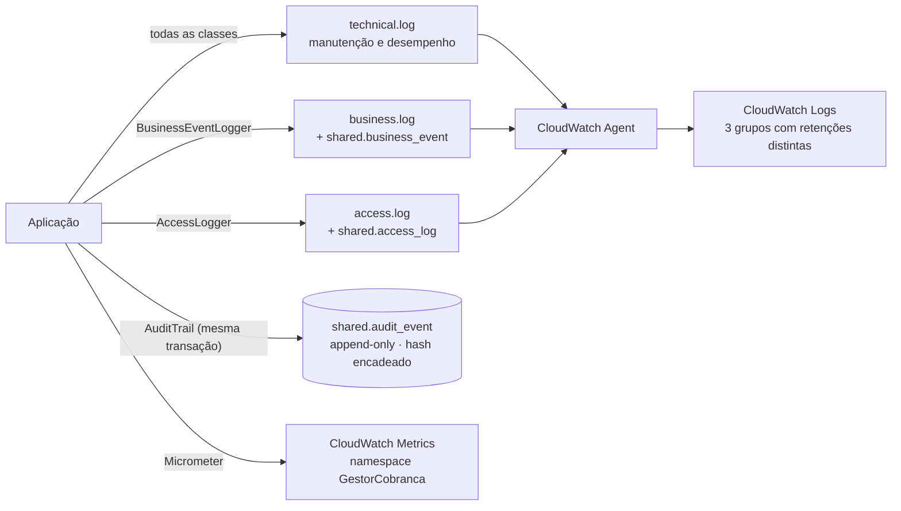
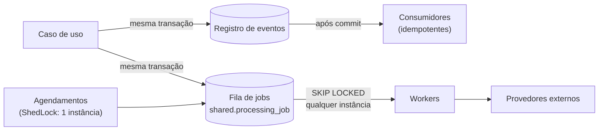

# Topologia lógica da aplicação

A plataforma é um **monólito modular**: um único artefato Java implantado em várias instâncias idênticas, internamente dividido em módulos de negócio com fronteiras verificadas por teste. Essa forma combina a simplicidade operacional de um único deploy com a separação de responsabilidades que permite, no futuro, extrair um módulo como serviço independente se o volume exigir.

## 1. Visão geral

O tempo real da caixa de entrada não usa serviço adicional: gatilhos nas tabelas de conversa e mensagem emitem `NOTIFY` (somente ids), cada instância escuta o canal numa conexão própria e repassa às conexões SSE abertas nela, filtrando assessoria e credores do escopo; o navegador então busca os dados pelos endpoints normais ([ADR-0008](adr/0008-tempo-real-sse-listen-notify.md)).

## 2. Camadas de cada módulo

Todo módulo segue a mesma arquitetura hexagonal. As setas indicam a única direção de dependência permitida (verificada automaticamente por ArchUnit e Spring Modulith).

## 3. Módulos de negócio e dependências

Cada caixa é um módulo (bounded context). Setas sólidas são chamadas síncronas permitidas; reações no sentido contrário ocorrem somente por **eventos de integração** publicados no kernel compartilhado.

### Eventos de integração (linguagem publicada)

| Evento | Publicado por | Consumido por (reação) |
| --- | --- | --- |
| `PortfolioStatusChanged` | organization | collection (elegibilidade), campaign (pausa) |
| `PortfolioLoaded` | ingestion/debt | collection (abertura de casos), scoring |
| `TitleStatusChanged` | debt | collection, campaign, negotiation |
| `ContactRestrictionChanged` | compliance | communication, campaign, telephony |
| `CaseStatusChanged`, `InteractionRecorded` | collection | campaign, scoring, analytics |
| `DisputeStatusChanged` | collection | campaign, negotiation |
| `AgreementStatusChanged`, `InstallmentStatusChanged` | negotiation | collection, campaign, settlement, portal |
| `PaymentConfirmed`, `PaymentReversed` | payment | collection, campaign, settlement, scoring |
| `PaymentInstructionStatusChanged` | payment | assistant (entrega do Pix gerado na conversa e conversão — ADR-0009) |
| `MessageStatusChanged` | communication | collection, campaign, assistant |
| `CallCompleted` | telephony | collection, scoring |
| `CadenceExhausted` | campaign | legal (critério "régua extrajudicial esgotada") |

Eventos são gravados na mesma transação da operação (Spring Modulith) e entregues após o commit; consumidores são idempotentes e falhas são reprocessadas automaticamente.

## 4. Isolamento de dados (multi-tenant e multi-credor)

Três barreiras independentes: (1) o token só autentica com sessão ativa no servidor; (2) os casos de uso filtram e validam o escopo de credores do usuário; (3) o banco recusa qualquer leitura ou escrita de outro tenant, mesmo que haja erro de código.

## 5. Fluxos de log e auditoria

| Fluxo | Finalidade | Exemplos |
| --- | --- | --- |
| Técnico | Diagnóstico, desempenho, erros | rota, status e duração de cada requisição; falhas de integração; jobs reprocessados |
| Negócio | Inteligência operacional | acordo formalizado (valor, parcelas, canal, operador); pagamento confirmado; contato efetivo |
| Acesso | Rastreabilidade de segurança | login e falhas, MFA, bloqueios, acesso negado, visualização de dado sensível, exportações |
| Auditoria | Prova de alterações | antes/depois de cada mudança relevante, autor, motivo; integridade verificável |

Dados pessoais (CPF, e-mail, telefone) são mascarados automaticamente em todos os logs.

## 6. Processamento assíncrono

Não há fila ou broker externo nesta fase: PostgreSQL atende eventos, jobs e travas distribuídas com garantias transacionais. Quando o volume justificar, a fila de jobs pode migrar para Amazon SQS sem alterar os casos de uso (a fila é uma porta de saída).
