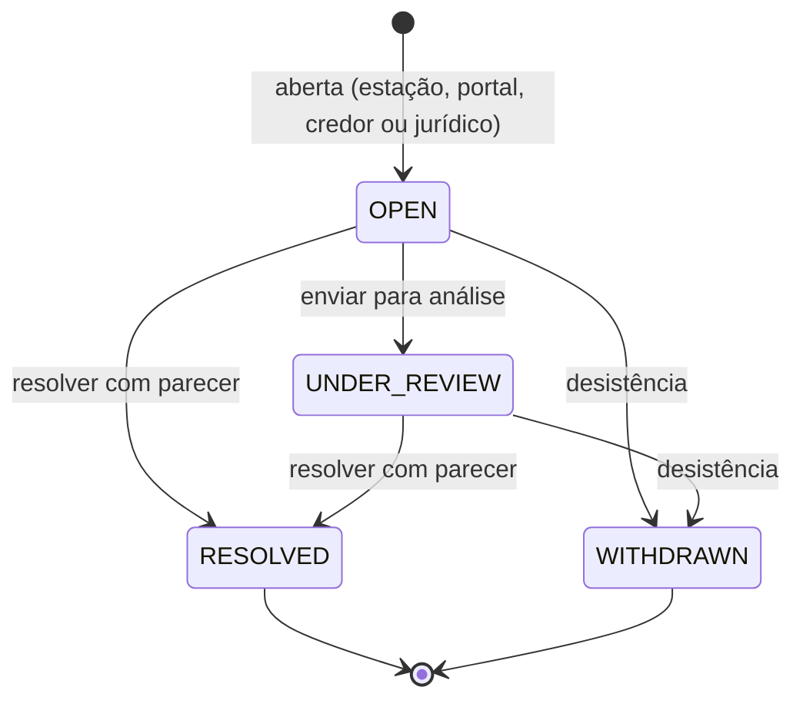

# Contestações (F21)

Como a assessoria trabalha uma dívida contestada pelo devedor, pelo credor ou pelo jurídico: quem é o responsável, quais prazos valem, como a assessoria pede a análise ao credor, como responde ao devedor e como o resultado chega ao título. O desenho técnico está em [tecnico/desenho/collection.md §7](../tecnico/desenho/collection.md#7-contestações-f21); os indicadores, em [indicadores.md §7](indicadores.md#7-contestações).

## 1. Ciclo de vida

- Contestação **bloqueante** (padrão) tira os títulos de réguas e negociações e suspende o contato de **cobrança** até a resolução. A resposta ao devedor (§5) não é cobrança e não é bloqueada por ela.
- "Aguardando o credor" **não é uma situação nova**: é derivado do pedido ao credor em aberto (§4) e aparece como selo, filtro e indicador. A contestação continua aberta ou em análise.
- Resolver (procedente, parcialmente procedente ou improcedente) ou desistir libera os títulos e reavalia o caso. Pedidos ao credor ainda abertos são cancelados (os lembretes deixam de sair).

## 2. Responsável e fila

| Quem | Pode |
| --- | --- |
| Gestão de contestações (`DISPUTE_MANAGE`: supervisor e gestor) | ver todas as contestações do seu escopo de credores, trabalhar qualquer uma, atribuir, devolver à fila, redistribuir e configurar prazos, distribuição e modelos |
| Quem trabalha contestações (`DISPUTE_WORK`: operador e, por herança, supervisor) | ver a fila, **assumir** as sem responsável ("Pegar para mim") e trabalhar **as próprias**; ao agir numa sem responsável, ela passa a ser dele |
| Outros perfis com acesso ao caso (`CASE_WORK`) | abrir a contestação na estação e anexar evidências, como antes |

- **Distribuição** (configuração): **manual** (padrão — a nova contestação fica sem responsável) ou **automática ao menos carregado** do grupo de analistas: vai a quem tem menos contestações em aberto; no empate, a quem recebeu há mais tempo. Um membro pode ser restrito a um credor. Sem grupo elegível, fica sem responsável.
- Só recebe quem está **ativo**, tem `DISPUTE_WORK` ou `DISPUTE_MANAGE` e tem **acesso ao credor** da contestação (escopo de credores).
- **Redistribuir** move todas as contestações em aberto de uma pessoa (férias, desligamento) para outra ou de volta à fila/distribuição automática, com motivo.
- Toda mudança de responsável fica no histórico da contestação (quem, quando, modo e motivo), na trilha de auditoria e no log de negócio (`dispute.assigned`).
- **Minhas pendências**: "Contestações sob minha responsabilidade" (analista), "Contestações sem responsável ou vencidas" (gestão), "Respostas ao devedor pendentes" e "Ajustes de título pendentes".
- Contestação aberta **pela tabulação** do atendimento ("Alega pagamento", "Contesta a dívida") segue as mesmas regras: prazos pela regra aplicável e responsável pela distribuição configurada — quem tabulou não vira responsável sozinho (pode assumir com "Pegar para mim").
- A fila vem ordenada pelo **prazo mais próximo** (o interno ou o de resposta ao devedor, o que vencer primeiro).

## 3. Prazos

Três relógios independentes; **nenhum pausa o outro**:

| Prazo | Para quê | De onde vem |
| --- | --- | --- |
| **Resposta ao devedor** | compromisso com o consumidor (CDC); é o que conta como "vencida" | informado na abertura **ou** regra de prazo |
| **Interno** | meta da equipe (SLA interno); nunca passa do prazo de resposta | regra de prazo |
| **Pedido ao credor** | prazo pedido ao credor para retornar | padrão da configuração, editável no envio |

**Regras de prazo** (configuração): por **tipo**, por **credor** ou por **credor + tipo**, cada uma com dias de resposta e dias internos (1 a 90). Vale a mais específica: credor + tipo → credor → tipo → padrão da assessoria (prazo de resposta dos Parâmetros da operação e prazo interno da configuração). A contestação guarda os prazos e a origem calculados **na abertura**; mudar uma regra não altera contestações já abertas.

O prazo de resposta ao devedor **não é pausado** enquanto se aguarda o credor: a demora do credor aparece como "aguardando o credor" e no indicador de retorno do credor, nunca como prazo maior para o consumidor.

## 4. Canal formal com o credor

1. **Contatos de contestação** no cadastro do credor: principal (destinatário) e cópias; opcionalmente por carteira — uma carteira com contato principal ativo usa os seus contatos no lugar dos do credor. Sem contato principal, o pedido não pode ser enviado.
2. **Solicitar ao credor** (na página da contestação): o texto vem do **modelo do tipo** (editável antes de enviar), com o protocolo, os títulos citados (todos ou os escolhidos), o prazo pedido e, se houver evidências escolhidas, o **link seguro** delas. Cópia opcional ao responsável. As respostas por e-mail vão ao responsável (*reply-to*); a assessoria **não lê e-mail de entrada**.
3. **LGPD**: o pedido **não leva nome nem documento do devedor** — o credor localiza pelo protocolo e pelos títulos. As evidências **não vão anexadas**: vão num link com **validade** (padrão 7 dias, configurável até 30) e **limite de downloads** (20), que entrega um ZIP só com as evidências escolhidas; cada download fica no log de acesso; link vencido, esgotado ou inválido é recusado e registrado.
4. **Lembrete** antes do prazo (padrão 1 dia; 0 desliga) e **cobrança do retorno vencido** no dia seguinte ao prazo, ambos automáticos (todos os dias às 08:05), uma vez por pedido.
5. **Resposta do credor**: registrada na tela (posição + resumo + documentos, que entram como evidências marcadas "do credor") ou enviada pelo próprio credor pela **API pública** (`POST /public-api/v1/disputes/{id}/creditor-responses`, escopo `disputes:write`), com até 5 documentos PDF, PNG ou JPEG de até 10 MB (tipo conferido pelo conteúdo). Os documentos da API passam pela **quarentena** (verificação de malware) antes de virar evidência; infectado tem o conteúdo apagado e é recusado, e o credor acompanha a situação pela API. A resposta encerra o "aguardando o credor" do pedido.
6. **Histórico**: cada pedido guarda o texto enviado, a versão do modelo, destinatários, títulos, evidências, downloads do link e cada e-mail (pedido, lembrete, cobrança) com a situação de envio.

Envio por SMTP: "enviado" significa aceito pelo servidor de e-mail; não há confirmação de entrega. Falha temporária é repetida (até 6 tentativas, espera crescente); falha definitiva aparece no pedido.

## 5. Resposta ao devedor

Para contestações abertas pelo **devedor** ou pelo **operador em nome dele**, a resolução deixa a **resposta ao devedor pendente** até ser enviada ou registrada. Abertas pelo credor ou pelo jurídico, não se aplica.

- Texto pelo **modelo do resultado** (procedente, parcial, improcedente), editável.
- **E-mail** ou **WhatsApp** (texto livre só dentro da janela de 24 h do WhatsApp) pela fila normal de mensagens, como **comunicação de serviço** (categoria transacional do porteiro de contato):
  - **não** é bloqueada pela suspensão da própria contestação nem conta nos limites diário/semanal e no intervalo mínimo da cobrança;
  - **é** bloqueada por descadastro/restrição pedida pelo devedor ou pela lei, por contato inválido, fora da janela de horário permitida e em feriado. Restrição pedida **pelo credor** não bloqueia (o credor não pode impedir a resposta exigida ao consumidor).
- Sem canal permitido, registra-se a entrega **por outro meio** (carta, presencial, protocolo), com o texto entregue.
- A situação acompanha a mensagem (enviada, entregue, lida, falha). Mensagem bloqueada ou com falha mantém a pendência.

## 6. Ajuste sugerido no título

Procedente ou parcialmente procedente sugere um ajuste, pelo tipo e pelo resultado (editável na resolução, ou "nenhum"):

| Tipo | Procedente | Parcialmente procedente |
| --- | --- | --- |
| Já pagou | baixar por pagamento comprovado | baixar por pagamento comprovado |
| Valor incorreto | corrigir o valor | corrigir o valor |
| Demais | cancelar os títulos | corrigir o valor |

A sugestão **não altera o título**. Fica **pendente** na contestação até:

- **feita** — detectada automaticamente quando o efeito aparece no título: cancelado (cancelar), quitado (pagamento) ou saldo diferente do da resolução (corrigir valor); ou
- **dispensada** com motivo.

Atalhos para os fluxos existentes, com as regras e permissões deles: **cancelar** abre o título com a confirmação de cancelamento já com o motivo sugerido; **pagamento** abre "Informar pagamento" com os títulos marcados (comprovante e aprovação conforme a regra de pagamentos); **corrigir valor** abre a correção manual do valor no título, já com o motivo "Contestação procedente" e o vínculo com a contestação (limite, aprovação por segunda pessoa e histórico em [correcao-de-valor.md](correcao-de-valor.md)); a carga do credor com o valor corrigido também conclui o ajuste.

## 7. Indicadores e logs

- Painel **Contestações** (`/paineis/contestacoes`): abertas, em aberto e vencidas, resolvidas no prazo, tempo médio, procedência, retorno do credor e fila por responsável — definições em [indicadores.md §7](indicadores.md#7-contestações).
- Eventos de negócio (sem dado pessoal): `dispute.opened`, `dispute.assigned`, `dispute.creditor_request_sent`/`_failed`/`_overdue`, `dispute.creditor_responded`, `dispute.resolved`, `dispute.debtor_notified`, `dispute.adjustment_suggested`/`_closed` — atributos em [logs-e-metricas.md §3.3](../tecnico/logs-e-metricas.md).

## 8. O que ainda depende do responsável

- Ligar a verificação de malware (daemon ClamAV) dos documentos recebidos pela API (decisão 815).

- Revisão jurídica dos **textos padrão** dos modelos (pedido ao credor por tipo e resposta ao devedor por resultado).
