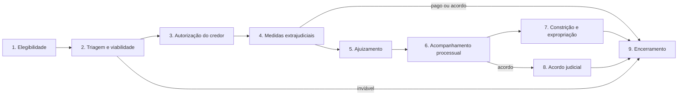

# Workflow jurídico e garantias

Como a solução acompanha os títulos que saem da cobrança amigável e entram na etapa jurídica, extrajudicial ou judicial. Desenho técnico: [`docs/tecnico/desenho/juridico.md`](../tecnico/desenho/juridico.md).

## 1. Base: o que a dívida precisa registrar

| Conceito | Por que importa | Principais dados |
| --- | --- | --- |
| **Garantia** | Define a via de recuperação e o valor recuperável | tipo (alienação fiduciária de veículo ou imóvel, hipoteca, penhor, cessão fiduciária de recebíveis, seguro garantia, outras); bem (placa, RENAVAM, chassi; matrícula e cartório; descrição); registro do gravame; avaliações (valor, data, fonte); situação |
| **Partes da obrigação** | Avalistas, fiadores e codevedores também podem ser cobrados e acionados | papel (devedor principal, avalista, fiador, codevedor, terceiro garantidor), por contrato |
| **Natureza do título** | Define a ação cabível | contrato, CCB, nota promissória, duplicata, cheque, confissão de dívida, outros; se é título executivo extrajudicial |
| **Prescrição** | Prazo fatal para o jurídico e limite para a cobrança | data-base, prazo legal aplicável, data estimada, interrupções (protesto, citação, reconhecimento da dívida) |

A garantia pertence ao contrato de origem e pode cobrir vários títulos.

## 2. Etapas do workflow

| # | Etapa | O que acontece | Saída |
| --- | --- | --- | --- |
| 1 | Elegibilidade | Regras por credor: atraso, valor, garantia, régua extrajudicial esgotada, acordos quebrados, prescrição próxima | Caso indicado ao jurídico |
| 2 | Triagem e viabilidade | Conferência documental, prescrição, pesquisa patrimonial, situação da garantia, custo × benefício | Via recomendada: protesto, execução extrajudicial da garantia, execução, monitória, busca e apreensão, ou inviável |
| 3 | Autorização do credor | Aprovação formal com orçamento de custas | Registro de quem autorizou e quando |
| 4 | Medidas extrajudiciais | Notificação e constituição em mora; protesto; negativação com comunicação prévia; execução extrajudicial de garantia (ex.: consolidação de imóvel em cartório, vias ampliadas pela Lei 14.711/2023) | Pagamento, acordo ou avanço ao judicial |
| 5 | Ajuizamento | Escolha da ação, responsável (interno ou escritório parceiro), petição, procuração, custas, distribuição | Processo com número CNJ, tribunal e vara |
| 6 | Acompanhamento processual | Andamentos, prazos em dias úteis com alertas, audiências, citação, defesas, recursos, sentença, cumprimento de sentença | Linha do tempo do processo |
| 7 | Constrição e expropriação | Busca e apreensão, penhora, avaliação, leilão ou adjudicação, levantamento de valores | Valores recuperados |
| 8 | Acordo judicial | Negociação com política própria (custas e honorários), homologação, suspensão do processo; quebra retoma o processo | Acordo acompanhado como os demais |
| 9 | Encerramento | Extinção; baixa de protesto e negativação no prazo legal após o pagamento; liberação do gravame; prescrição intercorrente; devolução ao credor ou baixa como incobrável | Caso encerrado e prestado contas |

**Transversal**: custas e despesas (adiantadas e reembolsáveis), documentos e evidências, auditoria de cada movimentação, painel jurídico (casos por fase, prazos vencendo, custas, valor recuperado).

## 3. Efeitos na operação

| Área | Efeito |
| --- | --- |
| Cobrança | Caso jurídico pausa as réguas extrajudiciais incompatíveis; devedor representado por advogado tem o contato direcionado ao advogado |
| Negociação | Política específica para casos judicializados; acordo judicial com retomada em caso de quebra |
| Pagamentos | Depósitos e levantamentos judiciais como origem de pagamento |
| Prestação de contas | Despesas jurídicas e honorários no demonstrativo do credor |
| Assistente de IA | Caso jurídico fica fora do escopo do assistente; menção a processo transfere para humano |

## 4. Integrações

| Integração | Uso | Situação |
| --- | --- | --- |
| DataJud (API pública do CNJ) | Metadados e andamentos processuais | Primeira opção para captura automática |
| Protesto eletrônico (cartórios de protesto) | Envio, acompanhamento e baixa de protestos | Requer convênio/provedor |
| Birôs de negativação | Inclusão e baixa | Requer contrato |
| Registro eletrônico de imóveis | Matrículas e procedimentos de consolidação | Requer convênio/provedor |
| Gravames de veículos | Consulta e baixa de gravame | Requer provedor |
| Captura de publicações e intimações | Diários oficiais | Fornecedor especializado |

## 5. Decisões pendentes (issue #14) — parâmetros com padrão conservador

Enquanto não forem decididas, as decisões abaixo são **parâmetros da assessoria** (tela/API de parâmetros do jurídico), com padrão conservador. Detalhes em [`docs/tecnico/desenho/juridico.md`](../tecnico/desenho/juridico.md) §B.7.

| # | Decisão | Parâmetro | Padrão |
| --- | --- | --- | --- |
| 1 | Jurídico interno, escritórios parceiros ou ambos | `conductModel` | somente jurídico interno; escritórios só acessam a plataforma quando habilitado, e então apenas os casos atribuídos |
| 2 | Quem adianta custas | `allowedExpenseAdvancers` | somente o credor; despesa só com autorização do credor e dentro do orçamento aprovado (`budgetEnforcement`) |
| 3 | Garantias predominantes (ordem das vias) | — | a viabilidade sugere a via pela garantia existente (imóvel → execução extrajudicial; veículo → busca e apreensão) |
| 4 | Captura de andamentos | `app.legal.providers.*` | lançamento manual; DataJud e fornecedores se encaixam como adaptadores após aprovação (issue #13) |
| 5 | Dívidas prescritas | `prescribedTitlePolicy` | título com a pretensão de cobrança prescrita **não** é indicado ao jurídico e o caso é sinalizado |
