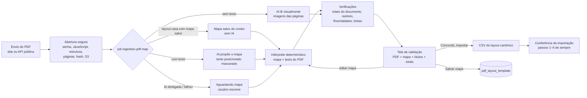

# Desenho — Importação PDF inteligente (módulo `ingestion`)

Pedido do responsável (resumo): *é comum o cliente não conseguir extrair os dados em Excel ou CSV e enviar PDF. Criar
um importador "Importação PDF inteligente" que lê o PDF, encontra os dados e cria uma tela intermediária para validação
dos dados encontrados — validar o "mapa" escrito pelo sistema na leitura do PDF. Se o usuário concordar, a importação é
concluída. O PDF pode vir em diversos formatos.*

A Importação PDF é uma **nova fonte** do fluxo de importação, não um fluxo paralelo: o resultado aprovado vira um
arquivo do **layout canônico** (`PADRAO`, CSV) que abre a **mesma conferência** de [`importacao.md`](importacao.md)
(formato, validação por linha, grandes totais, alertas de ticket médio e de separador, efetivação e aprovação de
segunda pessoa). Nenhuma regra de validação de linha é duplicada: o `RowValidator`, o `AmountParser` e o
`DocumentNormalizer` do ingestion são usados tal como estão. Regras para o usuário em
[`docs/negocio/layout-importacao.md`](../../negocio/layout-importacao.md) §9; decisões 660–679 e 685 em
[`decisoes-autonomas.md`](../../negocio/decisoes-autonomas.md).

## 1. Visão geral



| Peça | Responsabilidade |
| --- | --- |
| `PdfDocumentReader` / `PdfBoxDocumentReader` | Abertura segura do PDF (PDFBox 3.0.8), camada de texto posicionada (palavras com caixa em pontos, linhas reconstruídas) e imagem PNG de uma página |
| `ExtractionMap` (domínio, versão de esquema 1) | O "mapa": tipo de documento, separador decimal, onde está o devedor, campos do documento, como a tabela é delimitada, linhas por título, coluna do PDF → campo canônico, totais de controle e linhas a ignorar. **Nunca contém valores** |
| `ExtractionMapValidator` | Validação estrutural e semântica do mapa (limites, rótulos coerentes com o cabeçalho, destinos conhecidos, obrigatórios cobertos) |
| `MapInterpreter` | Aplica o mapa ao texto de forma **determinística** e devolve blocos de devedor, títulos, totais e campos do documento, com a origem de cada valor |
| `CanonicalAssembler` / `VisualAssembler` | Converte o resultado em `CanonicalRecord` (a linha que um CSV do layout padrão teria) |
| `ExtractionChecks` | Verificações automáticas: totais, rastreio de origem, `RowValidator` do ingestion, leitura visual, linhas não reconhecidas |
| `LayoutFingerprint` | Impressão digital do layout e teste "este PDF é do layout deste mapa salvo" |
| `PromptText` | Texto posicionado minimizado e mascarado enviado ao modelo |
| `MapExplainer` | O mapa em linguagem simples para a tela |
| `PdfMapProposer` | Chamadas ao modelo (proposta do mapa, correção, leitura visual) com saída estruturada por ferramenta |
| `PdfMapping` + `PdfMappingJobHandler` | Job do mapeamento (mapa salvo → IA → leitura visual → mapa manual) |
| `PdfAnalysis` | Recalcula a análise a partir do arquivo, do mapa e das decisões; cache curto do texto em memória |
| `PdfImportService` | Casos de uso (`PdfImportUseCases`): envio, consultas, edição do mapa, decisões, aprovação, mapas salvos, descarte |
| `PdfRetention` | Apaga o PDF do armazenamento após a retenção |

## 2. Leitura do PDF

### 2.1 Abertura segura (`PdfBoxDocumentReader#inspect`)

| Verificação | Código |
| --- | --- |
| Assinatura `%PDF-` nos primeiros 1.024 bytes (tipo pelo conteúdo, não pela extensão) | `import.file_type_invalid` |
| Tamanho (padrão 20 MB, `app.ingestion.pdf.max-file-size`) | `pdf_import.file_too_large` |
| Pede senha para abrir (`InvalidPasswordException`) | `pdf_import.password_protected` |
| JavaScript em qualquer objeto: árvore de nomes `/JavaScript`, `/JS`, `/S /JavaScript` (catálogo, páginas, anotações, formulários — percorre a tabela de referências inteira) | `pdf_import.javascript` |
| Estrutura que o parser não abre | `pdf_import.malformed` |
| Páginas acima de `max-pages` (200) ou, sem camada de texto, de `max-visual-pages` (30) | `pdf_import.too_many_pages` / `pdf_import.too_many_pages_visual` |

PDF protegido só com senha do proprietário (abre sem senha) é aceito e marcado (`encrypted` na auditoria). Nada é
executado: o PDFBox não interpreta JavaScript; a recusa evita guardar e mostrar conteúdo ativo.

### 2.2 Texto posicionado

Cada palavra do `PDFTextStripper` (ordenado por posição, texto sobreposto duplicado suprimido) vira um `TextWord` com
a caixa em pontos e origem no canto superior esquerdo (`XDirAdj`/`YDirAdj`, coerente com a imagem renderizada). As
linhas são reconstruídas pela linha de base: uma palavra entra na linha corrente se a base estiver a até 45% da menor
altura de letra (mínimo 1 pt). A camada de texto existe quando a maioria das páginas tem ao menos 5 palavras.

O texto (com dados pessoais) **nunca é gravado** nem registrado em log; é relido do arquivo guardado quando a tela pede
(cache em memória de 5 min, 16 entradas, chave assessoria + importação + hash).

## 3. O mapa de extração (esquema 1)

Schema JSON em `backend/src/main/resources/ingestion/pdf/extraction-map.schema.json` (o mesmo enviado ao modelo como
esquema da ferramenta).

| Parte | Conteúdo |
| --- | --- |
| `documentType`, `numberFormat` | descrição; `COMMA` (1.234,56) ou `DOT` (1,234.56) |
| `debtor` | `source`: `HEADER` (bloco "Rótulo: valor" antes de cada tabela, aberto por `blockStartLabel`), `COLUMNS` (colunas da tabela) ou `NONE`; `fields`: rótulo → destino, posição do valor (`RIGHT`/`BELOW`) e ajuste (`NONE`, `DROP_LEADING_CODE`, `LEADING_CODE`) |
| `documentFields` | campos lidos uma vez e aplicados a todos os títulos (ex.: "Data Emissão:" → `data_saldo`) |
| `table.headerLines` | rótulos de cada linha do cabeçalho, exatamente como no PDF e na ordem — a linha *i* descreve a linha *i* de cada título (**início da tabela**) |
| `table.linesPerRecord`, `table.anchorColumn` | linhas físicas por título (1–5) e a coluna da 1ª linha que abre um título |
| `table.endMarkers` | textos que encerram a tabela (**fim da tabela**) |
| `table.columns` | `header`, `line`, `targets` (lista; vazia = ignorar; várias colunas para o mesmo campo são unidas com `-`), limites `xMin`/`xMax` opcionais |
| `controlTotals` | rótulo, coluna (ou nulo = valor à direita do rótulo), campo somado ou `quantidade`, abrangência `BLOCK`/`DOCUMENT` |
| `ignoreLinesContaining` | rodapés e numeração (mínimo 3 caracteres) |

Destinos: coluna do layout canônico, `info:<nome>` (informação adicional: lida do PDF e mostrada na validação, **não
vai ao lote**) e
`pago_se_preenchido` (data de pagamento: preenchida → `situacao = PAGO`, que o ingestion já trata — não cria título
novo e suspende o existente para conciliação). Nenhuma expressão regular vem do modelo ou do usuário (sem risco de
ReDoS): os ajustes são um conjunto fechado.

## 4. Intérprete determinístico (`MapInterpreter`)

Mesmo texto e mesmo mapa produzem sempre o mesmo resultado (teste `sameInputSameOutput`); todo valor sai das palavras
do PDF.

1. Linhas com um texto de `ignoreLinesContaining` são descartadas.
2. **Cabeçalho**: a linha que contém, em ordem, todos os rótulos da 1ª linha do cabeçalho (comparação sem maiúsculas e
   acentos, **com** pontuação: `Cliente:` não casa com `Cliente`) abre a tabela; as linhas seguintes do cabeçalho são
   conferidas logo abaixo. Cada coluna ocupa a faixa entre os pontos médios dos rótulos vizinhos (ou os limites
   explícitos). Linha de título sem cabeçalho: limites explícitos ou, com uma coluna só, a linha inteira.
3. **Células**: palavras com intervalo menor que 0,8 da largura média de caractere formam um trecho, atribuído inteiro
   à coluna que contém o seu centro (o texto longo da 2ª linha, como a conta contábil, não invade a coluna-âncora).
4. **Títulos**: uma linha com a âncora preenchida **e do tipo do destino** (data para campos de data, valor para campos
   monetários) inicia um título; as linhas seguintes completam o título até `linesPerRecord`. O topo de uma nova página
   dentro da tabela (antes do cabeçalho repetido) nunca é anexado a um título; um título dividido entre páginas recebe
   a sua 2ª linha depois do cabeçalho repetido. O que sobra vira "linha não reconhecida" (aviso, com a região).
5. **Fim e totais**: linha com marcador de fim (ou rótulo de total) fecha a tabela; os totais são lidos nas colunas da
   1ª linha ou à direita do rótulo.
6. **Devedor**: o rótulo de abertura inicia um bloco (a não ser numa linha de fim de tabela, como "Subtotal do
   devedor:"); os campos "Rótulo: valor" são lidos à direita (1ª palavra a qualquer distância, as seguintes até um
   intervalo maior que 4 caracteres ou outro rótulo) ou abaixo. Blocos consecutivos do mesmo devedor (documento, ou
   nome) são unidos — cabeçalho repetido a cada página.

A montagem (`CanonicalAssembler`) lê os valores monetários com o `AmountParser` do ingestion sob o separador do mapa e
os entrega em texto canônico (`1234.56`, tipado, sem ambiguidade na conferência); o restante segue como no PDF (datas
`dd/mm/aaaa`, documento com máscara) e passa pelo validador do ingestion.

## 5. IA (Amazon Bedrock, Claude — aprovado)

Cliente do kernel (`shared.ai.bedrock.BedrockConverseModel`: tradução, prazo, retentativa única, erros, tokens e custo
pela tabela da configuração) com produto próprio: `app.ingestion.pdf.bedrock.*`, métricas `ingestion.pdf.bedrock.*`,
modelo único (Claude Sonnet, que lê texto e imagem). A subida falha sem `international-transfer-approved` (LGPD art.
33), como no assistente e no chat de suporte. Desligado (`enabled=false`, padrão), a importação funciona com mapas
salvos e com o mapa escrito pelo usuário.

### 5.1 Proposta do mapa (PDF com texto)

- **Entrada mínima e mascarada** (`PromptText`): linhas `[p<página> l<linha> y<topo>] x<pos> "<trecho>"…`, com **todo
  dígito trocado por 9** (CPF/CNPJ, telefones, valores e datas mantêm só o formato: `99.999.999/9999-99`, `R$ 9.999,99`)
  e e-mails por `email@mascarado`; amostra: 2/3 do limite na 1ª página e, nas demais, as 12 primeiras e as 6 últimas
  linhas, até `prompt-max-lines` (220). Nomes e endereços em letras continuam no texto (ver decisão 666). Nenhuma imagem
  é enviada quando há camada de texto.
- **Saída estruturada**: ferramenta `registrar_mapa` com o JSON Schema do mapa; o prompt versionado
  (`map-proposal-prompt.md`) traz as regras do domínio ("Pendente" = saldo, "Valor" = original, juros como `info:*`,
  `id_titulo` único, totais que somam os títulos — não quadros de resumo). O contexto lista os campos canônicos.
- **Validação no servidor**: desserialização estrita no `ExtractionMap` e `ExtractionMapValidator`. Proposta inválida
  volta ao modelo como resultado de ferramenta com `error` (problemas e caminhos) para **uma** correção
  (`repair-attempts`); ainda inválida → `AWAITING_MAP` (`pdf_map.ai_invalid`).
- **Falhas**: limite de taxa/5xx/tempo → o job tenta de novo (3 tentativas); recusa definitiva ou última tentativa →
  `AWAITING_MAP` (`pdf_map.ai_unavailable`).

### 5.2 Leitura visual (PDF sem camada de texto)

Páginas renderizadas a 150 dpi e enviadas como imagem (blocos `image` da Converse API — o contrato
`LanguageModel.ModelMessage` ganhou `attachments`) em lotes de 5 páginas; ferramenta `registrar_leitura` com a
transcrição **exatamente como impressa** de cada título (campos canônicos e `info:*`, página e confiança 0–1), os totais
impressos e o cabeçalho. O resultado fica cifrado (`visual_result`), os valores monetários passam pelo mesmo
`AmountParser`, os títulos são marcados `VISUAL` e a tela exige **conferência reforçada**: títulos com confiança abaixo
de 0,85 precisam ser confirmados ou excluídos um a um, e a aprovação exige a declaração "conferi os valores com as
imagens". O mapa da leitura visual é só descritivo (não editável nem reaproveitável). OCR externo (Amazon Textract) é
pendência de aprovação.

## 6. Reaproveitamento do mapa (`pdf_layout_template`)

"Salvar mapa para este credor" guarda o mapa (sem bloqueios e com os totais conferindo) com a **impressão digital**:
SHA-256 dos rótulos do cabeçalho da tabela (por linha, na ordem) e dos rótulos do devedor, normalizados. Salvar de novo
o mesmo layout cria a versão seguinte e desativa a anterior (um ativo por layout e credor, índice único parcial).

No próximo PDF do credor, o job testa os mapas ativos (os usados mais recentemente primeiro): casa quando alguma linha
contém todos os rótulos da 1ª linha do cabeçalho em ordem e, com cabeçalho de devedor, o rótulo de abertura e os
rótulos dos campos aparecem. Casou → mapa aplicado **sem IA** (`pdf_import.map_reused`); não casou → proposta da IA. O
usuário pode sempre "Pedir novo mapa à IA".

## 7. Verificações antes da tela (`ExtractionChecks`)

| Verificação | Efeito |
| --- | --- |
| Total do documento × soma da coluna (ou do campo) dos títulos do bloco/documento **que vão para o lote** (os excluídos pelo usuário ficam fora, decisão 685); contagem × `quantidade` | diferença acima de R$ 0,01 (ou de 1 título) **bloqueia** até corrigir o mapa ou justificar (mín. 10 caracteres, auditada); total ilegível idem |
| Total do mapa não encontrado; mapa sem totais | aviso (a conferência de grandes totais do wizard continua) |
| **Rastreio de origem**: cada valor é conferido de novo contra as palavras da região de origem (página, linha, caixa) | valor que não aparece literalmente no texto **bloqueia** |
| `RowValidator` do ingestion por título (CPF/CNPJ com dígito, nome, datas, valores, obrigatórios, título repetido no arquivo, contatos) | erro/aviso por título (como no CSV: títulos com erro não são importados) |
| Cabeçalho da tabela não encontrado; nenhum título | bloqueia |
| Linhas da tabela não reconhecidas; topo de página dentro da tabela | aviso com a região destacada |
| Leitura visual com confiança baixa | aviso; aprovação exige confirmar (um a um) ou excluir |
| Problemas do mapa (`ExtractionMapValidator`) | bloqueia |

Os alertas de **ticket médio** e de **separador decimal** continuam no passo 5 da conferência do ingestion, que recebe
o lote gerado (estatística sobre o histórico do credor — não é duplicada aqui).

## 8. Fluxo, estados e API

```
RECEIVED ─job─► MAPPING ─► AWAITING_VALIDATION ─Concordo, importar─► APPROVED ──► conferência (ImportReview)
                        └─► AWAITING_MAP ──mapa do usuário──┘
                        └─► FAILED (sem texto e sem IA; leitura visual falhou)
qualquer estado aberto ──descartar──► DISCARDED
```

Cada mudança de mapa cria uma revisão (`pdf_map_revision`, append-only) e zera as decisões sobre títulos (a numeração
pode mudar). Edição, decisão, aprovação e salvar mapa exigem a **revisão** que o usuário viu (409
`pdf_import.revision_changed`) e bloqueiam a linha (`SELECT … FOR UPDATE`).

**Aprovação** ("Concordo, importar"): sem bloqueios; justificativa se os totais não conferem; declaração na leitura
visual. Gera o CSV do layout canônico (UTF-8, `;`, aspas em todos os campos; colunas presentes nos títulos; títulos
excluídos fora) chamado `<pdf>-pdf-r<revisão>.csv` e chama `ImportReviewUseCases.start` **na mesma transação** — a
conferência começa com a prévia desse arquivo e segue os passos de sempre (formato, linhas, grandes totais informados
pelo usuário, alertas, efetivação com IMPORTAR e aprovação de segunda pessoa acima do limite). Nada é gravado na
carteira antes da efetivação da conferência.

Prefixo `/api/v1/ingestion/pdf-imports`:

| Método e caminho | Permissão | Função |
| --- | --- | --- |
| `POST /` (multipart `file`, `portfolioId`) | `IMPORT_EXECUTE` | envia o PDF (202) |
| `GET /?creditorId&portfolioId&status` | `IMPORT_VIEW` | importações (resumo) |
| `GET /{id}` | `IMPORT_VIEW` | estado completo: mapa, explicação, problemas, resumo, totais, ocorrências do documento, regiões, uso de IA, bloqueios, revisões, campos canônicos |
| `GET /{id}/records?status&debtor&q&page&size` | `IMPORT_VIEW` | títulos com origem, ocorrências e a marca `lowConfidence`; filtro (§8.1); valores pessoais mascarados sem `IMPORT_EXECUTE`/`DEBTOR_SENSITIVE_VIEW` |
| `GET /{id}/records/facets?debtor&q` | `IMPORT_VIEW` | contadores por situação (com o devedor e o texto) e os devedores (nome mascarado sem permissão de dado pessoal; sem máscara, `SENSITIVE_DATA_VIEWED`) |
| `GET /{id}/pages/{n}` | `IMPORT_VIEW` + (`IMPORT_EXECUTE` ou `DEBTOR_SENSITIVE_VIEW`) | PNG da página (110 dpi), `no-store` |
| `GET /{id}/file` | `IMPORT_VIEW` + `DEBTOR_SENSITIVE_VIEW` | PDF original |
| `PUT /{id}/map` `{map, revision}` | `IMPORT_EXECUTE` | aplica o mapa editado e reprocessa |
| `POST /{id}/new-map` | `IMPORT_EXECUTE` | nova proposta da IA |
| `POST /{id}/records/decisions` `{ordinals \| filter+expectedCount, decision, justification, revision}` | `IMPORT_EXECUTE` | `EXCLUDE`, `INCLUDE`, `CONFIRM` (leitura visual), um título ou em massa (§8.1); devolve aplicados e o que ficou de fora |
| `POST /{id}/approve` `{revision, totalsJustification?, visualReadingConfirmed}` | `IMPORT_EXECUTE` | gera o lote e abre a conferência |
| `POST /{id}/template` `{name, revision}` | `IMPORT_EXECUTE` | salva o mapa para o credor |
| `POST /{id}/discard` `{reason}` | `IMPORT_EXECUTE` | descarta |
| `GET /templates?creditorId&includeInactive`, `POST /templates/{id}/deactivate` | `IMPORT_VIEW` / `IMPORT_EXECUTE` | mapas salvos |

### 8.1 Filtros e decisões em massa (decisão 685)

**Filtro** (`PdfRecordQuery`), o mesmo na listagem, nos contadores e na decisão pelo critério do filtro — o que o
usuário vê é exatamente o que a ação alcança:

| Situação | Títulos |
| --- | --- |
| `ALL` | todos |
| `OK` / `WARNING` / `ERROR` | fora os excluídos: sem ocorrência / aviso (ou leitura visual de confiança baixa) / algum erro (`ERRORS`/`WARNINGS` aceitos como sinônimos) |
| `LOW_CONFIDENCE` | leitura visual abaixo de `min-confidence` ainda não confirmada nem excluída (também conta em `WARNING`/`ERROR`) |
| `EXCLUDED` | excluídos do lote |

`debtor` restringe ao bloco do devedor; `q` (até 80 caracteres, sem acento e sem diferença de maiúsculas) procura no
identificador do título e no contrato e, para quem vê dado pessoal, no nome e no CPF/CNPJ (também só pelos dígitos).

**Decisão** (`decideRecords`, uma transação, com a linha da importação bloqueada e a revisão do mapa conferida): alvo
pelos números (`ordinals`, até 1000) **ou** pelo critério do filtro (`filter` + `expectedCount`, a quantidade que o
usuário viu: outra quantidade → 409 `pdf_import.selection_changed`). As regras ficam no domínio
(`RecordDecisionPolicy`), que aplica o permitido e devolve, por motivo, o que ficou de fora:

| Decisão | Fica de fora |
| --- | --- |
| `EXCLUDE` (justificativa obrigatória, a mesma para o grupo) | já excluídos (`already_excluded`); confiança baixa **pode** ser excluída em massa |
| `INCLUDE` | não excluídos (`not_excluded`) |
| `CONFIRM` (justificativa obrigatória) | texto (`not_visual`), já confirmados (`already_confirmed`) e, **em massa**, os de confiança baixa (`low_confidence_one_by_one`) — decisão 667: só a decisão individual (um título escolhido pelo número) os confirma |

Depois de aplicar, a análise é recalculada de forma determinística com as decisões novas (totais de controle só com os
títulos do lote, resumo, contadores e bloqueios). Auditoria: **uma entrada por título** (`pdf_import.record_decided`,
com o motivo, a decisão, o número e o identificador do título, a revisão, `bulk` e o `operationId` comum à operação);
log técnico com o `operationId`, a quantidade pedida, aplicada e de fora; métricas `ingestion.pdf.records.decided{decision,bulk}`
e `ingestion.pdf.records.skipped{decision}`.

**Tela** (`PdfRecordsTable`): botões de situação com contadores, devedor e busca; checkbox por linha (rótulo com o
número e o identificador do título; espaço marca a linha com foco), checkbox do cabeçalho para a página visível (estado
indeterminado), aviso no padrão do Gmail ("50 selecionados nesta página — Selecionar todos os 57 do filtro"), limpar
seleção; a seleção sobrevive à troca de página e é limpa, com aviso, ao mudar o filtro. Barra de ações fixa
(`position: sticky`) com "Excluir do lote" (motivo único), "Reincluir" e, na leitura visual, "Confirmar leitura"; o
título de confiança baixa tem o próprio botão "Confirmar" na linha.

**API pública** (`/public-api/v1/imports/pdf`, escopos `imports:write`/`imports:read`, `Idempotency-Key` isolada por
token): envio e consulta da situação/resumo, sem dados do devedor. A importação fica aguardando validação humana na
tela — a API **nunca** aprova (`ck_pdf_import_approved` exige aprovador e conferência).

A **tela** (`/importacao/pdf/nova` e `/importacao/pdf/:id`) mostra a página como imagem gerada no servidor (PDFBox),
convertida em `data:` URL no navegador com o token no cabeçalho — sem pdf.js, sem nova dependência e sem afrouxar a CSP
(`img-src 'self' data:`); as regiões lidas são desenhadas por cima em porcentagem da página.

## 9. Persistência (`V2300__ingestion_pdf_import.sql`)

| Tabela | Notas |
| --- | --- |
| `pdf_import` | estado, arquivo (chave, hash, tamanho, páginas, camada de texto), mapa corrente (`jsonb`), origem e revisão, impressão digital, `visual_result` cifrado, resumo (contagens, somas, códigos — sem dado pessoal), decisões, uso de IA (chamadas, tokens, custo, modelo, latência), falha, justificativa cifrada, aprovação (`approved_by`, `review_id`), descarte; índice único do hash por carteira entre as abertas e aprovadas; índice único da chave de idempotência |
| `pdf_map_revision` | histórico do mapa, append-only (gatilho + privilégio) |
| `pdf_layout_template` | mapas salvos por credor e impressão digital, versionados; um ativo por layout |

Todas com `tenant_id` e RLS forçado.

## 10. Logs, eventos e métricas

Eventos de negócio (`docs/tecnico/logs-e-metricas.md` §3.2a): `pdf_import.received`, `pdf_import.map_proposed`,
`pdf_import.map_reused`, `pdf_import.map_edited`, `pdf_import.map_approved`, `pdf_import.imported`,
`pdf_import.discarded`, `pdf_import.mapping_failed` — com páginas, títulos, devedores, totais conferidos, tokens e custo,
nunca valores do devedor. Métricas `ingestion.pdf.*` (§5) e as do cliente Bedrock. Logs técnicos só com ids, contagens
e códigos. Auditoria: `pdf_import.received`, `map_applied`, `awaiting_map`, `map_updated` (mapa antes/depois),
`new_map_requested`, `record_decided` (uma por título: decisão, número, identificador do título, justificativa,
`operationId`, `bulk`), `approved` (revisão, origem, títulos,
justificativa, conferência), `discarded`, `file_deleted`; `pdf_layout_template.saved`/`deactivated`. Log de acesso:
`SENSITIVE_DATA_VIEWED` (títulos sem máscara e imagem de página) e `FILE_DOWNLOADED`.

## 11. Retenção

`PdfRetention` (diário, `retention-cron`, ShedLock): importações aprovadas, descartadas ou com falha há mais de
`retention` (120 dias) têm o PDF apagado do armazenamento e a leitura visual removida; ficam hash, mapa, resumo e
trilha. O CSV canônico gerado segue a guarda dos arquivos de importação.

## 12. Testes

- Unitários: `MapInterpreterTest` (números pt-BR e ponto decimal, totais divergentes, separador errado detectado pelos
  totais, total ilegível, `RowValidator` por título, rótulos à direita/abaixo com ajustes, linhas ignoradas, coluna de
  pagamento, reprodutibilidade, validador do mapa), `PdfExtractionTest` (PDFs **sintéticos** gerados no teste: histórico
  com títulos em duas linhas, cabeçalho de devedor e totais; título dividido entre páginas; vários devedores com tabela
  continuando na página seguinte e totais por devedor e geral; tabela simples de uma linha por título; PDF só imagem;
  impressão digital), `PdfBoxDocumentReaderTest` (senha, só senha de proprietário, JavaScript, malformado, não PDF,
  páginas demais, imagem), `PdfMapProposerTest` (mascaramento, correção, proposta inválida), `ConverseTranslatorImageTest`.
- Integração: `PdfImportIT` (envio → mapa da IA dublê → edição → exclusão → aprovação → conferência com o lote validado;
  idempotência; mapa salvo reaplicado sem IA; justificativa de totais; leitura visual com conferência reforçada; IA
  indisponível → mapa manual; escopo por credor), `PublicApiPdfImportIT`, `PublicApiContractIT`.
- Frontend: regras do mapa, envio, editor do mapa e tela de validação.
- Sandbox: `SandboxDemoPdfCompatibilityTest` (os PDFs fictícios de demonstração e os mapas do sandbox — o salvo do
  histórico e o gabarito manual da tabela — com o leitor, o intérprete e as verificações reais; bloqueio do PDF com
  totais divergentes; quebra de página), `DemoPdfFactoryTest`, `FileDemoPdfShelfTest`; no sandbox no ar, o `verify.sh`
  envia o PDF de verificação pela API pública e confere mapa salvo, títulos e totais. Roteiro de demonstração sem IA e
  como ligar o Bedrock localmente: [`operacao/sandbox.md`](../operacao/sandbox.md) §4b.

Nenhum PDF real entra no repositório: os documentos de teste são gerados com dados fictícios (CPF/CNPJ com dígito
válido gerado, e-mails `exemplo.test`).

## 13. Limitações conhecidas

- Rótulos de cabeçalho repetidos na mesma tabela (duas colunas com o mesmo texto) não são distinguíveis pelo mapa; use
  limites `xMin`/`xMax` (validador recusa o rótulo repetido).
- Um título cuja âncora não tem o tipo esperado (ex.: vencimento ilegível) não inicia título e aparece como linha não
  reconhecida — a conferência dos totais do documento acusa a diferença.
- PDF com tabela sem cabeçalho repetido e topo de página ocupado por texto: o topo é ignorado (aviso), nunca anexado.
- Páginas giradas são lidas com as coordenadas ajustadas do PDFBox; layouts em colunas de texto (jornal) não são o alvo.
