# Desenho — Importação de carteiras (módulo `ingestion`) e conferência da importação

Escopo: módulo `ingestion` (lotes CSV/XLSX/API, validação por linha, processamento em fatias retomáveis) e o
**assistente de conferência** (wizard) que antecede a efetivação de uma carga. Regras de formato e o passo a passo
para o usuário estão em [`docs/negocio/layout-importacao.md`](../../negocio/layout-importacao.md).

Pedido do responsável (resumo): *uma etapa anterior à efetivação em que os grandes totais sejam conferidos com a soma
manual do Excel; inteligência de ticket médio que alerte valores muito acima ou abaixo do esperado; e prevenção do
cenário em que `1.00` (um real) vira `100` porque o separador decimal veio como ponto — inclusive com convenções
misturadas no mesmo arquivo.*

## 1. Visão geral

```mermaid
flowchart LR
  U[Envio do arquivo<br/>passo 1] --> P[Leitura prévia<br/>formato numérico por coluna]
  P -->|ambíguo ou misturado| F[Aguardando formato<br/>passo 2: usuário decide]
  P -->|inequívoco| V
  F --> V[Validação das linhas<br/>passo 3: erros por linha<br/>+ valores por linha]
  V --> A[Análise<br/>ticket médio, sinais]
  A --> T[Totais de controle<br/>passo 4]
  T --> L[Alertas de valor<br/>passo 5]
  L --> R[Resumo e efetivação<br/>passo 6]
  R -->|acima do limite| AP[Aprovação de segunda pessoa]
  R --> I[Lote IMPORT<br/>mesmo arquivo, mesmo formato,<br/>linhas excluídas puladas]
  AP --> I
```



| Peça | Responsabilidade |
| --- | --- |
| `ImportBatch` (existente, evoluído) | Lote de processamento. Ganhou o **formato numérico aplicado** (`number_format`), a **análise de formato** da leitura prévia (`format_analysis`), o status `AWAITING_FORMAT` (só prévia de conferência), o vínculo com a conferência (`review_id`), os totais de controle da API (`control_totals`) e o contador `rows_excluded`. |
| `ImportReview` (novo agregado) | Estado do assistente no servidor: lote de prévia corrente, passo atual, confirmação do formato, verificações de totais, status da análise, efetivação, aprovação e lote de importação gerado. |
| `ImportReviewAlert` | Alerta de valor por linha (ou do arquivo, linha 0) com prioridade, faixa esperada, referência estatística e a decisão do usuário (confirmado/excluído) com justificativa. |
| `ImportTotalsCheck` | Cada conferência de totais (append-only): valores informados × calculados, diferenças, resultado e dicas (razão 10ⁿ, interpretação alternativa que bate, linhas suspeitas). |
| `import_row_value` | Valores por linha da prévia (sem dado pessoal): base dos totais por dimensão e da análise de ticket médio. |
| `AmountParser`, `ColumnFormatAnalyzer` | Leitura de valores monetários e inferência do formato **por coluna**. Funções puras (domínio). |
| `ControlTotals` | Comparação dos totais com tolerância e detecção de razão próxima de 10ⁿ. |
| `LogScaleStats`, `AmountOutlierPolicy`, `ReviewSignals` | Estatística robusta em escala logarítmica e regras dos alertas. |
| `TitleAmountStatisticsPort` (debt, novo) | Distribuição histórica dos valores principais por credor/carteira/produto, calculada no banco. |

## 2. Formato numérico

### 2.1 Leitura de um valor (`AmountParser`)

Origem **tipada** (célula numérica do XLSX ou número JSON) não tem ambiguidade: o leitor entrega o valor exato em
texto canônico (`1234.56`) e marca o campo como tipado em `SourceRow.typed`. Origem **texto** (CSV, célula de texto
do XLSX, string JSON) passa pela análise abaixo.

1. Remove espaços nas pontas, `R$` (prefixo ou sufixo) e o sinal: `-` ou `+` no início, `-` no fim (`1.234,56-`, padrão
   de ERPs) ou parênteses contábeis `(1,50)`. Outros símbolos (`US$`, `$`, `€`, `%`, letras) → `row.<campo>_invalid`.
2. Notação científica (`1e3`, `1,5E+3`, `1.23457E+11`) → `row.amount_scientific_notation` (a planilha converteu o
   número e pode ter perdido dígitos). Nunca é convertida.
3. Espaço (inclusive não separável e fino) só é aceito como separador de milhar em grupos de 3 (`1 000,00`).
4. Classificação pelo uso de `.` e `,`:

| Forma | Exemplos | Classe | O que prova sobre a coluna |
| --- | --- | --- | --- |
| só dígitos | `1234`, `007` | `PLAIN` | nada |
| `.` e `,` — o último é o decimal | `1.234,56` / `1,234.56` | `COMMA_DECIMAL` / `DOT_DECIMAL` | vírgula decimal / ponto decimal |
| um só tipo, repetido (só pode ser milhar) | `1.000.000` / `1,000,000` | `COMMA_DECIMAL` / `DOT_DECIMAL` | o repetido é milhar |
| um separador seguido de 1, 2 ou 4+ dígitos (milhar sempre tem 3) | `1,5`, `10,50` / `10.5`, `1.00` | `COMMA_DECIMAL` / `DOT_DECIMAL` | é o decimal |
| um separador seguido de exatamente 3 dígitos, parte inteira de 1–3 dígitos sem zero à esquerda | `1.000`, `1.234` / `1,000`, `12,345` | `AMBIGUOUS_DOT` / `AMBIGUOUS_COMMA` | **nada**: milhar ou decimal com 3 casas |
| qualquer outra combinação | `1..5`, `1.2.3,4`, `1,234,56.7`, `1.`, `12.34.567` | `INVALID` | — |

5. Conversão sob uma convenção: grupos de milhar validados (`\d{1,3}(G\d{3})+`), no máximo um separador decimal,
   **no máximo 2 casas**; casas além da segunda só são aceitas se forem zeros (`1,500` sob vírgula = 1,50) — caso
   contrário `row.amount_too_many_decimals`. Até 17 dígitos inteiros.

### 2.2 Convenção por coluna (`ColumnFormatAnalyzer`)

Durante a leitura prévia (que já percorre o arquivo inteiro antes de qualquer gravação), cada coluna monetária
(`valor_contrato`, `valor_principal`, `saldo`, `avaliacao_valor`) acumula: valores tipados, valores em texto (no XLSX,
"números guardados como texto" — reportados), contagem por classe, amostras reais por classe (linha + texto original,
até 6 por classe) e, para cada **opção de interpretação**, a soma e a quantidade de valores inválidos.

| Situação da coluna | Critério | Efeito |
| --- | --- | --- |
| `NOT_NEEDED` | só valores tipados e/ou `PLAIN` | nada a decidir |
| `DETECTED` | evidência de uma só convenção e nenhum ambíguo | convenção detectada |
| `INFERRED` | ambíguos + evidência de uma só convenção | ambíguos lidos pela convenção da coluna (ex.: `1,5` presente → `1.000` = mil) |
| `AMBIGUOUS` | ambíguos e nenhuma evidência | **bloqueia**: o usuário escolhe |
| `MIXED` | evidência das duas convenções | **bloqueia**: o usuário escolhe |

Opções oferecidas: `COMMA` e `DOT` (convenção única para a coluna) e, só para `MIXED`, `PER_VALUE_GROUPING` /
`PER_VALUE_DECIMAL` (cada valor inequívoco pelo próprio formato; os ambíguos como milhar / como decimal). Para cada
opção a tela mostra a soma da coluna, os inválidos que ela produziria e as **mesmas amostras reais** convertidas lado a
lado (`1.000 → R$ 1.000,00` × `1.000 → R$ 1,00`). Em `DETECTED`/`INFERRED` a alternativa só é listada se não invalidar
nenhum valor. A sugestão de outra coluna do mesmo arquivo com convenção detectada é exibida, nunca aplicada.

### 2.3 Quem decide

| Fluxo | Coluna `AMBIGUOUS`/`MIXED` |
| --- | --- |
| Conferência (wizard) | o lote de prévia para em `AWAITING_FORMAT` logo após a leitura prévia, sem validar linhas; a decisão do usuário retoma a validação no mesmo lote |
| Envio direto (`POST /batches`, `mode=IMPORT`) e API (`/batches/records`) | sem decisão informada (`decimalSeparator` / `numberFormat`), o lote **falha antes de qualquer gravação** com `import.number_format_undecided` (ocorrência na linha 0 com colunas e exemplos) |

A decisão aplicada fica em `import_batch.number_format` (`{"valor_principal": {"convention": "COMMA", "source": "USER"}}`;
`source` = `DETECTED`, `INFERRED`, `NOT_NEEDED`, `USER` ou `API`) e é usada pelo `RowValidator` em todas as linhas. O lote
de importação gerado pela conferência copia exatamente a decisão da prévia.

Mudar o formato depois da validação cria **uma nova prévia** do mesmo arquivo na mesma conferência (ocorrências são
append-only e não são refeitas); totais e alertas da prévia anterior deixam de valer.

### 2.4 Outras proteções

- Identificador (`id_titulo`, `contrato`) em notação científica → erro `row.scientific_notation`; célula numérica do
  XLSX em identificador com mais de 15 dígitos → erro `row.identifier_precision_lost` (o Excel guarda só 15 dígitos
  significativos). Zeros à esquerda do documento continuam recompostos com aviso (`row.document_padded`).
- XLSX com valor tipado de mais de 2 casas não nulas (fórmula `=A1*1,1` sem arredondamento) → erro
  `row.amount_too_many_decimals` com orientação de arredondar na planilha. Antes desta mudança, `10.005` tipado era
  lido como **10.005** reais (o ponto era tratado como milhar) — o cenário que motivou o pedido.
- Número JSON com mais de 15 dígitos significativos → erro `row.amount_precision` (a camada HTTP lê números como
  `double`; até 15 dígitos a leitura é exata).

## 3. Totais de controle (passo 4)

O usuário informa, **sem ver antes os totais calculados** (para não "copiar" o número), um ou mais de: quantidade de
linhas de dados, soma de `valor_principal`, soma de `saldo`, soma de `valor_contrato` (a coluna como está na planilha,
com repetições). Os totais calculados vêm de `import_row_value` (todas as linhas de dados do arquivo, inclusive as com
erro — a soma do Excel também as inclui), lidos com o formato aplicado.

| Regra | Padrão (`app.ingestion.review.*`) |
| --- | --- |
| Tolerância de quantidade | `count-tolerance: 0` |
| Tolerância de valor (arredondamento) | `amount-tolerance: 0.01` |
| Pelo menos um total informado | sempre |

Divergência acima da tolerância **bloqueia** a efetivação até nova conferência que bata (cada tentativa fica gravada em
`import_totals_check`). Para localizar a diferença, a resposta traz:

- **Razão 10ⁿ**: se informado ÷ calculado estiver a ±0,5% de 10ⁿ (n = ±1, ±2, ±3), a mensagem diz explicitamente
  que parece erro de separador decimal e aponta a coluna e as linhas suspeitas (valores ambíguos e maiores valores).
- **Interpretação alternativa**: se o total informado bate com a soma de outra opção do passo 2, a mensagem indica
  qual e oferece voltar ao passo 2.
- **Linha com o valor da diferença**: até 5 linhas cujo valor é igual à diferença (linha a mais/duplicada na soma).
- **Valores inválidos**: quantidade de linhas cujo valor não pôde ser lido (não entram na soma).
- **Quebras**: totais por faixa de vencimento (a vencer, 1–30, 31–60, 61–90, 91–180, 181–360, 361–720, > 720 dias,
  data inválida), por situação informada, por produto (20 maiores + "outros") e por validade da linha (válida, com
  erro, excluída na conferência). Credor e carteira são os do lote (um lote é sempre de uma carteira).

## 4. Ticket médio e alertas (passo 5)

### 4.1 Método

Valores monetários são positivos e assimétricos (muitos pequenos, poucos grandes); a média e o desvio padrão são
dominados pelos extremos — exatamente os valores que queremos detectar. Usamos **estatística robusta em escala
logarítmica**:

- `y = ln(valor)`; `m = mediana(y)`; `MAD = mediana(|y − m|)`; `σ = 1,4826 · MAD` (consistente com o desvio padrão
  para dados normais); piso `σ ≥ 0,5` (≈ ×1,65) para distribuições muito concentradas (ex.: todas as parcelas iguais).
- *z* robusto = `(y − m) / σ` (Iglewicz & Hoaglin). Faixa típica = `e^(m ± 2σ)`.
- Alerta `AMOUNT_HIGH` se *z* > 3,5 e `AMOUNT_LOW` se *z* < −3,5 (limiar `outlier-z`, configurável).
- **Provável separador decimal** (`DECIMAL_SCALE`, prioridade máxima): valor fora da faixa cujo `valor ÷ 10^k` ou
  `valor × 10^k` (k = 1, 2, 3) cai dentro de |*z*| ≤ 2. A mensagem sugere o valor corrigido (`R$ 123.456,00` parece
  `R$ 1.234,56`).

### 4.2 Referência

Hierarquia por linha (a primeira com amostra ≥ `min-history-sample`, padrão 30):

1. histórico do credor na mesma carteira e produto;
2. histórico do credor na mesma carteira;
3. histórico do credor;
4. o próprio arquivo, por produto;
5. o próprio arquivo.

O histórico é o valor principal dos títulos já carregados (`debt.debt_title`, qualquer situação), calculado no banco
por `percentile_cont` (`TitleAmountStatisticsPort`, módulo debt). Sem referência com amostra mínima, não há alertas
estatísticos (os demais sinais continuam).

### 4.3 Outros sinais

| Tipo | Regra (padrões configuráveis) |
| --- | --- |
| `FILE_SCALE_SHIFT` (arquivo) | mediana do arquivo ÷ mediana do histórico próxima de 10ⁿ (±25%, n ≠ 0) |
| `CENTS_PATTERN` (arquivo) | ≥ 99% dos valores do arquivo sem centavos e ≤ 50% no histórico (separador perdido ou valores em centavos), ou o contrário |
| `BALANCE_ABOVE_PRINCIPAL` | saldo > principal × (1,02 + 0,10 × meses em atraso, mínimo 1 mês) — encargos que não justificam; razão 10ⁿ é destacada |
| `DUE_DATE_TOO_FUTURE` / `DUE_DATE_TOO_OLD` | vencimento além de 10 anos à frente / mais de 20 anos atrás |
| `DEBTOR_MAGNITUDE_SPREAD` | mesmo devedor (chave = blind index do documento) com títulos cuja razão para a mediana do devedor ≥ 100 |
| `CONTRACT_INSTALLMENTS_MISMATCH` | contrato com 2+ linhas e mesmo `valor_contrato`: soma das parcelas > 2 × valor do contrato ou razão próxima de 10ⁿ |

Prioridade: `DECIMAL_SCALE` 100, `FILE_SCALE_SHIFT` 95, `CENTS_PATTERN` 90, `AMOUNT_HIGH` 70 (+ |z|), `BALANCE_ABOVE_PRINCIPAL`
60, `CONTRACT_INSTALLMENTS_MISMATCH` 55, `DEBTOR_MAGNITUDE_SPREAD` 50, `AMOUNT_LOW` 40, datas 30. Até `max-alerts`
(10.000) alertas por prévia; acima disso, a efetivação fica bloqueada (problema sistemático: volte ao passo 2).

### 4.4 Revisão

Alertas não bloqueiam sozinhos. O usuário revisa a lista priorizada (filtros por tipo e situação, resumo por tipo) e
decide **por linha ou em lote** (seleção ou filtro), sempre com justificativa: **Confirmo que está correto**
(`CONFIRMED`) ou **Excluir a linha do lote** (`EXCLUDED`; todos os alertas da linha passam a excluídos). Decisões
podem ser reabertas até a efetivação. Bloqueiam a efetivação: alertas de escala (`DECIMAL_SCALE`, `FILE_SCALE_SHIFT`,
`CENTS_PATTERN`) não revisados (`require-scale-review: true`) e mais de `max-unreviewed-alerts` (padrão 10) alertas
abertos.

Linhas excluídas não são gravadas: o lote de importação as pula e registra o aviso `row.excluded_by_review` (contador
`rows_excluded`).

## 5. Efetivação (passo 6) e aprovação

Pré-condições (`ImportReview#blockers`): formato confirmado para a prévia corrente, prévia `VALIDATED` com ao menos uma
linha válida não excluída, totais conferidos e batendo na prévia corrente, análise concluída, alertas dentro dos
limites. A tela mostra o impacto (linhas a importar, títulos novos estimados × já existentes, a suspender pela
situação informada, linhas com erro e excluídas, soma do principal) e exige a palavra **IMPORTAR**. Arquivo já
importado com sucesso na carteira exige justificativa (regra existente).

Aprovação de segunda pessoa: se a soma do principal a importar ≥ `approval-threshold` (padrão R$ 1.000.000,00; vazio
desativa), a conferência vai para `AWAITING_APPROVAL`; outra pessoa com `IMPORT_APPROVE` — diferente de quem enviou o
arquivo e de quem pediu a efetivação (também para o administrador) — aprova com a mesma palavra ou recusa com motivo.
Nada da conferência muda enquanto aguarda aprovação.

A efetivação cria o lote `IMPORT` com o mesmo arquivo (`reprocess_of_batch_id` = prévia), o mesmo `number_format`, o
`review_id`, e o pula as linhas excluídas. As garantias de idempotência, retomada e cancelamento do processamento
continuam as mesmas.

### 5.1 Estados da conferência

```
OPEN ──commit──► COMMITTED                     (abaixo do limite)
OPEN ──commit──► AWAITING_APPROVAL ──approve──► COMMITTED
                                   └─reject───► REJECTED
OPEN ──cancel──► CANCELLED
```

O passo atual (`current_step`, 1–6) é salvo a cada navegação; o que cada passo mostra é derivado do lote corrente
(status, análise) e das decisões gravadas.

## 6. API

Prefixo `/api/v1/ingestion`.

| Método e caminho | Permissão | Função |
| --- | --- | --- |
| `POST /reviews` (multipart: `file`, `portfolioId`, `layoutId?`) | `IMPORT_EXECUTE` | inicia a conferência com um arquivo novo |
| `POST /reviews/from-batch` `{batchId}` | `IMPORT_EXECUTE` | inicia a conferência com o arquivo de um lote existente |
| `GET /reviews?status&creditorId&portfolioId` | `IMPORT_VIEW` | conferências (andamento, aguardando aprovação…) |
| `GET /reviews/{id}` | `IMPORT_VIEW` | estado completo (passos, bloqueios, formato, último total, resumo de alertas, impacto) |
| `PUT /reviews/{id}/step` `{step}` | `IMPORT_EXECUTE` | salva o passo atual |
| `POST /reviews/{id}/format` `{decisions: {coluna: opção}}` | `IMPORT_EXECUTE` | confirma/decide o formato (retoma ou refaz a prévia) |
| `POST /reviews/{id}/totals` `{rows?, principalTotal?, balanceTotal?, contractAmountTotal?}` | `IMPORT_EXECUTE` | confere os totais |
| `GET /reviews/{id}/totals/breakdown` | `IMPORT_VIEW` | quebras (após a primeira conferência) |
| `GET /reviews/{id}/alerts?type&status&page&size` | `IMPORT_VIEW` | alertas priorizados |
| `POST /reviews/{id}/alerts/decisions` `{alertIds? , type?, decision, justification}` | `IMPORT_EXECUTE` | decisão por linha ou em lote |
| `POST /reviews/{id}/commit` `{confirmationText, forceReason?}` | `IMPORT_EXECUTE` | efetiva (ou pede aprovação) |
| `POST /reviews/{id}/approve` `{confirmationText, note?}` / `POST /reviews/{id}/reject` `{reason}` | `IMPORT_APPROVE` | aprovação de segunda pessoa |
| `POST /reviews/{id}/cancel` `{reason}` | `IMPORT_EXECUTE` | abandona a conferência |

`POST /batches/records` aceita números JSON (sem ambiguidade) e strings (analisadas como o CSV), além de
`numberFormat` (`{"valor_principal": "COMMA"}`) e `controlTotals` (`{rows, principalTotal, balanceTotal,
contractAmountTotal}`) opcionais: totais divergentes falham o lote antes de gravar (`import.control_totals_mismatch`),
com o detalhe na ocorrência da linha 0. `POST /batches` (multipart) aceita `decimalSeparator=COMMA|DOT` para colunas
ambíguas.

## 7. Persistência (`V0401__ingestion_review.sql`)

| Tabela | Notas |
| --- | --- |
| `import_batch` (+ colunas) | `review_id`, `number_format jsonb`, `format_analysis jsonb`, `control_totals jsonb`, `rows_excluded`; status `AWAITING_FORMAT` (só `VALIDATE_ONLY` com `review_id`) |
| `import_review` | estado do assistente; `check` dos estados; aprovador ≠ quem pediu ≠ quem enviou (`check`); sem `DELETE` |
| `import_totals_check` | append-only (gatilho + privilégio) |
| `import_review_alert` | só as colunas de decisão são atualizáveis (privilégio de coluna); sem `DELETE` |
| `import_row_value` | append-only; chave (tenant, lote, linha); valores, vencimento, situação, produto, contrato, `id_titulo`, chave do devedor (blind index HMAC — nunca o documento) |

Todas com `tenant_id` e RLS forçado. Os lotes antigos continuam válidos (colunas novas anuláveis ou com padrão).

## 8. Logs, eventos e métricas

Eventos de negócio (sem dado pessoal; referência `import_review`): `import.format_confirmed`, `import.totals_matched`,
`import.totals_mismatch`, `import.alerts_detected`, `import.outliers_reviewed`, `import.review_committed`,
`import.review_approved`, `import.review_rejected`. Atributos em `docs/tecnico/logs-e-metricas.md` §3.2a.

Métricas: `ingestion.format.columns{status}`, `ingestion.format.text_numbers`, `ingestion.totals.checks{result,hint}`,
`ingestion.review.alerts{type}`, `ingestion.review.decisions{decision}`, `ingestion.review.commits{approval}`,
`ingestion.review.approvals{decision}`, `ingestion.review.analysis.duration{outcome}`. Taxa de divergência =
`checks{result=mismatch}` ÷ `checks`.

Auditoria: `import_review.created`, `import_review.format_confirmed` (decisões antes/depois), `import_review.totals_checked`
(informados × calculados), `import_review.alerts_decided` (quantidade, tipo/filtro, decisão, justificativa),
`import_review.committed`, `import_review.approved`/`rejected`, `import_review.cancelled`.

## 9. Testes

- Unitários: tabela de casos do `AmountParser` (`1.00`, `1,00`, `1.000`, `1,000`, `1.000,00`, `1,000.00`, `1.000.000`,
  `1 000,00`, `R$ 1.234,56`, `-1,5`, `(1,50)`, `1e3`, …), `ColumnFormatAnalyzer` (colunas mistas, só ambíguas, inferidas,
  tipadas), `ControlTotals` (tolerâncias, razão 10ⁿ), `LogScaleStats` (mediana/MAD conferidos à mão),
  `AmountOutlierPolicy`, `ImportReview` (bloqueios, segregação), leitores (tipado × texto no XLSX, números JSON).
- Integração (`IngestionReviewIT`): separador misturado barrado até a decisão; totais divergentes bloqueiam e apontam
  a razão 10ⁿ; alertas revisados liberam; linha excluída não é gravada; aprovação de segunda pessoa; API com strings
  ambíguas falha sem decisão e importa com `numberFormat`; totais de controle da API.
