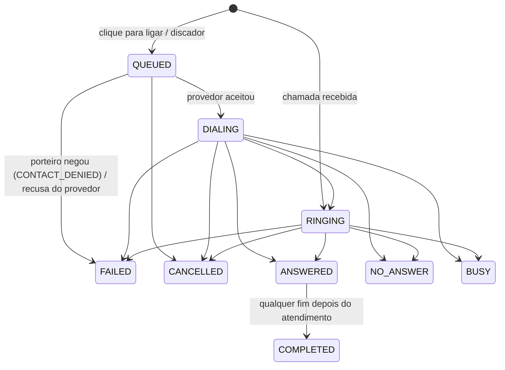

# Desenho — módulo `telephony` (telefonia e discador, F20)

Escopo: chamadas vinculadas ao caso, clique para ligar da estação de cobrança, campanhas de discagem (progressiva e
preditiva), presença do operador para o discador, tabulação e registro no caso, gravações e webhooks do provedor.
Schema `telephony`, migrations V1200–V1299 (`V1200` tabelas, `V1201` permissões novas nos perfis existentes e
tabulações de chamada no collection, `V1202` ambiente multiprovedor: roteamento, ramal por plataforma e contingência,
`V1203` provedores Twilio e Plivo e id da perna da chamada no provedor).
Dependências: `shared`, `organization :: usecases`, `debt :: usecases`, `compliance :: usecases`,
`collection :: usecases`. Reações no sentido contrário chegam por eventos (`DebtorAnonymized`); o encerramento publica
`CallCompleted` (consumido pelo incentive).

Plataformas (issue #12): **Alvaria CX** (antiga Aspect; `ALVARIA`), **Tarifando Telecom** (`TARIFANDO`), **Twilio**
(`TWILIO`) e **Plivo** (`PLIVO`), usadas ao mesmo tempo no **ambiente multiprovedor** (§13); o usuário escolhe a plataforma
de cada conta e o roteamento decide qual liga em cada escopo. O módulo entrega o domínio completo, a porta de saída
`TelephonyProvider`, a porta de webhook `TelephonyWebhookAdapter`, o simulador `SANDBOX` (local/teste, recusado no perfil
`prod`), o adaptador da Alvaria sobre contrato **a confirmar** (anexo A; disca só com a homologação ligada), o esqueleto
**desligado** da Tarifando (anexo B) e os adaptadores **prontos** da Twilio (anexo C) e da Plivo (anexo D), sobre as APIs
públicas e documentadas. Como plugar um provedor real: §9.

## 1. Chamada (`Call`, tabela `phone_call`)

| Campo | Conteúdo |
| --- | --- |
| direção / origem | `OUTBOUND`/`INBOUND`; `CLICK_TO_CALL`, `DIALER`, `INBOUND` |
| vínculo | credor, carteira, devedor, caso, contato (`debt.debtor_contact`), operador, campanha e item da lista |
| número | `number_encrypted` (AES-256-GCM via `EncryptedStringConverter`), `number_hash` (blind index HMAC por tenant, finalidade `contact.phone` — o mesmo do cadastro de contatos, obtido por `DebtorContactUseCases#tryFingerprint`), `number_masked` |
| provedor | conta (`provider_account`), provedor e `provider_call_id` — único por (tenant, provedor): idempotência |
| porteiro | `contact_attempt_id` (tentativa registrada no compliance) ou `denial_reasons` |
| instantes | na fila, início da discagem, toque, atendimento, conexão ao operador, fim, tabulação |
| durações (s) | **toque** = início do toque (ou da discagem) → atendimento/fim; **conversação** = conexão ao operador → fim (zero sem operador); **pós-atendimento** = fim → tabulação do operador |
| AMD | `HUMAN`, `MACHINE`, `UNKNOWN` (desconhecido é tratado como pessoa: não se desliga na cara de quem atendeu) |
| resultado | `ANSWERED` (pessoa conectada a operador), `NO_ANSWER`, `BUSY`, `VOICEMAIL` (AMD), `FAILED`, `CANCELLED`, `ABANDONED` (pessoa sem operador livre) |
| interação | `NONE` → `AWAITING_TABULATION` (operador) ou `PENDING` (automática) → `RECORDED`/`SKIPPED`, com `interaction_id` |

Só avança: evento repetido ou fora de ordem (ex.: `RINGING` depois de `ANSWERED`) é **obsoleto** e não muda nada.
Falha/cancelamento depois do atendimento vira `COMPLETED` (a chamada foi atendida). Resultado de `COMPLETED`: AMD
`MACHINE` → `VOICEMAIL`; conectada e não abandonada → `ANSWERED`; atendida sem chegar a operador → `ABANDONED`
(critério conservador para a taxa de abandono).

## 2. Toda discagem passa pelo porteiro

| Momento | Chamada | Efeito |
| --- | --- | --- |
| clique para ligar | `ContactGate#evaluate` (verificação prévia, não registra tentativa) | negado → chamada `FAILED/CONTACT_DENIED` com motivos e próximo instante permitido na resposta, sem discar e sem reservar o operador; `call.blocked` (`stage=precheck`) |
| job de discagem (`telephony.dial`) | `ContactGate#authorizeAndRecord` (origem `OPERATOR`, referência `call`) imediatamente antes de `originate` | negado → `FAILED/CONTACT_DENIED`, operador liberado; permitido → tentativa registrada na mesma transação da discagem |
| ciclo do discador (`telephony.dialer_tick`) | `ContactGate#authorizeAndRecord` (origem `CAMPAIGN`) por item | negado com `nextAllowedAt` (horário, feriado, limites, intervalo) → item adiado **sem consumir tentativa**; sem fim previsto (restrição) → item `EXCLUDED/CONTACT_RESTRICTED`; `call.blocked` (`stage=dial`) |
| chamada recebida | — | o devedor ligou: não há tentativa de contato |

Falha transitória do provedor desfaz a transação inteira — inclusive a tentativa registrada no compliance. O porteiro
aplica janelas, dias, feriados, limites diário/semanal e intervalo mínimo no canal `PHONE` (RB02).

## 3. Clique para ligar

1. `POST /telephony/calls {caseId, contactId?}` (cabeçalho `Idempotency-Key` opcional): caso visível e credor no escopo,
   caso não encerrado, operador habilitado (ramal) e **disponível** (`AVAILABLE`), telefone válido do devedor (o
   escolhido ou o de maior prioridade), conta do credor ou a padrão.
2. Verificação prévia do porteiro (§2). Permitido → chamada `QUEUED`, operador `ON_CALL` (reservado: o discador não
   entrega outra chamada a ele), job `telephony.dial`.
3. Job: autoriza e registra a tentativa e pede ao provedor `originate` (operador primeiro, depois o devedor — padrão
   *agent first*). Aceite → `DIALING`.
4. Eventos do provedor (§9): toque, atendimento (conexão imediata: o operador já está na linha), fim.
5. Fim → operador em `WRAP_UP` (pós-atendimento) até tabular (§6). `POST /calls/{id}/hangup` encerra (o próprio
   operador ou a supervisão, auditado).

## 4. Campanhas de discagem (`dialer_campaign`, `dialer_entry`)

**Lista**: montada a partir de uma **fila do collection** pelo port público (`CaseUseCases#search`): casos elegíveis em
`OPEN`/`IN_NEGOTIATION` da fila (e da carteira, se informada), aguardando na fila (`ownerType = QUEUE`) — ou também os
atribuídos, com `includeAssigned`. Um item por caso e campanha (único); páginas de 200 por job (`telephony.dialer_load`),
até 50 mil casos por carga; `reload` acrescenta os que entraram na fila depois. O credor da campanha é o da fila; fila
sem credor exige acesso a todos os credores.

**Ciclo** (`telephony.dialer_tick`, um pendente por campanha): pedido na ativação, quando um operador da campanha fica
disponível, quando uma chamada da campanha termina e a cada 3 s pelo agendamento (ShedLock). Sob lock da campanha:

1. fora da janela própria (opcional, fuso de operação) → nada; a política do compliance continua valendo;
2. ritmo (`DialerPacing`, domínio puro):
   * **progressivo**: `livres − em andamento` (uma linha por operador livre);
   * **preditivo**: razão = 1 ÷ taxa de atendimento por pessoa observada no dia (discadas ÷ atendidas por pessoa),
     limitada à razão máxima da campanha (1–5); aquecimento (menos de 30 discagens) → razão 1;
     abandono ≥ 80% do máximo → razão cai pela metade do excedente; abandono ≥ máximo (com ≥ 20 atendidas) → razão 1
     até a taxa baixar; teto de 50 chamadas novas por ciclo;
3. itens vencidos por prioridade (`FOR UPDATE SKIP LOCKED`): caso encerrado → `EXCLUDED/CASE_CLOSED`; atribuído a
   operador sem `includeAssigned` → `EXCLUDED/CASE_ASSIGNED`; inelegível ou fora de `OPEN`/`IN_NEGOTIATION` → adiado
   pelo intervalo; sem telefone → `EXCLUDED/NO_PHONE`; telefone em rodízio pela prioridade dos contatos a cada tentativa;
4. porteiro por item (§2) e `dialBatch` por conta; recusa do provedor → tentativa `FAILED` (retentativa).

**Abandono** = atendidas por pessoa sem operador ÷ atendidas por pessoa (conectadas + abandonadas), no dia de operação.
Padrão de mercado: **máximo de 3%** (Ofcom/FTC; adotado como padrão configurável, 0–10%). Sem operador livre no
atendimento, o sistema encerra com mensagem informativa (`HangupReason.ABANDONED`).

**Retentativas** (`RetryPolicy`): atendida e conectada → `COMPLETED`; os demais resultados voltam a `PENDING` após o
intervalo (5 min a 7 dias, padrão 120 min; ocupado em metade do intervalo, mínimo 5 min) até o máximo de tentativas
(1–20, padrão 3) → `EXHAUSTED`. A frequência por devedor continua limitada pelo porteiro.

**Distribuição** (`CallDistributor`): atendimento por pessoa → operador `AVAILABLE` da campanha **livre há mais tempo**
(`last_available_at`), escolhido com `SKIP LOCKED` e reservado (`ON_CALL`) na mesma transação — duas chamadas atendidas
ao mesmo tempo nunca vão ao mesmo operador — e `bridge` no provedor. AMD `MACHINE` → encerra (`VOICEMAIL`).

Ciclo de vida: `DRAFT → ACTIVE ⇄ PAUSED → FINISHED`; parâmetros só mudam fora de `ACTIVE`; pausar para de discar
(chamadas em andamento seguem); encerrar exclui os itens pendentes (`CAMPAIGN_FINISHED`). Indicadores do dia:
`GET /dialer-campaigns/{id}/stats` (discadas, atendidas, ASR, abandono, AMD, tempos médios, razão atual e motivo).

## 5. Chamadas recebidas

Evento `INBOUND` do provedor: o número é localizado pelo blind index nas chamadas anteriores identificadas; se todas são
do mesmo devedor, a chamada é vinculada ao caso da última (ou ao caso ativo do devedor na mesma carteira). Distribuição:
o responsável pelo caso, se disponível; senão o operador disponível há mais tempo. Sem operador → perdida
(`NO_ANSWER`, registrada automaticamente). Chamada não identificada é tabulada informando o caso.

## 6. Encerramento: interação no caso e `CallCompleted`

| Situação | Tabulação | Registro no caso |
| --- | --- | --- |
| chamada com operador (clique para ligar, discador conectado, recebida atendida) | **operador**, no pós-atendimento (`POST /calls/{id}/tabulation`, exige `INTERACTION_REGISTER`): qualquer tabulação ativa, com promessa/retorno quando exigidos; sugestão pelo resultado | síncrono, no contexto do operador (a interação é dele: tentativas e CPC do incentive) |
| prazo do pós-atendimento vencido (padrão 15 min) | automática pela sugestão (`TabulationDeadlineJob`) | job, como sistema |
| sem operador (discador não atendido/ocupado/AMD/abandono, falha, recebida perdida) | automática | job `telephony.record_interaction` |
| nunca discada (porteiro, recusa do provedor) | — | não registra (não houve contato) |

Tabulações automáticas: `NO_ANSWER` (não atende, cancelada), `BUSY`, `VOICEMAIL` (já no catálogo), `CALL_ABANDONED`,
`CALL_FAILED` e `CALL_ANSWERED` (atendida sem tabulação do operador) — `V1201` nas assessorias existentes e
`DefaultTabulations` nas novas; nenhuma é contato efetivo. Registro: canal `PHONE`, origem `TELEPHONY`, referência
externa `call:<id>` (reenvio não duplica), início = início da discagem/toque, fim = fim da chamada. Caso encerrado,
tabulação desativada ou interação com mais de 7 dias → não registra (métrica `telephony.interactions{outcome=skipped_*}`).

`CallCompleted` (linguagem publicada, na transação do encerramento) para toda chamada que chegou ao provedor: `callId`,
`caseId`, `debtorId`, `creditorId`, `portfolioId`, `operatorId` (quem atendeu), `direction`, `result` (§1) e
`durationSeconds` = **conversação**. O incentive usa só `ANSWERED` com duração > 0: TMA e tempo em atendimento
(ocupação = tempo de chamadas atendidas ÷ tempo logado, `remuneracao-variavel.md` §2).

## 7. Presença do operador (ACD)

`Agent` (tabela `agent`): ramal/usuário SIP configurado pelo gestor e estado `OFFLINE`, `AVAILABLE`, `ON_CALL`,
`WRAP_UP`, `PAUSED` (com motivo do catálogo: `BREAK`, `LUNCH`, `RESTROOM`, `TRAINING`, `FEEDBACK`, `MEETING`,
`BACKOFFICE`, `TECHNICAL_ISSUE`, `OTHER`; os quatro do meio são pausas produtivas). O operador escolhe entrar
(opcionalmente numa campanha ativa do seu escopo), disponível, pausa e sair; `ON_CALL`/`WRAP_UP` são conduzidos pelas
chamadas (não há pausa nem saída voluntária no pós-atendimento: tabule primeiro). Sinal do cliente
(`POST /presence/me/heartbeat`) a cada 30 s; sem sinal por 90 s o operador sai (exceto em chamada). Cada mudança
grava um intervalo **append-only** (`presence_interval`) e `agent.presence_changed`.

**Por que no telephony e não no identity.** O estado é do discador: muda a cada chamada (subsegundo), é lido e
bloqueado na distribuição (`SKIP LOCKED`) junto com a chamada, e depende de ramal e campanha — conceitos da telefonia.
O identity continua dono de autenticação e sessões (tempo logado do incentive, decisão 24 da remuneração variável); a
presença do discador acrescenta disponível/pausa/em chamada sem acoplar o identity ao discador, e o grafo não permite
telephony → identity. Os intervalos de presença ficam disponíveis para o incentive/analytics por evento ou view (§11).

## 8. Gravações

Conta com `recording_enabled` grava as chamadas e exige `recording_notice` (aviso ao devedor no início: "esta ligação
pode ser gravada…", também por `check` no banco). Evento `RECORDING_AVAILABLE` → `call_recording` (`PENDING`) → job
`telephony.recording_fetch`: confere o tipo de áudio, limite de 200 MB, grava no `FileStorage` (categoria
`CALL_RECORDING`, chave `tenants/<tenant>/call-recordings/…`, SSE no S3, SHA-256), remove a gravação do provedor (dado
pessoal num lugar só) e registra `call.recording_stored`; transação desfeita remove o arquivo.

Acesso (`GET /calls/{id}/recording?purpose=`): permissão **`CALL_RECORDING_LISTEN`** (supervisor, gestor, admin),
chamada no escopo e **finalidade** obrigatória (`QUALITY_MONITORING`, `DISPUTE`, `DEBTOR_REQUEST`, `LEGAL`, `AUDIT`);
registra `FILE_DOWNLOADED` no log de acesso (recurso, gravação, chamada, credor, finalidade) e o contador de acessos;
resposta `no-store` com `X-Content-SHA256`.

Retenção: política `CALL_RECORDINGS` do compliance (`RetentionUseCases#policyFor`), descarte diário do arquivo
(metadados permanecem, `PURGED/RETENTION`). Anonimização do devedor (`DebtorAnonymized`) descarta as gravações
(`PURGED/ANONYMIZATION`) e elimina número, índice e máscara das chamadas.

**Aviso e base legal (consentimento).** A gravação de chamadas de cobrança se apoia no exercício regular de direitos e
no legítimo interesse (LGPD art. 7º, VI e IX; a base do credor fica em `compliance.legal_basis_record`), com
transparência ao titular pelo aviso no início da chamada (art. 9º) e direito de oposição pelos canais do compliance.
Não se usa consentimento como base (revogável a qualquer momento, inviabilizaria a prova). O aviso é tocado pelo
provedor (URA/anúncio) — flag `announceRecording` no pedido de discagem — e registrado na chamada
(`recording_announced`) e na gravação (`announced`). Validar o texto do aviso com o jurídico antes da produção.

## 9. Provedor e webhooks

**Porta de saída** `TelephonyProvider`: `originate` (clique para ligar, operador primeiro), `dialBatch` (discador,
devedor primeiro, AMD), `bridge` (conecta a atendida ao ramal), `hangup` (motivo `OPERATOR`, `ABANDONED` com mensagem,
`MACHINE`, `CANCELLED`), `fetchRecording`/`deleteRecording`. Falha transitória → `TransientProviderException`; recusa →
`DialResult.rejected(código)`. O andamento chega **somente por eventos**; o id interno vai como referência do cliente.
Capacidades opcionais: `validateCredentials`, `validateEndpoint` (formato do ramal na plataforma), `verifyCredentials`
(teste de conexão, leitura da própria conta), `softphoneIdentity`/`issueSoftphoneToken` (softphone de navegador). O
`ProviderContext` leva o endereço público do webhook da conta (callbacks por chamada) e `BridgeRequest`/`HangupRequest`
levam o id da **perna** no provedor (`provider_leg_id`, decisão 586) e o operador escolhido.

**Instruções por webhook** (decisão 581). Provedores que pedem instruções da chamada por webhook (TwiML, Plivo XML)
declaram `instructionRequest`; o evento do mesmo webhook vem marcado `awaitingInstructions` e o domínio **não** chama a API
para conectar ou encerrar — `CallInstructions` decide, a partir do estado gravado, `DialDebtor` (operador atendeu: discar
para o devedor; número só no corpo da resposta), `Hold` (aguardando AMD), `ConnectAgent`, `Announce` (aviso de gravação),
`Hangup` (com ou sem a mensagem de abandono) e o adaptador traduz (`render`). Reentrega idêntica de um pedido de instruções
recebe a mesma resposta, sem efeito. URLs de callback geradas pelos adaptadores só levam referências opacas (`k` = tipo,
`ref` = id interno da chamada, `leg`, `amd`, `op` = id do operador); nunca número, nome ou ramal.

**Webhook** `POST /api/v1/webhooks/telephony/{routingKey}` (`PublicEndpoint`, sem JWT), mesmo padrão do communication:
limite por rota e IP (429; padrão 6.000/min, decisão 589) e de corpo (64 KiB, 413) → rota global `webhook_route` (tenant e
conta, chave aleatória de 256 bits) → assinatura sobre o corpo bruto — e, para Twilio e Plivo, sobre a **URL pública**
(`app.telephony.webhook.public-base-url` + caminho + consulta crua, lida sem consumir o formulário) — com o segredo da
conta, tempo constante, **cobrindo o instante** quando o provedor assina instante (fora de ±5 min → 401) → recibo do corpo (reentrega idêntica sem efeito) → eventos fora da janela de replay (2 dias) descartados
→ idempotência pelo **id do evento** (`provider_event`) e pelo estado da chamada. Recusa → `WEBHOOK_REJECTED` no log de
acesso.

**Simulador** (`SANDBOX`, `app.telephony.sandbox.enabled`, recusado no `prod` por `TelephonySandboxGuard`): aceita as
discagens sem rede; destino terminado em `0000` → recusa, `9999` → falha transitória; `auto-progress` (local) simula
toque e atendimento; nos testes os eventos vêm de `POST /telephony/sandbox/calls/{id}/events` ou do webhook assinado
(`X-Sandbox-Signature: t=<epoch>,v1=<hmac(webhookSecret, t + "." + corpo)>`); gravação = WAV de 1 s de silêncio.

**Como plugar um provedor real** (os passos valem para fechar a Alvaria e a Tarifando — anexos A e B):

1. `ProviderType.<NOVO>` com as credenciais exigidas (ex.: `accountSid`/`authToken`, `apiKey`/`apiSecret`,
   `webhookSecret`) e o valor no `check` de `provider_account.provider` (nova migration).
2. Adaptador em `infrastructure/provider/<provedor>` implementando `TelephonyProvider` com `RestClient` (connect 3 s,
   read 10 s), `integration.calls{provider,operation,outcome}`, 429/5xx/timeout → `TransientProviderException`.
   Padrões comuns:
   * **CPaaS com API REST** (estilo Twilio/Vonage/Plivo/Zenvia/Infobip/TotalVoice): `originate` = criar chamada para o
     ramal do operador com instrução de "dial" para o devedor; `dialBatch` = N chamadas de saída com `machineDetection`
     e `statusCallback` apontando para o webhook (com o `callId` como parâmetro); `bridge` = atualizar a chamada com
     instrução de conexão ao ramal/fila; gravação por parâmetro `record` e anúncio por instrução `say/play`;
   * **PABX/SIP próprio** (Asterisk/FreeSWITCH via ARI/ESL, ou SBC com API): `originate` = canal para o ramal +
     `Dial` para o tronco; `dialBatch` = originate assíncrono com AMD do PABX; eventos do PABX convertidos por um
     conector para o formato do webhook (ou adaptador de entrada próprio que chame `ProviderEventUseCases`);
   * **Discador hospedado do provedor** (preditivo no provedor): implementar `dialBatch` enviando a lista e
     **desabilitar o ritmo local** é uma alternativa, mas perde o controle do abandono e da porta do compliance por
     tentativa — não recomendado; se adotado, o provedor precisa chamar a autorização antes de cada discagem.
3. `TelephonyWebhookAdapter` do provedor: validação da assinatura dele (HMAC do corpo/URL, instante assinado quando
   houver) e conversão dos status para `ProviderCallEvent` (`RINGING`, `ANSWERED` + AMD, `COMPLETED` + quem desligou,
   `NO_ANSWER`, `BUSY`, `FAILED`, `CANCELLED`, `INBOUND`, `RECORDING_AVAILABLE`).
4. Testes do adaptador com servidor HTTP local (sem rede externa), como `WhatsAppCloudGatewayTest`.
5. Ramais: `PUT /telephony/agents/{userId}` (ramal padrão) e, por plataforma,
   `PUT /telephony/agents/{userId}/endpoints/{accountId}` com o usuário SIP/ramal (ou identidade WebRTC) do provedor.
6. Situação do adaptador (`TelephonyProvider#readiness`): `READY` disca em qualquer ambiente; `CONTRACT_PENDING` só com o
   provedor em `app.telephony.homologation.providers` (`APP_TELEPHONY_HOMOLOGATION_PROVIDERS`, somente no ambiente de
   homologação); `NOT_IMPLEMENTED` recusa criar e ativar conta. Mude para `READY` só depois do roteiro de homologação.

## 10. Permissões, API e auditoria

| Permissão | Quem (padrão) | Uso |
| --- | --- | --- |
| `TELEPHONY_USE` | operador, supervisor, gestor, admin | clique para ligar, presença, encerrar e tabular as próprias chamadas |
| `TELEPHONY_SUPERVISE` (nova) | supervisor, gestor, admin | ver operadores e todas as chamadas do escopo, operar campanhas, encerrar chamada de outro, forçar saída |
| `TELEPHONY_MANAGE` | gestor (novo), admin | contas do provedor, ramais, configurar campanhas |
| `CALL_RECORDING_LISTEN` (nova) | supervisor, gestor, admin | ouvir/baixar gravações (finalidade + log de acesso) |

REST (`/api/v1/telephony`): `calls` (POST clique para ligar, GET busca com `operator=me`, `awaiting-tabulation`, `{id}`,
`{id}/hangup`, `{id}/tabulation`, `{id}/recording`), `agents` (PUT `{userId}`, GET, POST `{userId}/logout`),
`presence/me` (GET, `login`, `available`, `pause`, `campaign`, `heartbeat`, `logout`), `dialer-campaigns` (CRUD,
`activate`, `pause`, `finish`, `reload`, `entries`, `stats`), `accounts` (CRUD, `credentials`, `activate`,
`deactivate`, `providers`, `comparison`), `routes` (GET, PUT, DELETE), `agents/endpoints` e
`agents/{userId}/endpoints/{accountId}` (ramal por plataforma), `sandbox` (eventos e chamada recebida simulados).

Auditoria: contas (criação, alteração, rotação de credenciais — só as chaves —, ativação), ramais, campanhas (criação,
parâmetros antes/depois, ativação, pausa, encerramento, recarga), encerramento de chamada pela supervisão e saída
forçada (com motivo). Interações são append-only no collection.

## 11. Logs e métricas

Eventos de negócio (`logs-e-metricas.md` §3.7): `call.dialed`, `call.blocked`, `call.completed`, `call.abandoned`,
`call.tabulated`, `call.recording_stored`, `dialer.campaign_activated|paused|finished`, `agent.presence_changed` —
somente ids, enums e durações; nunca número, nome ou ramal.

Métricas (`telephony.*`, §5): chamadas por resultado, pedidos de discagem, negações por motivo, atendidas por pessoa
no discador (`connected`/`abandoned` → **taxa de abandono**), tempos de toque/conversação/pós-atendimento/distribuição
(p50/p95/p99), chamadas curtas (≤ 3 s encerradas pelo sistema, acompanhamento da Anatel), ciclos e chamadas colocadas
pelo ritmo, itens da lista, presença, tabulações, interações, gravações, acessos a gravações, webhooks e falhas de jobs.
**ASR** = `telephony.calls{result ∈ ANSWERED, VOICEMAIL, ABANDONED}` ÷ `telephony.calls` (discadas).

## 12. Pendências

* Fechar o contrato da Alvaria (anexo A) e implementar a Tarifando (anexo B). ~~Áudio no navegador~~ (26/10/2026):
  softphone WebRTC da Twilio (§13.6); Plivo segue pelo ramal SIP (anexo D).
* Twilio/Plivo: homologação com conta real e número brasileiro (anexos C e D), validação do texto falado
  (`app.telephony.messages`) com o jurídico e da voz pt-BR escolhida.
* ~~Telas~~ (24/10/2026): "Ligar" (Alt + L) na estação/ficha com a decisão do porteiro por telefone, barra de presença
  (sinal a cada 30 s enquanto conectado, na sessão inteira do usuário), tabulação obrigatória com contagem regressiva do
  prazo automático, campanhas com painel de supervisão (5 s), chamadas com player de gravação (finalidade, áudio em
  `blob:` — CSP `media-src 'self' blob:`) e ramais. ~~Pendente: telas das contas do provedor~~ (26/10/2026): "Plataformas de telefonia" (`/telefonia/plataformas`) com
  contas, roteamento e comparação; "Ramais por plataforma" em Operadores e ramais.
* Incentive: consumir intervalos de presença (tempo logado **disponível**) — hoje usa sessões do identity (decisão 24
  da remuneração variável); evento ou view a definir.
* Monitoria ao vivo (escuta/sussurro) e transferência de chamada dependem do provedor.
* Validar com o jurídico o texto do aviso de gravação e a retenção das gravações por credor.

## 13. Ambiente multiprovedor

Padrão de mercado em contact centers de cobrança: várias contas de telefonia por assessoria, cada uma com plataforma,
credenciais, números (bina), webhook próprio e situação ativa/inativa; regras dizem qual conta disca em cada escopo, com
contingência.

### 13.1 Contas (`provider_account`)

| Antes (V1200) | Agora (V1202) |
| --- | --- |
| uma conta ativa padrão + uma por credor (`uk_tel_account_active`) | **várias contas ativas**, de provedores diferentes |
| `creditor_id` = conta do credor (escolha da conta) | `creditor_id` = conta **restrita** ao credor (bina dele): só regras desse credor a usam |
| provedor `SANDBOX` | `SANDBOX`, `ALVARIA`, `TARIFANDO`, `TWILIO`, `PLIVO` (V1203) |
| — | `rate_per_minute` (opcional): tarifa informada para o custo estimado da comparação |

Criação: provedor `NOT_IMPLEMENTED` → `422 telephony_account.provider_unavailable`; `DISABLED` (Twilio/Plivo com
`app.telephony.<provedor>.enabled=false`) → `telephony_account.provider_disabled`; `CONTRACT_PENDING` sem homologação →
conta criada **inativa** (credenciais guardadas, rota do webhook inativa); ativar exige `canDial`
(`telephony_account.provider_not_ready`). Credenciais validadas pelo adaptador (`validateCredentials`; ex.: `apiBaseUrl`
da Alvaria em HTTPS e no domínio permitido — proteção contra SSRF). A **primeira conta ativa** de um escopo sem regra vira a
principal dele (padrão da assessoria ou do credor), auditado com `automatic=true` — o comportamento de conta única continua
igual. A V1202 cria as regras a partir das contas ativas existentes.

`GET /telephony/accounts/providers`: provedores, credenciais exigidas e opcionais, `readiness`, `dialable`, `available` e
`verifiable` (teste de conexão). A conta devolve `webhookUrl` (endereço público) e `consoleEndpoints` (endereços a
cadastrar no console: URL de voz do número na Twilio, Answer/Hangup URL da Application na Plivo). `POST
/telephony/accounts/{id}/test`: verificação leve das credenciais (decisão 590), auditada `telephony_account.connection_tested`.

**Números (bina) por credor ou carteira** (decisão 587): a bina é da conta; para números diferentes por credor ou carteira,
cadastra-se uma conta por número — com as mesmas credenciais da plataforma, se for o caso — e a regra do escopo. Números
**0303** (telemarketing ativo) são configurados como bina como qualquer outro (a Twilio oferece números nacionais 0303
com CNPJ e endereço no Brasil, anexo C); a obrigatoriedade do prefixo para cobrança segue a regulação da Anatel (anexo C).

### 13.2 Roteamento (`account_route`, decisão 561)

Uma regra por escopo — `CAMPAIGN`, `PORTFOLIO`, `CREDITOR`, `DEFAULT` — com **conta principal** e **contingência**
opcional. `PUT /telephony/routes` (cria ou substitui a regra do escopo), `GET`, `DELETE /{id}`; auditoria
`telephony_route.created|updated|deleted`. O credor do escopo vem do escopo (credor, credor da carteira, credor da campanha;
nulo no padrão e em campanha de fila sem credor) e define quem pode alterar (`AccessScope`) e quais contas servem.

| Discagem | Ordem das regras |
| --- | --- |
| discador | campanha → carteira do item → credor do item → padrão |
| clique para ligar | carteira do caso → credor → padrão, **ajustada pelo operador** (abaixo) |
| chamada recebida | a conta cujo webhook recebeu |

Numa regra: a principal, se ativa e com provedor que disca neste ambiente; senão a contingência assume como principal;
sem nenhuma, a regra seguinte. Sem conta → `409 telephony.not_configured` (clique) ou item sem discar com
`telephony.dialer.entries{outcome=no_account}` (discador). Contas resolvidas uma vez por ciclo do discador por
(credor, carteira).

**Por operador/ramal.** O ramal pertence a uma plataforma. No clique para ligar, candidatas = principal e contingência da
regra do caso, depois as contas em que o operador tem ramal próprio ativo (restritas ao credor do caso); vale a primeira
pela qual o operador é alcançável. Nenhuma → `409 telephony.agent_not_on_account`. No discador, entrar numa campanha com
regra própria exige ramal na conta dela (mesmo código); a distribuição só escolhe operadores alcançáveis pela conta da
chamada (`not exists agent_endpoint … and not active`, no mesmo `SKIP LOCKED`).

### 13.3 Ramal por plataforma (`agent_endpoint`)

| Registro para (operador, conta) | Ramal usado nessa conta |
| --- | --- |
| nenhum | ramal padrão do operador (`agent.extension`) — p. ex. URI SIP do PABX da assessoria, alcançável por todas |
| ativo | o ramal próprio da conta |
| inativo | **fora desta plataforma**: a conta não lhe entrega chamadas nem disca por ele |

`GET /telephony/agents/endpoints` (supervisão), `PUT`/`DELETE /telephony/agents/{userId}/endpoints/{accountId}` (gestão,
auditado `telephony_agent.endpoint_configured|updated|removed`). `originate` e `bridge` enviam o ramal da conta que disca.

### 13.4 Contingência sem chamada duplicada (decisão 562)

`TransientProviderException.notProcessed()` = o pedido comprovadamente **não criou** a chamada: conexão recusada, tempo de
conexão esgotado, host não resolvido, 429 ou 503, falha ao obter o token. Só nesses casos, e com
`app.telephony.routing.fallback-enabled` (padrão `true`):

* clique para ligar (`telephony.dial`): a **mesma chamada** (mesmo id, mesma tentativa no compliance) passa para a conta de
  contingência da regra (`Call#switchToFallback`, uma única vez, só em `QUEUED` sem id do provedor), com o ramal do
  operador nela; falha também na contingência → exceção, transação desfeita (inclusive o desvio e a tentativa) e o job
  tenta de novo pela principal;
* discador: o lote inteiro vai para a contingência da regra; nova falha desfaz o ciclo.

Tempo de leitura esgotado e outros 5xx são **ambíguos** (o provedor pode ter discado): repetem na mesma conta com a mesma
referência do cliente e `Idempotency-Key` (deduplicação no fornecedor a confirmar — anexo A). A chamada guarda
`fallback_from_account_id`; o adaptador da Alvaria, num lote parcial (mais de 50 itens), recusa os restantes em vez de
relançar (os já aceitos não se repetem). Simulador: destino terminado em `9998` = falha "não processada".
**Twilio e Plivo não deduplicam pedidos de criação de chamada**: tempo de leitura esgotado ou 5xx (exceto 503) na criação
vira recusa `TWILIO_UNCONFIRMED`/`PLIVO_UNCONFIRMED` — sem repetir nem desviar, a tentativa no compliance fica registrada
(decisão 582).

### 13.5 Webhooks, métricas, logs e comparação

* Webhook por conta (`routingKey` próprio, rota ativa só com a conta ativa) e autenticidade **pelo adaptador do provedor
  da rota**; conta de outro provedor ou outro segredo → `401` (`WEBHOOK_REJECTED`).
* Métricas novas (série própria para não mudar as dimensões de `telephony.calls`, usadas por painéis/alarmes):
  `telephony.provider.calls{provider,origin,result}`, `telephony.provider.talk_time{provider}`,
  `telephony.provider.dial{provider,origin,outcome}` (`accepted`, `rejected`, `transient`, `transient_not_processed`),
  `telephony.provider.fallbacks{from,to,origin}`; adaptadores: `integration.calls{provider=alvaria|twilio|plivo,operation,
  outcome}` e `integration.calls.duration` (operações `oauth_token`, `originate`, `dial_batch`/`dial`, `bridge`, `hangup`,
  `fetch_recording`, `fetch_recording_media`, `delete_recording`, `verify_credentials`; resultados `success`, `rejected`,
  `transient`, `timeout`, `unreachable`); `telephony.webhook.instructions{provider,kind,instruction}` (respostas TwiML/XML)
  e `telephony.softphone.tokens{provider,outcome}`.
  **ASR por provedor** = `telephony.provider.calls{result ∈ ANSWERED, VOICEMAIL, ABANDONED}` ÷ `telephony.provider.calls`.
* Eventos de negócio de chamada ganham `provider`, `accountId` e `fallback`.
* `GET /telephony/accounts/comparison?from&to` (padrão: últimos 30 dias; até 366): por conta — discadas, recusadas,
  atendidas, conectadas, falhas, discadas pela contingência, ASR, conexão, taxa de falha, toque e conversa médios, minutos
  tarifáveis (atendimento → fim) e **custo estimado** = minutos × tarifa informada (a fatura do fornecedor é a
  referência). Aba "Comparação" da tela.

### 13.6 Softphone (decisões 569, 584 e 585)

O áudio do operador segue pelo **ramal** (softphone instalado, aparelho SIP ou telefone) — a plataforma chama o ramal
primeiro — ou, na **Twilio**, pelo navegador: ramal da conta `client:<identidade>` (letras, dígitos e `_`). Na estação, o
ponto `SOFTPHONE` (`features/telephony/station/softphone.ts`) liga o `WebrtcSoftphone` quando o operador entra na
telefonia: `POST /telephony/presence/me/softphone` (`TELEPHONY_USE`, só o próprio usuário, `no-store`) devolve, para cada
conta ativa em que o ramal dele é de navegador, um **Access Token** de 1 h (Voice Grant só de entrada; saída só com o
TwiML App opcional da conta), renovado no aviso `tokenWillExpire` do SDK. O **Twilio Voice JavaScript SDK**
(`@twilio/voice-sdk` 2.18.5, npm, versão fixa) entra no build como pedaço carregado sob demanda (`twilio-voice-device`,
~180 kB, ~40 kB transferidos), fora do pacote inicial; **nunca CDN** (`script-src 'self'` inalterado). A política do navegador
é ampliada só com o adaptador ligado, por `BrowserPolicyContribution` (shared, reunida pelo identity): `connect-src
wss://voice-js.<borda>.twilio.com https://eventgw.twilio.com https://sdk.twilio.com`, `media-src https://sdk.twilio.com`
(sons do SDK) e `Permissions-Policy: microphone=(self)`. Chamadas entregues ao navegador são **atendidas
automaticamente** (decisão 591); silenciar fica na barra de presença; encerrar continua pelo backend.

**Plivo** (decisão 585): o Browser SDK (`plivo-browser-sdk`) depende de `wasm-pack`, cujo `postinstall` baixa um binário
da Internet na instalação, e exige token gerado pela API da Plivo — fora das condições do build (pacote auditável, sem
downloads na instalação). O operador da Plivo atende pelo endpoint SIP da Plivo (`sip:<usuario>@phone.plivo.com`) num
softphone instalado. Reavaliar quando o SDK deixar de baixar binários.

### 13.7 Testes

`TelephonyMultiProviderIT`: SANDBOX e Alvaria (contrato pendente, homologação ligada no perfil de teste) contra um dublê
HTTP local ao mesmo tempo — regra por credor, ramal por plataforma no `originate`, evento assinado por conta e recusa com
segredo de outra, contingência Alvaria (503) → SANDBOX com uma única tentativa no compliance, operador fora da plataforma,
regra de campanha com lote e `bridge` pela Alvaria, comparação, catálogo, Tarifando recusada, conta restrita a outro credor,
conta inativa na regra. `AlvariaTelephonyProviderTest` (servidor HTTP local) e `AlvariaWebhookAdapterTest`.
`TelephonyCpaasIT`: Twilio e Plivo dublados ao mesmo tempo por `FakeHttpApi` (servidor HTTP local único da execução, endereço
injetado pelo `IntegrationTest`), webhooks entregues pela porta HTTP real e assinados como os provedores assinam — clique
para ligar Twilio com gravação copiada e removida, chamada recebida com TwiML na resposta (operador ou mensagem de abandono),
discador Plivo com AMD (espera, conexão, secretária encerrada pela API), contingência Twilio (503) → Plivo com uma tentativa
no compliance, catálogo, endereços do console, teste de conexão, softphone e CSP. Unidade: `TwilioSecurityTest` (vetor oficial
da assinatura e layout do Access Token), `TwilioWebhookAdapterTest`, `TwilioTelephonyProviderTest`, `PlivoSignatureTest`
(cadeia do exemplo oficial), `PlivoWebhookAdapterTest`, `PlivoTelephonyProviderTest`. Frontend: cadastro por plataforma
(`account-dialogs.spec.ts`) e softphone com o SDK dublado (`softphone.spec.ts`). Nenhuma chamada real.

## Anexo A — Alvaria CX (antiga Aspect)

**Confirmado (fontes públicas, 26/10/2026)**

* A Aspect Software fundiu-se à Noble Systems em 2021 e passou a se chamar **Alvaria**. Em set/2024 o portfólio de
  **WFM/WEM voltou à marca Aspect** (Aspect Workforce, WorkforceOS); `www.aspect.com` hoje é esse produto ("an Alvaria
  brand") e **não oferece telefonia nem discador**. Outbound continua **Alvaria**.
* Alvaria CX: outbound omnichannel com foco em compliance e cobrança — modos de ritmo *precision, preview, automatic,
  predictive e blaster*; Compliance Hub (consentimento, fuso do devedor, portabilidade, exclusões); implantação em nuvem
  pública/privada, VPC, on-premises ou híbrida; funciona sobre ACD de terceiros (Zoom Contact Center, Avaya Experience
  Platform). Listas por Advanced List Management/Advanced Outreach (troca de arquivos com arquivo de resultados).
* Integrações de CTI de terceiros usam eventos de chamada da plataforma (início, fim, atualização de chamada, login/logout).
* **A documentação da API não é pública** (acesso por contrato/comunidade de parceiros). Autenticação, formato de eventos,
  webhooks, AMD por API, gravações, WebRTC e regiões de processamento de dados **não estão publicados**.

**Decisões** (560, 565): tipo `ALVARIA` (é o produto que disca; rótulo "Alvaria CX (Aspect)"); o **discador do Gestor
comanda** e a Alvaria é a plataforma de voz (origina, detecta secretária, conecta, grava, notifica). Usar as campanhas da
Alvaria tiraria o porteiro do compliance de cada tentativa, a tabulação e a distribuição do domínio; só seria aceitável se
a Alvaria chamar a autorização (`ContactGate`) antes de cada discagem — reavaliar com o contrato.

**Implementado sobre o que é confirmável** (`infrastructure/provider/alvaria`): `AlvariaApiContract` isola tudo o que é
**suposição** (caminhos `/oauth2/token`, `/api/v1/calls/agent-first`, `/calls/batch`, `/calls/{id}/bridge`, `/hangup`,
`/recordings/{ref}`, nomes de campos, `Idempotency-Key`, lote de 50); `AlvariaTelephonyProvider` — OAuth 2.0 *client
credentials* com cache por conta (60 s de folga; 401 renova uma vez), HTTPS no domínio permitido
(`app.telephony.alvaria.allowed-host-suffixes`, padrão `.alvaria.com` — a confirmar), sem redirecionamento, timeouts
3 s/10 s, classificação de erros (§13.4), códigos `ALVARIA_<código>`; `AlvariaWebhookAdapter` — formato **canônico** do
Gestor assinado (`X-Gestor-Signature: t=…,v1=HMAC-SHA256(webhookSecret, t.corpo)`), publicado pela Alvaria se permitir
configurar a notificação, ou por um conector que traduza os eventos de CTI dela. Credenciais: `apiBaseUrl`, `clientId`,
`clientSecret`, `webhookSecret`. `readiness = CONTRACT_PENDING`.

**Pedir à Alvaria**

1. Documentação da API de CTI/outbound do produto contratado (Alvaria CX/Cloud ou instância on-premises): originar
   "operador primeiro", discagem em lote com AMD, conexão ao ramal/fila, encerramento com mensagem, gravação (download e
   remoção), referência do cliente e deduplicação de pedidos (idempotência).
2. Autenticação (OAuth 2.0? escopos, validade, rotação) e o endereço da instância da assessoria (domínio para o allowlist).
3. Notificações de chamada: eventos, campos, AMD, quem desligou, gravação disponível, reentrega, **assinatura** (HMAC com
   instante? token? IPs de origem) — ou orientação para o conector de CTI.
4. Ambiente de homologação com números de teste e ramais, limites de taxa e janelas de manutenção.
5. Onde os dados (áudio, números, gravações) são processados e armazenados (região, subprocessadores) e DPA para a LGPD;
   retenção das gravações no lado deles.
6. SDK WebRTC de navegador (se houver) e requisitos de CSP.
7. Se o discador/campanhas da Alvaria for exigido comercialmente: callback de autorização por tentativa.

**Homologação (passo a passo)**

1. Ajustar `AlvariaApiContract` e os testes do adaptador ao contrato recebido; `AlvariaWebhookAdapter` ao formato real.
2. Homologação AWS: `APP_TELEPHONY_HOMOLOGATION_PROVIDERS=ALVARIA` e `APP_TELEPHONY_ALVARIA_ALLOWED_HOSTS=<domínio>`
   (só nesse ambiente; [ativação](../operacao/ativacao-aws.md) §7.6).
3. Cadastrar a conta (Plataformas de telefonia), copiar o webhook para a Alvaria, ramais por plataforma.
4. Roteiro: clique para ligar (operador primeiro, anúncio de gravação), atendida/não atendida/ocupado/caixa postal,
   discador progressivo com AMD e abandono, encerramento pelo supervisor, gravação copiada e removida no fornecedor,
   evento repetido/fora de ordem, assinatura inválida, 429/503 → contingência, timeout ambíguo sem duplicar, rotação de
   credencial.
5. Aprovado: `readiness()` → `READY`, remover a variável de homologação; produção.

## Anexo B — Tarifando Telecom (tarifando.com.br)

**Confirmado (site do fornecedor, 26/10/2026)**: Tarifando Franchising Ltda. (CNPJ 18.147.772/0001-16, Palhoça/SC).
VoIP, PABX IP em nuvem (SaaS, ramais, URA, gravação, indicadores, "integração com CRMs e click to call"), **Call Center**
por posição com discador *Power, Predictive, Preview e Call Back*, URA reversa, gravador, "classificador de caixa postal",
perfis administrativo/agente/supervisor e **"APIs e integração via REST"**; números em vários DDDs; plataforma
omnichannel. Preços públicos por canal/ramal/posição; os pacotes de telefonia "ilimitada" **não podem ser usados com
discador automático** (o discador exige o plano Call Center). **Não há documentação pública de API**, webhooks, WebRTC nem
AMD por API.

**Implementado**: `ProviderType.TARIFANDO` (credenciais provisórias `apiBaseUrl`, `apiToken`, `webhookSecret`) e
`TarifandoTelephonyProvider` **desligado** (`NOT_IMPLEMENTED`): a aplicação recusa criar e ativar conta, nunca disca por
ele e as operações recusam explicitamente (nada simulado). Sem adaptador de webhook.

**Pedir à Tarifando**: documentação da API REST (click to call operador primeiro, discagem em lote/discador por API,
conexão ao ramal, encerramento, gravações), autenticação, webhooks/eventos de chamada e assinatura, AMD ("classificador
de caixa postal") por chamada, plano necessário para discagem automática pela API e tarifas por minuto (fixo/móvel,
cadência de tarifação), ramais SIP/WebRTC, números (bina por credor), ambiente de testes, onde os dados e as gravações
ficam e DPA. Homologação: os mesmos passos do anexo A depois de implementar o adaptador.

## Anexo C — Twilio Programmable Voice

**Situação: `READY`** (API pública e documentada). Desligável por ambiente: `app.telephony.twilio.enabled`
(`APP_TELEPHONY_TWILIO_ENABLED`, padrão `true`; desligada → `DISABLED`, conta recusada).

**Implementado** (`infrastructure/provider/twilio`)

| Operação | Como (API REST `https://api.twilio.com/2010-04-01/Accounts/{AccountSid}/…`) |
| --- | --- |
| autenticação | HTTP Basic com a **API Key** (SID `SK…` e segredo); o **Auth Token** só valida webhooks e o teste de conexão (a assinatura da Twilio usa só o Auth Token) |
| `originate` | `POST Calls.json`: `To` = ramal do operador (`client:<id>`, `sip:…` ou E.164), `From` = bina, `Timeout`, `StatusCallback` (perna do operador, `completed`) e `Twiml` **inline** (≤ 4.000 caracteres): `<Dial callerId timeout record="record-from-answer-dual" recordingStatusCallback><Number statusCallbackEvent="ringing answered completed" statusCallback url="…k=announce">+55…</Number></Dial>` — o `url` do `<Number>` toca o aviso de gravação ao devedor antes de conectar |
| `dialBatch` | um `POST Calls.json` por item (sem lote na API): `MachineDetection=Enable`, `AsyncAmd=true`, `AsyncAmdStatusCallback`, `MachineDetectionTimeout` (`amd-timeout`, padrão 8 s), `StatusCallbackEvent` ringing/answered/completed, `Record=true` + `RecordingChannels=dual` + `RecordingStatusCallback`, `Twiml` de espera (`<Say>` do aviso + `<Pause>`) |
| `bridge` | `POST Calls/{Sid}.json` com `Twiml` `<Dial timeout="20" callerId><Client>/<Sip>/<Number></Dial>` |
| `hangup` | `Status=completed` (encerra também em andamento); abandono: `Twiml` `<Say>` com a mensagem + `<Hangup/>` |
| gravação | `GET Recordings/{Sid}.wav?RequestedChannels=2` (dois canais: operador e devedor separados; HTTP Basic) e `DELETE Recordings/{Sid}.json` depois da cópia |
| teste de conexão | `GET Accounts/{Sid}.json` com a API Key e com o Auth Token (só leitura) |
| softphone | Access Token JWT HS256 (`cty: twilio-fpa;v=1`, `iss` = API Key, `sub` = conta, `grants.identity`, `grants.voice.incoming.allow`, `outgoing.application_sid` só com `twimlAppSid`), 1 h (máx. 24 h) |

**Webhooks** (decisão 581): `X-Twilio-Signature` = Base64(HMAC-SHA1(Auth Token, URL completa com consulta + parâmetros
do POST ordenados, nome+valor)) — validada contra o **vetor oficial** da documentação. Callbacks por chamada no webhook da
conta (`k=status|amd|recording|announce`, `ref`, `leg=agent|customer|dialer`, `amd`). Tradução: `ringing` → `RINGING`;
`in-progress` → `ANSWERED` (perna do devedor; no discador com AMD o atendimento vem do veredito); `completed`, `busy`,
`no-answer`, `failed` (`SipResponseCode` como causa), `canceled`; `AnsweredBy`: `human` → pessoa, `machine_*`/`fax` →
máquina, `unknown` → desconhecido (tratado como pessoa). Idempotência: `CallSid` + status (`…:amd`, `RecordingSid` +
status). Instante: `Timestamp` (RFC 2822, assinado no corpo); veredito AMD = recebimento − `MachineDetectionDuration`.
Chamada recebida: a **URL de voz do número** (`?k=inbound`) responde com TwiML — `<Dial>` ao operador escolhido (com aviso e
gravação) ou a mensagem de abandono.

**AMD** (decisão 583): `Enable` (veredito assim que identifica; `DetectMessageEnd` espera o bipe e serve para deixar
recado, o que não fazemos) e **assíncrono** (a chamada segue enquanto o AMD analisa: o aviso de gravação toca, sem silêncio
extra para a pessoa).

**Configurar no console da Twilio (passo a passo)**

1. Conta (ou subconta por assessoria): copie **Account SID** e **Auth Token** (Account Info). Crie uma **API Key** padrão
   (Account → API keys & tokens; `SK…` e segredo, mostrado uma vez).
2. Número: compre um número **local** brasileiro (exige empresa com CNPJ e comprovante de endereço no Brasil; não é
   oferecido a pessoa física) ou **nacional 0303** (mesmos documentos), ou porte o seu. Bina da conta = esse número (E.164).
3. No número (Phone Numbers → Manage → Voice): "A call comes in" = **Webhook** `POST` com o endereço `?k=inbound` da conta e
   "Call status changes" = `?k=status&leg=inbound` (tela "Endereços para o console").
4. Softphone no navegador (opcional): ramal do operador na conta `client:<identidade>` (ex.: `client:op_ana`). Para chamadas
   de saída pelo navegador (não usadas hoje), crie um TwiML App e informe o `twimlAppSid`.
5. No sistema: Plataformas de telefonia → Nova conta → Twilio → credenciais, bina, gravação e tarifa → **Testar conexão** →
   ramais → regra de roteamento.

**Homologação** (conta de teste com crédito; números brasileiros): clique para ligar com operador no navegador e por SIP
(aviso tocado ao devedor; gravação em dois canais copiada e removida na Twilio); discador progressivo com AMD (pessoa,
secretária, desconhecido) e abandono com mensagem; chamada recebida com e sem operador livre; encerramento pelo supervisor;
assinatura inválida (401); reentrega do mesmo callback; 503 → contingência; rotação da API Key e do Auth Token.

**Custos de referência** (preços públicos, USD, agosto/2026; a fatura é a referência): saída para fixo (grandes cidades)
US$ 0,0310/min, fixo a partir de número 0303 US$ 0,0620/min, móvel US$ 0,0663/min; navegador/SIP US$ 0,0040/min; entrada em
número local US$ 0,0100/min; número local US$ 4,25/mês; AMD US$ 0,0075 por chamada; gravação US$ 0,0025/min + armazenamento
US$ 0,0005/min/mês (removida após a cópia); síntese de voz: básica grátis, Standard US$ 0,0008 e Neural US$ 0,0032 por 100
caracteres.

**Limitações**: a Twilio não informa quem desligou nos callbacks de status (lado `PROVIDER`); a API usa a região US1
(processamento nos EUA — avaliar a transferência internacional na LGPD, art. 33, com o DPA da Twilio); a criação de chamada
não é deduplicada (decisão 582); a voz `Polly.Camila` (pt-BR) deve ser conferida no console; conexão ao operador que não
atende em 20 s encerra a chamada.

**Fontes oficiais** (consultadas em 26/10/2026): [Call resource](https://www.twilio.com/docs/voice/api/call-resource),
[Modificar chamadas em andamento](https://static1.twilio.com/docs/voice/tutorials/how-to-modify-calls-in-progress/csharp),
[Answering Machine Detection](https://twilio.com/docs/voice/answering-machine-detection),
[Webhooks security](https://www.twilio.com/docs/usage/webhooks/webhooks-security) e o
[algoritmo com exemplo](https://static0.twilio.com/docs/security), [Recording](https://www.twilio.com/docs/voice/api/recording.md),
[TwiML `<Dial>`](https://twilio.com:443/docs/voice/twiml/dial), [`<Number>`](https://www.twilio.com/docs/voice/twiml/number.md),
[`<Client>`](https://www.twilio.com/docs/voice/twiml/client), [`<Say>`](https://www.twilio.com/pt-br/docs/voice/twiml/say),
[Access Tokens](https://twilio.com/docs/iam/access-tokens),
[Requisitos de rede dos SDKs](https://www.twilio.com/docs/voice/sdks/network-connectivity-requirements),
[`@twilio/voice-sdk`](https://npmjs.com/package/@twilio/voice-sdk),
[Regulação de números no Brasil](https://www.twilio.com/en-us/guidelines/br/regulatory),
[Preços Brasil](https://www.twilio.com/en-us/voice/pricing/br). Anatel (prefixo de cobrança):
[0304 aprovado em 2022](https://www.tnh1.com.br/noticia/nid/anatel-aprova-uso-do-prefixo-0304-para-ligacoes-de-cobranca/),
[proposta de 2024 de usar o 0303 para cobrança](https://convergenciadigital.com.br/telecom/anatel-vai-ampliar-codigo-0303-para-chamadas-de-cobranca-e-doacoes)
e [0303 em 2022, com cobrança isenta](https://tecnoblog.net/noticias/prefixo-0303-agora-vale-para-todas-as-ligacoes-de-telemarketing/)
— a situação atual deve ser confirmada com o jurídico antes da produção.

## Anexo D — Plivo Voice

**Situação: `READY`**. Desligável: `app.telephony.plivo.enabled` (`APP_TELEPHONY_PLIVO_ENABLED`, padrão `true`).

**Implementado** (`infrastructure/provider/plivo`; API `https://api.plivo.com/v1/Account/{auth_id}/…`, HTTP Basic com Auth
ID e Auth Token, corpo JSON)

| Operação | Como |
| --- | --- |
| `originate` | `POST Call/`: `from` = bina (dígitos), `to` = ramal (`sip:<usuario>@phone.plivo.com` ou telefone), `answer_url` (`k=answer&leg=agent`), `hangup_url`, `ring_timeout`. A Plivo exige `answer_url` (não há XML inline): ao atender o operador, a resposta devolve `<Record startOnDialAnswer>` + `<Dial callerId timeout redirect="false" action callbackUrl confirmSound><Number>55…</Number></Dial>` — o número do devedor vem da chamada gravada (cifrada) direto para o corpo; `confirmSound` toca o aviso ao devedor |
| `dialBatch` | um `POST Call/` por item com `machine_detection=true`, `machine_detection_time` (`amd-time`, padrão 5 s), `machine_detection_url`, `ring_url`, `answer_url` e `hangup_url`. Atendida: `<Record recordSession>` + `<Speak>` do aviso + `<Wait length=amd+1 silence>` + `<Redirect>` (`k=amdwait`) |
| ids | a criação devolve `request_uuid` (id da chamada no domínio); o `CallUUID` chega em `ring`/`answer`/`amd`/`hangup` e é guardado em `provider_leg_id` (decisão 586) |
| `bridge` | `POST Call/{call_uuid}/` `legs=aleg`, `aleg_url` = `k=bridge&ref&op=<operador>` → `<Dial><User>…</User></Dial>` |
| `hangup` | `DELETE Call/{call_uuid}/`; antes do `CallUUID`, `DELETE Request/{request_uuid}/`; abandono: transferência para `k=abandon` (`<Speak>` + `<Hangup/>`). **Nunca** `DELETE Call/` sem id (encerraria todas as chamadas da conta) |
| gravação | `GET Recording/{id}/` → `recording_url` (HTTPS e host em `recording-hosts`, padrão `media.plivo.com`, anti-SSRF), download com HTTP Basic, `DELETE Recording/{id}/` |
| teste de conexão | `GET /v1/Account/{auth_id}/` |

**Webhooks**: `X-Plivo-Signature-V3` + `X-Plivo-Signature-V3-Nonce` = Base64(HMAC-SHA256(Auth Token, URL com a consulta
reordenada + `.` + parâmetros do POST ordenados nome+valor + `.` + nonce)), várias assinaturas separadas por vírgula —
conforme a documentação e o utilitário oficial `validate_v3_signature` do SDK; testado com a cadeia do exemplo oficial.
Tradução: `ring` → `RINGING`; `answer` → `ANSWERED` (sem AMD) ou espera (com AMD; operador no clique para ligar → toque do
devedor); `amd` (`Machine=true`) → máquina; `amdwait` → atendida, desconhecido (tratado como pessoa); `hangup` → `COMPLETED`
com `AnswerTime`, senão `BUSY`/`FAILED`/`CANCELLED`/`NO_ANSWER` pela causa; `dial` (`DialAction=answer|hangup`) e `dialend`
(`DialStatus`) → perna do devedor no clique para ligar; `recording` (arquivo pronto, ignora o aviso de início com duração
−1). Idempotência: `CallUUID` + passo; sem instante assinado (instante = recebimento).

**AMD** (decisão 583): a Plivo detecta só em segundo plano e notifica `machine_detection_url` quando acha máquina; o fim da
espera sem veredito vale como pessoa (`UNKNOWN`), sem prolongar o silêncio além do tempo de detecção.

**Configurar no console da Plivo (passo a passo)**

1. Copie **Auth ID** e **Auth Token** (Overview; para uma assessoria por subconta, os da subconta).
2. Alugue um número brasileiro (local, móvel ou 0800); a Plivo não publica a lista de documentos do Brasil — siga o pedido do
   console/suporte. Bina = esse número.
3. Crie uma **Application** com Answer URL = endereço `?k=inbound` da conta e Hangup URL = `?k=hangup&leg=inbound` (POST) e
   ligue o número a ela.
4. Crie um **Endpoint** por operador (usuário, senha, alias, ligado à Application) e cadastre o ramal
   `sip:<usuario>@phone.plivo.com` em Operadores e ramais → Ramais por plataforma; o operador registra o endpoint num
   softphone SIP.
5. Em Voice → Settings, ligue a autenticação HTTP das gravações.
6. No sistema: Nova conta → Plivo → **Testar conexão** → ramais → roteamento.

**Homologação**: os mesmos roteiros do anexo C, mais: transferência (`bridge`) com `CallUUID`, cancelamento antes do toque
(`DELETE Request`), download da gravação com autenticação HTTP ligada e host do `recording_url` (ajuste
`APP_TELEPHONY_PLIVO_RECORDING_HOSTS` se a Plivo entregar outro host).

**Custos de referência** (USD, página pública): saída fixo grandes cidades US$ 0,0200/min (demais fixos US$ 0,0330), móvel
US$ 0,0980/min; SIP/navegador US$ 0,0033/min; entrada local US$ 0,0060/min; número local US$ 5,00/mês (móvel US$ 20, 0800
US$ 30); AMD e gravação sem custo; armazenamento grátis por 90 dias.

**Limitações**: softphone de navegador não adotado (decisão 585); a Plivo não assina instante; a documentação do
`hangup_url` não lista causa nem lado do desligamento (lidos quando presentes); AMD só notifica máquina; regras de números
brasileiros não publicadas; processamento fora do Brasil (avaliar transferência internacional e DPA).

**Fontes oficiais** (26/10/2026): [Call API](https://www.plivo.com/docs/voice/api/calls.md),
[AMD assíncrono](https://www.plivo.com/docs/voice/api/call/asynchronous-machine-detection/) e
[conceito](https://docs.plivo.com/docs/voice/concepts/machine-detection),
[Signature validation V3](https://www.plivo.com/docs/voice/concepts/signature-validation.md) (e `plivo/utils/signature_v3.py`
do SDK oficial plivo-python), [XML `<Dial>`](https://www.plivo.com/docs/voice/xml/dial/),
[`<Record>`](https://docs.plivo.com/docs/voice/xml/record), [`<Wait>`/`<Redirect>`/`<Hangup>`](https://plivo.com/docs/voice/xml/routing),
[`<Speak>`](https://www.plivo.com/docs/voice/xml/audio-output.md), [Recordings](https://www.plivo.com/docs/voice/api/recordings.md),
[Endpoints](https://www.plivo.com/docs/voice/api/endpoints.md),
[Browser SDK — JWT](https://www.plivo.com/docs/voice/sdk/browser/jwt-authentication.md),
[Rede e firewall](https://docs.plivo.com/docs/voice/concepts/firewall-network-configuration.md),
[Preços Brasil](https://www.plivo.com/voice/pricing/br/), [Compliance de números](https://www.plivo.com/docs/numbers/regulatory-compliance.md).
