# Ativação do sistema na AWS — guia operacional

Roteiro para colocar o Gestor de Cobrança no ar numa conta AWS, do zero até o primeiro usuário da primeira assessoria, e para mantê-lo depois. É escrito para quem executa os comandos na conta. Os detalhes de cada script e do Terraform ficam em [`infra/terraform/README.md`](../../../infra/terraform/README.md), que continua sendo a referência técnica. Este guia põe os passos em ordem, diz o que conferir em cada um e o que fazer quando algo dá errado.

**Convenções**

- Os comandos rodam a partir da **raiz do repositório**, salvo indicação. `<env>` é `homologacao` ou `producao`.
- **Conferir:** o que precisa estar verdadeiro antes de seguir. **Se der errado:** causa provável e correção.
- **[requer aprovação]**: serviço desligado por padrão que só é ligado depois da aprovação registrada no PR (tabela no [README do Terraform](../../../infra/terraform/README.md#serviços-que-requerem-aprovação)).
- **[pendente de decisão — nº]**: depende de uma decisão ainda aberta em [`decisoes-autonomas.md`](../../negocio/decisoes-autonomas.md).
- Nenhum segredo é digitado em arquivo, argumento de comando ou chat. Os valores vão direto ao cofre pelo `scripts/ops/provision-secrets.sh` (§3).

**Ordem geral.** Faça tudo em **homologação** primeiro. Produção só depois do checklist de go-live (§10) aprovado em homologação.

| Etapa | Seção | Tempo aproximado |
| --- | --- | --- |
| Conta, acessos, ferramentas, domínio, aprovações | §1 | 1 a 3 dias (contratos e DNS) |
| Bucket de state e infraestrutura base (sem computação) | §1.8, §2 | 30 min (RDS leva ~15 min) |
| Segredos e chaves | §3 | 10 min |
| Primeiro artefato, computação em modo bootstrap, papéis do banco, migrations | §4 | 40 min |
| DNS, primeiro acesso, assessoria e administrador | §6 | 30 min |
| Integrações (e-mail, WhatsApp, Pix, Bedrock) | §7 | variável (aprovações dos provedores) |
| Observabilidade, segurança, go-live | §8–§10 | 1 dia |

```mermaid
flowchart LR
    A["§1 Pré-requisitos"] --> B["§1.8 State"] --> C["§2 Base<br/>enable_compute = false"] --> D["§3 Segredos"]
    D --> E["§4.1 build.sh"] --> F["§4.2 Computação<br/>bootstrap_mode = true"] --> G["§4.3 Papéis<br/>db-admin.sh"] --> H["§4.4 migrate.sh"]
    H --> I["§4.6 Modo normal"] --> J["§6 DNS e<br/>primeiro acesso"] --> K["§7 Integrações"] --> L["§10 Go-live"]
```



## Sumário

1. [Pré-requisitos](#1-pré-requisitos)
2. [Infraestrutura base](#2-infraestrutura-base)
3. [Segredos e chaves](#3-segredos-e-chaves)
4. [Banco de dados e primeira subida](#4-banco-de-dados-e-primeira-subida)
5. [Build e implantação de versões](#5-build-e-implantação-de-versões)
6. [DNS e primeiro acesso](#6-dns-e-primeiro-acesso)
7. [Integrações](#7-integrações)
8. [Observabilidade e operação](#8-observabilidade-e-operação)
9. [Checklist de segurança](#9-checklist-de-segurança)
10. [Checklist de go-live](#10-checklist-de-go-live)
11. [Problemas comuns](#11-problemas-comuns)
12. [Pendências deste guia](#12-pendências-deste-guia)

---

## 1. Pré-requisitos

### 1.1 Conta e organização

1. Use uma **conta AWS dedicada** ao produto. Os dois ambientes ficam na mesma conta, separados por nome (`gestor-cobranca-homologacao-*` e `gestor-cobranca-producao-*`), VPC e chave de state. É o que o Terraform supõe: um único bucket de state por conta (§1.8).
2. Se a empresa usa **AWS Organizations**, crie a conta como membro. Se houver SCP restringindo regiões, ela precisa permitir:
   - `sa-east-1` para toda a infraestrutura;
   - `us-east-1` para o **console** do Bedrock e as regiões de destino do perfil `us.*` (`us-east-1`, `us-east-2`, `us-west-1`, `us-west-2`) para `bedrock:InvokeModel`, se o assistente for ligado (§7.4);
   - o IAM, que é global.
3. **Faturamento:** cadastre um cartão de crédito como forma de pagamento padrão (os modelos do Bedrock são cobrados pelo AWS Marketplace, §7.4). Em *Billing and Cost Management → Budgets*, crie um orçamento mensal da conta com alerta por e-mail em 80% e 100%.

**Conferir:** `aws sts get-caller-identity` mostra a conta certa; o orçamento aparece em *Budgets*.

### 1.2 Usuário administrador com MFA

1. **Usuário root:** entre uma única vez, ative **MFA** (chave física ou aplicativo), confira que não existem chaves de acesso (*Security credentials → Access keys* vazio) e guarde as credenciais em cofre da empresa. O root não é usado na operação.
2. **IAM Identity Center** (SSO), habilitado na região **`sa-east-1`**: crie o *permission set* `AdministratorAccess`, atribua-o ao grupo de administradores da conta e **exija MFA** (*Settings → Authentication → Multi-factor authentication: Every time they sign in*).
3. Configure a CLI com SSO:
   ```bash
   aws configure sso            # região sa-east-1, permission set AdministratorAccess
   aws sso login --profile <perfil>
   export AWS_PROFILE=<perfil>
   aws sts get-caller-identity
   ```
4. Anote o **ARN do papel do SSO**, que entra em `secrets_admin_principal_arns` (§2.1). O caminho do papel inclui a região do Identity Center:
   ```bash
   aws iam list-roles --path-prefix /aws-reserved/sso.amazonaws.com/ \
     --query 'Roles[?starts_with(RoleName, `AWSReservedSSO_AdministratorAccess_`)].Arn' --output text
   ```
   O `terraform.tfvars.example` traz `arn:aws:iam::<ID_DA_CONTA>:role/aws-reserved/sso.amazonaws.com/sa-east-1/AWSReservedSSO_AdministratorAccess_*`. Se o Identity Center estiver em outra região, ajuste o trecho `sa-east-1` do caminho para o que o comando acima mostrar.

**Se der errado:** se o comando não listar nenhum papel, o permission set ainda não foi provisionado na conta (*Identity Center → AWS accounts → Provisioning status*).

### 1.3 Permissões de quem executa

| Quem | Precisa de |
| --- | --- |
| Operador da infraestrutura (Terraform) | administração da conta (permission set acima) |
| Quem grava segredos (`provision-secrets.sh`) | estar em `secrets_admin_principal_arns` (bucket de segredos) ou ter acesso ao prefixo `/gestor-cobranca/<env>/` e à chave KMS (com SSM) |
| Quem implanta (`build.sh`, `migrate.sh`, `release.sh`, `db-admin.sh`) | leitura das saídas do Terraform (acesso ao bucket de state), escrita no bucket de artefatos, `ssm:SendCommand`/`GetCommandInvocation`, `ec2:*LaunchTemplate*`, `autoscaling:*InstanceRefresh*`, e **`iam:PutRolePolicy` e `iam:DeleteRolePolicy` no papel das instâncias** (saída `instance_role_name`), exigidos pela janela de migração (§3.5) |

Não existe pipeline de CI/CD versionado no repositório: hoje esses scripts são executados pelo operador, com o permission set acima. **[pendente de decisão — 474]** ferramenta e papel dedicado do pipeline.

### 1.4 Ferramentas na máquina do operador

| Ferramenta | Versão | De onde vem a exigência |
| --- | --- | --- |
| Terraform (ou OpenTofu) | **≥ 1.10** (trava nativa `use_lockfile` no S3) | `envs/*/versions.tf` |
| Provider AWS | `~> 6.0` (baixado pelo `terraform init`) | `envs/*/versions.tf` |
| AWS CLI | v2, com o **Session Manager plugin** | README do Terraform |
| JDK | **21** (o `build.sh` recusa outra versão) | `scripts/deploy/build.sh`, `backend/pom.xml` |
| Maven | 3.9+ (o projeto não tem `mvnw`) | README do Terraform |
| Node.js | 22.23 (`frontend/.nvmrc`; aceitos `^22.22.3`, `^24.15.0` ou `>=26`) e npm | `frontend/package.json` |
| Utilitários | `jq`, `openssl`, `git`, `unzip`, `sha256sum`; `shellcheck` para validar scripts | scripts em `scripts/` |

```bash
terraform version && aws --version && session-manager-plugin --version
java -version && mvn -version && node --version && npm --version
jq --version && openssl version
```

**Conferir:** Terraform ≥ 1.10, `java -version` com `version "21`, Node na faixa acima.

### 1.5 Domínio, certificado e DNS

1. Defina o domínio de cada ambiente. Os exemplos usam `homologacao.gestorcobranca.com.br` e `app.gestorcobranca.com.br` (`domain_name`). Ele vira `APP_BASE_URL`, origem do CORS, emissor do JWT e base dos links de ativação, do portal do devedor e dos webhooks.
2. **Certificado TLS no ACM, na região `sa-east-1`** (a do ALB). Escolha uma das opções:
   - **Sem aprovação:** importe no ACM um certificado comprado do domínio (*Certificate Manager → Import*) e informe o ARN em `certificate_arn`.
   - **Com aprovação** **[requer aprovação]**: `enable_acm_certificate = true`. O Terraform emite o certificado com validação DNS. Sem Route 53, os registros de validação saem em `terraform output acm_validation_records` e precisam ser criados no provedor de DNS **durante** o `apply`, que espera até 2 h.
3. **DNS:**
   - **Sem aprovação:** CNAME do domínio para `alb_dns_name` no provedor de DNS (§6.1).
   - **Com aprovação** **[requer aprovação]**: `enable_route53 = true` e `route53_zone_id` da zona hospedada. O Terraform cria o alias e, com o ACM, os registros de validação.

### 1.6 Provedores externos

| Provedor | Obrigatório para subir? | O que providenciar |
| --- | --- | --- |
| **SMTP** (e-mail transacional) | **Sim.** As instâncias não sobem sem `app/smtp-username` e `app/smtp-password`, e os links de ativação dos administradores saem por e-mail | host, porta 587 com STARTTLS, usuário e senha; domínio remetente com SPF, DKIM e DMARC. O Amazon SES não está entre os serviços autorizados (comentário do `tfvars.example`) |
| WhatsApp Cloud API (Meta) | Não | app na Meta, número verificado, token de acesso permanente, *app secret* (§7.2) |
| PSP com API Pix do Bacen | Não | credenciais OAuth2, certificado de cliente (PKCS#12), liberação dos IPs de saída (§7.3) |
| Amazon Bedrock | Não | acesso aos modelos e aprovações (§7.4) |
| SMS, boleto, telefonia | Não disponíveis | aguardam a escolha do provedor (issue #12, §7.6) |

### 1.7 Aprovações a registrar antes de começar

Cada linha é uma variável do `terraform.tfvars`, desligada por padrão.

| Variável | Serviço | Sem a aprovação | Recomendação para produção |
| --- | --- | --- | --- |
| `enable_acm_certificate` | ACM | certificado importado (`certificate_arn`) | qualquer das duas |
| `enable_route53` | Route 53 | CNAME no provedor de DNS | qualquer das duas |
| `enable_waf` | AWS WAF | proteção só no ALB e na aplicação | **aprovar** antes de clientes pagantes (fase 2) |
| `use_ssm_parameters` | SSM Parameter Store + KMS | bucket S3 de segredos dedicado | qualquer das duas; o bucket já tem política restritiva |
| `enable_sns_notifications` | SNS | alarmes só no console | **aprovar**: sem ela, ninguém é avisado de um alarme |
| `data_kms_key_arn`, `logs_kms_key_arn` | KMS com chave do cliente | chaves gerenciadas pela AWS | conforme contrato com os credores |
| `assistant_bedrock_enabled` + `bedrock_international_transfer_approved` | Amazon Bedrock | assistente sem provedor (conversas vão para humanos) | aprovado em 25/10/2026; a transferência internacional segue **[pendente de decisão — 371]** |

### 1.8 Backend de estado do Terraform (uma vez por conta)

```bash
scripts/ops/bootstrap-state.sh --region sa-east-1
```

Cria `gestor-cobranca-tfstate-<conta>` com versionamento, SSE, bloqueio de acesso público, TLS obrigatório e expiração de versões antigas em 365 dias. A trava é o arquivo `.tflock` no próprio bucket (`use_lockfile`), sem DynamoDB.

**Conferir:** a última linha mostra `pronto. Em infra/terraform/envs/<ambiente>/backend.hcl use: bucket = "gestor-cobranca-tfstate-<conta>"`. O script é idempotente: rodar de novo só reaplica as configurações.

**Se der errado:** `BucketAlreadyOwnedByYou` não ocorre (o script testa antes). `AccessDenied` indica credencial errada; confira o `AWS_PROFILE`.

---

## 2. Infraestrutura base

Repita esta seção para cada ambiente: primeiro `homologacao`, depois `producao`.

### 2.1 Preparar os arquivos do ambiente

```bash
cd infra/terraform/envs/<env>
cp backend.hcl.example backend.hcl
cp terraform.tfvars.example terraform.tfvars
```

- `backend.hcl`: troque `<ID_DA_CONTA>`. A chave já vem por ambiente (`homologacao/terraform.tfstate` ou `producao/terraform.tfstate`).
- `terraform.tfvars`: `domain_name`, `certificate_arn` (ou `enable_acm_certificate`), `secrets_admin_principal_arns` com o ARN do §1.2, `smtp_host` e `smtp_port`, o primeiro administrador da plataforma (`platform_admin_email`, `platform_cnpj` e, opcional, `platform_admin_name`; §6.2), os hosts dos PSPs (`payment_pix_allowed_hosts`; §7.3) e as variáveis aprovadas do §1.7.
- **Primeira aplicação:** `enable_compute = false`. Em **produção**, o exemplo vem com `enable_compute = true`: mude para `false` nesta etapa.
- Nunca coloque segredos no `tfvars`. Os dois arquivos ficam fora do Git: `*.tfvars` pelo `.gitignore` da raiz e `backend.hcl` pelo `infra/terraform/.gitignore` (decisão 505). Confira com `git check-ignore -v infra/terraform/envs/<env>/backend.hcl infra/terraform/envs/<env>/terraform.tfvars`.

As regras de guarda do `main.tf` recusam o plano quando faltar algo: sem `certificate_arn` nem ACM; `enable_route53` sem `route53_zone_id`; sem SSM e sem `secrets_admin_principal_arns`; Bedrock sem a aprovação da transferência; `crypto_active_key_id` fora de `crypto_key_ids`; `db_pool_size × asg_max_size × 2` acima de 200 (limite de conexões de `app_runtime_login`) ou acima de `db_max_connections − 20`; `platform_admin_email` sem `platform_cnpj` (ou o contrário); `payment_webhook_mtls_enabled = true` (o ALB ainda não verifica certificados de cliente, decisão 316). E-mail, nome e CNPJ do administrador e os hosts de PSP também são validados no formato.

O plano também mostra **avisos** (blocos `check`, que não bloqueiam): computação sem `platform_admin_email`/`platform_cnpj` (ignore se o administrador da plataforma já existe no ambiente) e produção sem `payment_pix_allowed_hosts`.

### 2.2 Validar antes de aplicar

```bash
terraform fmt -check -recursive infra/terraform
terraform -chdir=infra/terraform/envs/<env> init -backend=false
terraform -chdir=infra/terraform/envs/<env> validate
terraform -chdir=infra/terraform/envs/<env> test      # planos com provider simulado (tests/plan.tftest.hcl)
diff -r infra/terraform/envs/homologacao infra/terraform/envs/producao   # só .example, tests/ e seus arquivos locais
```

**Conferir:** `validate` sem erros e `test` com todos os `run` em `pass`.

**Trava do provider (primeira vez e a cada atualização do provider; decisão 507).** O repositório ainda não traz o `.terraform.lock.hcl` dos ambientes: gere-o com acesso ao registro e versione-o no mesmo PR.

```bash
for e in homologacao producao; do
  terraform -chdir=infra/terraform/envs/$e providers lock \
    -platform=linux_amd64 -platform=linux_arm64 -platform=darwin_amd64 -platform=darwin_arm64
done
git add infra/terraform/envs/*/.terraform.lock.hcl
```

Depois disso, `init` usa as versões e hashes travados; `terraform init -lockfile=readonly` recusa divergências. Use sempre a mesma ferramenta (Terraform ou OpenTofu): o lock de cada uma registra um endereço de registro diferente.

### 2.3 Aplicar a base (sem computação)

```bash
cd infra/terraform/envs/<env>
terraform init -backend-config=backend.hcl
terraform plan -out=base.tfplan
terraform apply base.tfplan
```

Cria rede, security groups, buckets, RDS (cerca de 15 min), ALB, observabilidade e, se aprovados, WAF, KMS do SSM, SNS e ACM. O RDS sobe com o banco `cobranca` e só a conta mestre (`cobranca_master`), cuja senha é gerada e guardada pelo próprio RDS no Secrets Manager.

**Se der errado:**
- `Informe certificate_arn…` ou outra mensagem de `precondition`: é uma regra de guarda (§2.1). Corrija o `tfvars`.
- Certificado em `PENDING_VALIDATION` até o tempo limite: os registros de `acm_validation_records` não foram criados no DNS.
- `Error acquiring the state lock`: outro `apply` em andamento. Espere. Só use `terraform force-unlock <id>` se tiver certeza de que não há outro processo.

### 2.4 O que conferir em cada componente

Guarde as saídas: `terraform output` (nenhuma contém segredo).

| Componente | Como conferir | Esperado |
| --- | --- | --- |
| **VPC** | `aws ec2 describe-subnets --filters Name=tag:Environment,Values=<env> --query 'Subnets[].[CidrBlock,AvailabilityZone]' --output table` | 6 sub-redes em 2 AZs (pública, aplicação e dados em cada); NAT em `terraform output nat_public_ips` |
| **Security groups** | `aws ec2 describe-security-groups --filters Name=group-name,Values=gestor-cobranca-<env>-sg-* --query 'SecurityGroups[].GroupName'` | `sg-alb` (80/443 de `alb_ingress_cidrs_ipv4`), `sg-app` (8080 só do `sg-alb`), `sg-db` (5432 só do `sg-app`) |
| **S3** | `terraform output app_bucket_name artifacts_bucket_name logs_bucket_name secrets_bucket_name` e `aws s3api get-public-access-block --bucket <bucket>` | buckets criados, todos com bloqueio de acesso público; o de segredos só sem SSM |
| **RDS** | `aws rds describe-db-instances --db-instance-identifier $(terraform output -raw db_identifier) --query 'DBInstances[0].[DBInstanceStatus,Engine,EngineVersion,StorageEncrypted,PubliclyAccessible,MultiAZ,BackupRetentionPeriod,DeletionProtection]'` | `available`, `postgres`, `16.x`, `true`, `false`, `false` na fase 1, 7 (homologação) ou 14 (produção), `true` |
| **Senha mestre** | `terraform output db_master_user_secret_arn` | ARN `arn:aws:secretsmanager:…:secret:rds!db-…`; o valor não está no state |
| **ALB** | `aws elbv2 describe-load-balancers --names gestor-cobranca-<env>-alb --query 'LoadBalancers[0].[State.Code,DNSName]'` | `active`; DNS igual a `terraform output alb_dns_name` |
| **Target group** | `aws elbv2 describe-target-groups --names gestor-cobranca-<env>-app --query 'TargetGroups[0].HealthCheckPath'` | `/actuator/health/readiness` (ainda sem alvos) |
| **CloudWatch** | `terraform output log_group_names dashboard_name` e `aws cloudwatch describe-alarms --alarm-name-prefix gestor-cobranca-<env>- --query 'MetricAlarms[].AlarmName'` | grupos `/gestor-cobranca/<env>/{technical,business,access,run-command}`, painel `gestor-cobranca-<env>-operacional` e os alarmes do §8.1 (vários em `INSUFFICIENT_DATA` até haver instância: é normal) |
| **WAF** (se aprovado) | `aws wafv2 get-web-acl-for-resource --resource-arn <ARN do ALB> --region sa-east-1` | Web ACL `gestor-cobranca-<env>-alb` com as regras `limite-de-taxa-por-ip`, `aws-ip-reputation`, `aws-common`, `aws-known-bad-inputs` e `aws-sqli`; logs em `aws-waf-logs-gestor-cobranca-<env>` |
| **KMS** (se SSM aprovado) | `aws kms describe-key --key-id alias/gestor-cobranca/<env>/secrets --query 'KeyMetadata.KeyState'` e `aws kms get-key-rotation-status --key-id alias/gestor-cobranca/<env>/secrets` | `Enabled`; rotação ligada (365 dias) |
| **SNS** (se aprovado) | e-mail de confirmação recebido por `alarm_email_endpoints` | clicar em *Confirm subscription* em cada caixa |

---

## 3. Segredos e chaves

### 3.1 Onde ficam

| Configuração | Destino | Quem lê |
| --- | --- | --- |
| `use_ssm_parameters = false` (padrão) | `s3://gestor-cobranca-<env>-secrets-<conta>/<env>/<nome>` | papel das instâncias (`<env>/app/*`) e os administradores de `secrets_admin_principal_arns`; a política do bucket **nega** a qualquer outro principal, inclusive administradores de S3 da conta |
| `use_ssm_parameters = true` | SecureString `/gestor-cobranca/<env>/<nome>`, cifrada com `alias/gestor-cobranca/<env>/secrets` | papel das instâncias (`.../app/*`) |

O script descobre o destino pela saída `secrets_source` do Terraform. Por isso o §2 precisa estar aplicado e o `terraform init` feito na máquina do operador.

| Nome | Uso na aplicação | Como é criado |
| --- | --- | --- |
| `app/db-password` | `DB_PASSWORD` (`app_runtime_login`) | `generate` (40 alfanuméricos) |
| `migration/db-owner-password` | `DB_MIGRATION_PASSWORD` (`app_owner`, só migrations) | `generate` |
| `app/crypto-key-k1` | `APP_CRYPTO_KEY_K1`, chave AES-256-GCM dos campos pessoais | `generate` (Base64 de 32 bytes) |
| `app/crypto-blind-index-key` | `APP_CRYPTO_BLIND_INDEX_KEY`, HMAC da busca sem dado em claro | `generate`; **não é rotacionável** sem reindexação |
| `app/jwt-private-key`, `app/jwt-public-key` | `/etc/gestor-cobranca/jwt-*.pem` (RS256) | `generate` (RSA 2048, PKCS#8 e X.509) |
| `app/smtp-username`, `app/smtp-password` | `SMTP_USERNAME`, `SMTP_PASSWORD` | `set`, com o valor do provedor |

### 3.2 Gerar as chaves e senhas

```bash
scripts/ops/provision-secrets.sh --env <env> generate
```

Gera só os ausentes; os existentes são mantidos (`… já existe; mantido`). Os valores nascem com `openssl` num diretório temporário `0700` apagado ao fim e vão ao cofre por arquivo, nunca por argumento.

### 3.3 Cadastrar as credenciais do SMTP

```bash
scripts/ops/provision-secrets.sh --env <env> set app/smtp-username   # digite o usuário e Ctrl-D
scripts/ops/provision-secrets.sh --env <env> set app/smtp-password   # digite a senha e Ctrl-D
```

Digite o valor no terminal (entrada padrão), sem `echo` nem `printf` com o segredo na linha de comando, porque ele ficaria no histórico do shell. O valor precisa ter uma única linha e não pode conter aspas simples.

### 3.4 Conferir

```bash
scripts/ops/provision-secrets.sh --env <env> check
```

**Conferir:** todos os nomes com `ok`, nenhum `AUSENTE`. As instâncias **não sobem** com qualquer segredo de `app/*` ausente (o user-data falha e o alarme `bootstrap-failures` dispara).

**Se der errado:**
- `AccessDenied` no bucket de segredos: o principal atual não casa com `secrets_admin_principal_arns`. Confira com `aws sts get-caller-identity` e o ARN do §1.2; corrija o `tfvars` e aplique.
- `… já existe; use --force para rotacionar`: o segredo existe. Só use `--force` numa rotação planejada (§8.5).

### 3.5 Segredo de migração e a janela de 75 minutos (decisão 311)

O papel das instâncias lê **só** `app/*`. A senha de `app_owner` (dono do schema, capaz de desligar o RLS) fica em `migration/*` e só é legível:

1. **durante `scripts/deploy/migrate.sh`**: o script cria no papel das instâncias a política inline temporária `migration-window`, que permite ler `migration/*` **apenas** a partir da instância escolhida (`ec2:SourceInstanceARN`) e **até** 75 minutos depois (`aws:CurrentTime`). A política é removida ao fim, com sucesso ou falha. Se a remoção falhar, ela expira sozinha no prazo; o script avisa e pede a remoção manual:
   ```bash
   aws iam delete-role-policy --role-name $(terraform -chdir=infra/terraform/envs/<env> output -raw instance_role_name) --policy-name migration-window
   ```
2. **com `db_admin_access = true`** (temporário), para `db-admin.sh` criar os papéis e rotacionar senhas.

A decisão 311 está marcada **[revisar]** no registro; o mecanismo está implementado como descrito.

**Conferir, depois de cada migração:**
```bash
aws iam list-role-policies --role-name $(terraform -chdir=infra/terraform/envs/<env> output -raw instance_role_name)
```
A lista não pode conter `migration-window`.

### 3.6 Regras para não vazar segredos

- Nenhum valor em `tfvars`, `backend.hcl`, scripts, issues, PRs, tickets ou chat. Os valores nunca aparecem no plano, no state nem nas saídas do Terraform.
- Não copie segredos para a máquina local: o script não tem ação de leitura de valor, e não deve ter.
- Nas instâncias, o user-data grava os PEM em `/etc/gestor-cobranca/` (0600, dono `gestor`) e as variáveis sensíveis em `/etc/gestor-cobranca/secrets.env` (0600, `root`). Não abra esses arquivos em sessões do Session Manager sem necessidade: a sessão é auditada.
- **Perda das chaves = perda dos dados.** Sem `app/crypto-key-*` e `app/crypto-blind-index-key`, os campos pessoais cifrados ficam ilegíveis. O bucket de segredos é versionado e o Parameter Store guarda histórico, mas ambos estão na mesma conta. **[pendente de decisão — 472]** custódia de uma cópia das chaves fora da conta.

---

## 4. Banco de dados e primeira subida

Sequência da primeira implantação de cada ambiente (README do Terraform, §2, passos 3 a 7).

### 4.1 Primeiro artefato

```bash
scripts/deploy/build.sh --env <env> --version 0.1.0     # produção: use initial_artifact_version do tfvars (1.0.0)
```

O empacotamento está descrito no §5.1. A versão precisa ser igual a `initial_artifact_version` do `tfvars`. Versões são **imutáveis** por bucket: se `0.1.0` já foi publicada, use outra.

**Conferir:** `versão 0.1.0 publicada` e `aws s3 ls s3://$(terraform -chdir=infra/terraform/envs/<env> output -raw artifacts_bucket_name)/artifacts/0.1.0/` com `gestor-cobranca.jar`, `build-info.json` e `SHA256SUMS`.

### 4.2 Computação em modo bootstrap

No `terraform.tfvars`:

```hcl
enable_compute           = true
bootstrap_mode           = true   # health check do ASG pelo EC2 enquanto não há schema
db_admin_access          = true   # instância lê a senha mestre do RDS (só para o §4.3)
initial_artifact_version = "0.1.0"

# primeiro administrador da plataforma (§6.2, decisão 500)
platform_admin_email = "plataforma@<domínio da empresa>"   # caixa funcional, de preferência
platform_admin_name  = "Operação da Plataforma"
platform_cnpj        = "<CNPJ da empresa que opera a plataforma>"
```

```bash
cd infra/terraform/envs/<env>
terraform plan -out=compute.tfplan && terraform apply compute.tfplan
```

O Terraform publica os scripts de bootstrap no bucket de artefatos (com o SHA-256 fixado no user-data), cria o papel das instâncias, o launch template (IMDSv2 obrigatório, sem chave SSH) e o ASG. A instância instala o Corretto 21 e o CloudWatch Agent, baixa e confere o JAR, lê os segredos e inicia o serviço. A aplicação ainda **não fica pronta**: o banco não tem papéis nem schema e o systemd reinicia o processo a cada 10 s. Com `bootstrap_mode`, o ASG não substitui a instância por isso.

**Conferir:**
```bash
ASG=$(terraform output -raw autoscaling_group_name)
aws autoscaling describe-auto-scaling-groups --auto-scaling-group-names "$ASG" \
  --query 'AutoScalingGroups[0].Instances[].[InstanceId,LifecycleState,HealthStatus]' --output table
aws ssm describe-instance-information --query 'InstanceInformationList[].[InstanceId,PingStatus]' --output table
aws logs tail /gestor-cobranca/<env>/technical --since 20m --log-stream-name-prefix i- --format short
```
- Instância `InService`/`Healthy` e agente SSM `Online`.
- No fluxo `<instância>/bootstrap`: `CloudWatch Agent configurado`, `instância i-…, artefato 0.1.0` e `serviço gestor-cobranca iniciado (versão 0.1.0)`.

**Se der errado:**

| Sintoma no `bootstrap.log` | Causa | Correção |
| --- | --- | --- |
| `hash inválido para …` | script de bootstrap alterado no bucket | `terraform apply` de novo (republica os scripts) |
| falha ao baixar `artifacts/<versão>/…` | versão não publicada ou diferente de `initial_artifact_version` | §4.1 com a versão do `tfvars` |
| `falha ao ler o segredo app/…` | segredo ausente | §3.4 |
| `app/jwt-private-key não é PEM PKCS#8` | chave gravada à mão em outro formato | `provision-secrets.sh --env <env> generate --only app/jwt-private-key --force` |
| `GC_TRUSTED_PROXY_CIDRS ausente ou inválido` | `instance.conf` sem as sub-redes do ALB | não deve ocorrer com o Terraform do repositório; reaplique |
| agente SSM `ConnectionLost` | sem saída pelo NAT | confira a rota `0.0.0.0/0` das sub-redes de aplicação para o NAT |

### 4.3 Papéis do banco (`app_owner` e `app_runtime`)

```bash
scripts/deploy/db-admin.sh --env <env> bootstrap-roles
```

Executa `scripts/db/bootstrap-roles.sql` **na instância**, via SSM Run Command, com a senha mestre lida do Secrets Manager (por isso o `db_admin_access = true`). Nenhuma senha passa por argumento de processo ou log. O script é idempotente e cria:

| Papel | Login | Para quê |
| --- | --- | --- |
| `app_owner` | sim (`migration/db-owner-password`) | dono do banco e dos schemas; usado **só** pelo Flyway |
| `app_runtime` | não | privilégios de runtime, concedidos pelas migrations; sem `BYPASSRLS` |
| `app_runtime_login` | sim (`app/db-password`) | conexão da aplicação; herda `app_runtime`; até 200 conexões, `statement_timeout` 60 s e `idle_in_transaction_session_timeout` 120 s |

**Conferir:** `operação 'bootstrap-roles' concluída` e, no grupo `/gestor-cobranca/<env>/run-command`, a saída `criação dos papéis da aplicação concluída`.

**Se der errado:** `sem acesso à senha mestre: aplique o Terraform com db_admin_access = true` significa que o `apply` do §4.2 não incluiu `db_admin_access`. `nenhuma instância InService/Healthy` significa que o §4.2 não terminou.

### 4.4 Primeira migração

```bash
scripts/deploy/migrate.sh --env <env> --version 0.1.0
```

O script confere a versão publicada, escolhe uma instância do ASG, abre a janela de migração (§3.5) e executa `run-migrations.sh` na instância por SSM Run Command (até 60 min). O mesmo JAR roda em modo `--app.mode=migrate`, sem HTTP, jobs ou eventos, conectado como `app_owner`. A senha vai por arquivo de ambiente 0600 e o processo termina com código 0 ou ≠ 0. O serviço em execução não é tocado. O Flyway trava a tabela de histórico, então duas execuções simultâneas não aplicam a mesma migration duas vezes.

Na tentativa seguinte do systemd (até 10 s), a aplicação conecta como `app_runtime_login`, o Hibernate valida o schema (`ddl-auto: validate`) e o readiness passa a responder 200.

### 4.5 Verificar o Flyway

1. **Saída do script:** `migrations da versão 0.1.0 aplicadas em <env>` e `janela de migração encerrada (política migration-window removida)`.
2. **Log técnico da migração** (fluxo `<instância>/migrate`):
   ```bash
   aws logs tail /gestor-cobranca/<env>/technical --since 30m --log-stream-name-prefix "<instância>/migrate" --format short
   ```
   As mensagens do Flyway mostram as migrations aplicadas e a versão final. O histórico fica na tabela `shared.flyway_schema_history` (`default-schema: shared`), com `validate-on-migrate` e `out-of-order` ligados (faixas de versão por módulo).
3. **Aplicação de pé:** o target fica `healthy` no ALB:
   ```bash
   TG=$(aws elbv2 describe-target-groups --names gestor-cobranca-<env>-app --query 'TargetGroups[0].TargetGroupArn' --output text)
   aws elbv2 describe-target-health --target-group-arn "$TG" --query 'TargetHealthDescriptions[].[Target.Id,TargetHealth.State]'
   ```
   Se o schema não corresponder às entidades, o Hibernate recusa a subida e o erro aparece no `technical.log` da instância.
4. **Janela fechada:** §3.5, "Conferir".

**Se der errado:** `migrations da versão … falharam; o rollout NÃO deve prosseguir`. Leia o fluxo `<instância>/migrate`. Migration com checksum diferente (`validate-on-migrate`) indica arquivo de migration alterado depois de publicado: isso se corrige no código, nunca no banco. `falha ao ler migration/db-owner-password` indica que a janela não foi aberta (falta `iam:PutRolePolicy`, §1.3).

### 4.6 Modo normal

No `tfvars`, `bootstrap_mode = false` e `db_admin_access = false`. Depois:

```bash
terraform plan -out=normal.tfplan && terraform apply normal.tfplan
```

O health check do ASG passa a ser o do ALB e a instância perde o acesso à senha mestre. A mudança altera só o ASG e a política IAM, sem recriar instâncias.

**Conferir:** `aws autoscaling describe-auto-scaling-groups --auto-scaling-group-names "$ASG" --query 'AutoScalingGroups[0].HealthCheckType'` devolve `ELB`, e o `plan` seguinte não mostra mudanças.

---

## 5. Build e implantação de versões

### 5.1 Como o artefato é montado

`scripts/deploy/build.sh --env <env> --version <versão> [--skip-tests] [--no-publish]`:

1. **Frontend:** `npm ci` e `npm run build -- --configuration production` em `frontend/`. O script localiza o `index.html` gerado em `frontend/dist/` (hoje `dist/gestor-cobranca-web/`).
2. **Backend:** `mvn clean process-resources`, cópia do frontend para `backend/target/classes/static/` e `mvn verify` (ou `package -DskipTests`). O Spring Boot serve o SPA em `/` a partir do próprio JAR `backend/target/gestor-cobranca.jar`. O script confere que o JAR contém `BOOT-INF/classes/static/index.html`.
3. **Pacote:** `SHA256SUMS` e `build-info.json` (versão, commit, árvore suja, data, autor, hash) em `backend/target/release/<versão>/`.
4. **Publicação:** `s3://<bucket de artefatos>/artifacts/<versão>/`, com o `SHA256SUMS` por último, porque ele marca a versão como completa. A publicação é recusada se a versão já existir e, **em produção, se a árvore do Git tiver alterações não commitadas**.

Cada ambiente tem o próprio bucket de artefatos: publique a mesma versão, do mesmo commit, em homologação e depois em produção.

### 5.2 Implantar uma versão

```bash
scripts/deploy/build.sh   --env <env> --version 1.4.0
scripts/deploy/release.sh --env <env> --version 1.4.0
```

O `release.sh`:

1. confere a publicação e recusa se houver outro *instance refresh* em andamento;
2. executa o `migrate.sh` uma única vez (omitido com `--skip-migrations`);
3. cria uma versão do launch template trocando só a tag `ArtifactVersion` e a define como padrão;
4. dispara o *instance refresh* (Rolling, mínimo de 90% saudáveis, máximo de 200%: as novas sobem antes de as antigas saírem), com **reversão automática** se o alarme de 5xx ou o de instâncias não saudáveis disparar;
5. acompanha até `Successful` (tempo limite `RELEASE_TIMEOUT_SECONDS`, padrão 5400 s).

O ALB drena cada instância antiga (*deregistration delay* de 60 s) e o Spring encerra de forma graciosa ao receber `SIGTERM`. Esse é o modelo de atualização do projeto: **troca de instâncias no mesmo ASG**, não blue/green com dois ambientes.

### 5.3 Health checks

| Verificação | Onde | Contrato |
| --- | --- | --- |
| Readiness (ALB) | `GET /actuator/health/readiness` na porta 8080, direto na instância | 200; intervalo 15 s, 2 sucessos para saudável, 3 falhas para não saudável |
| Liveness | `/actuator/health/liveness` | disponível para diagnóstico na instância |
| Borda | `/actuator/**` pela internet | **404** (regra do listener); isso é o esperado |
| ASG | `ELB` no modo normal, `EC2` no bootstrap | instância não saudável é substituída |

**Conferir depois de cada release:** target group com todos os alvos `healthy` (§4.5), `curl -sI https://<domínio>/` com `HTTP/2 200`, `curl -s -o /dev/null -w '%{http_code}\n' https://<domínio>/actuator/health` com `404`, e o painel `gestor-cobranca-<env>-operacional` sem 5xx.

### 5.4 Reverter

```bash
scripts/deploy/release.sh --env <env> --rollback                          # artefato anterior
scripts/deploy/release.sh --env <env> --rollback --to-template-version 12 # versão específica do launch template
```

As migrations **não** são revertidas: elas são sempre compatíveis com a versão anterior (*expand/contract*). Se a AWS reverter um refresh sozinha, o `release.sh` restaura o launch template para a versão em uso e termina com erro: a versão anterior continua no ar.

**Invariante com o Terraform:** a versão mais recente do launch template é sempre a que está em uso. Não crie versões pelo console.

---

## 6. DNS e primeiro acesso

### 6.1 Apontar o domínio

- Sem Route 53: crie no provedor de DNS um **CNAME** de `<domínio>` para `terraform output -raw alb_dns_name`.
- Com Route 53 (§1.7): o alias já foi criado pelo `apply`.

**Conferir:** `dig +short <domínio>` resolve para os IPs do ALB; `curl -sI https://<domínio>/` devolve 200 com o certificado do domínio (`curl -vI` mostra o `subject` certo); `http://` redireciona para `https://`.

### 6.2 Tenant e administrador da plataforma

A aplicação cria na inicialização o **tenant da plataforma** (slug `plataforma`), o perfil `PLATFORM_ADMIN` e o **primeiro administrador**, que recebe um link de ativação por e-mail (`PlatformBootstrap`, decisão 500). Os valores vêm do `tfvars` (§4.2): `platform_admin_email` e `platform_cnpj` (obrigatórios juntos) e `platform_admin_name` (opcional), entregues às instâncias como `APP_BOOTSTRAP_PLATFORM_ADMIN_EMAIL`, `APP_BOOTSTRAP_PLATFORM_CNPJ` e `APP_BOOTSTRAP_PLATFORM_ADMIN_NAME`.

- **Uma única vez.** Existindo qualquer usuário com o perfil `PLATFORM_ADMIN`, nada é recriado nem sobrescrito: trocar o e-mail, o nome ou o CNPJ no `tfvars` não cria outro administrador nem altera o existente. Outros administradores da plataforma são criados por ele, em **Administração → Usuários**, com auditoria.
- **Dado pessoal.** O e-mail é marcado `sensitive` (não aparece no plano nem nas saídas), mas fica no user-data do launch template e, portanto, no state, que está no bucket cifrado e de acesso restrito do §1.8. Use uma caixa funcional da operação. Depois de criado o administrador, as três variáveis podem sair do `tfvars` (o próximo `apply` só gera uma nova versão do launch template).
- O link usa `APP_BASE_URL`: aponte o DNS (§6.1) em até 72 h depois da primeira subida completa (§4.4), ou renove o link pelo "Esqueci minha senha" (passo 4).

**Procedimento:**

1. Com as variáveis no `tfvars` desde o §4.2, a criação acontece na primeira subida em que a aplicação fica pronta (logo depois do §4.4).
2. **Conferir** no log técnico: `Tenant da plataforma criado (slug 'plataforma')` e `Administrador da plataforma <id> criado; link de ativação enviado por e-mail`. Nas subidas seguintes aparece, no máximo, `Bootstrap da plataforma: já existe administrador da plataforma; o e-mail configurado não é usado`.
   ```bash
   aws logs filter-log-events --log-group-name /gestor-cobranca/<env>/technical \
     --filter-pattern '"Administrador da plataforma"' --query 'events[].message' --output text
   ```
3. O administrador abre o link (válido por **72 h**, uso único, token no fragmento `#token=`), define a senha (12+ caracteres, 3 classes) e entra em `https://<domínio>/` com a **assessoria `plataforma`**, o e-mail e a senha.
4. **Link perdido ou expirado:** na tela de login, **Esqueci minha senha** com a assessoria `plataforma` e o e-mail. Enquanto a conta não estiver ativada, chega um **novo link de ativação** (72 h), e o anterior deixa de valer (decisão 504). A tela responde igual para qualquer e-mail.
5. **MFA obrigatório** (decisão 501): no primeiro login, a própria tela pede o cadastro do autenticador TOTP (QR code ou chave, e o código de 6 dígitos) antes de liberar o acesso. Sem o autenticador, não há acesso.

**Se der errado:**
- A aplicação não sobe e o log técnico cita `app.bootstrap.platform-cnpj é obrigatório` ou `platform-admin-email está vazio`: configuração incompleta; o Terraform já recusa esse caso, então confira se o `apply` foi feito com o `tfvars` certo.
- `GC_PLATFORM_ADMIN_EMAIL sem GC_PLATFORM_CNPJ` no `bootstrap.log`: mesmo caso, detectado pelo user-data.
- Nenhuma mensagem de criação e nenhum usuário: as variáveis estavam vazias na subida (o plano avisou pelo bloco `check`). Preencha e rode `terraform apply`; o refresh recria as instâncias e o bootstrap roda.

### 6.3 Primeira assessoria e seu administrador

Com o administrador da plataforma autenticado:

1. Menu **Plataforma → Assessorias** (`/plataforma/assessorias`) → nova assessoria: slug (minúsculas, números e hífen, 3 a 50 caracteres), razão social, nome fantasia, CNPJ, nome e e-mail do administrador. A chamada é `POST /api/v1/platform/tenants` (permissão `TENANT_MANAGE`).
2. O provisionamento cria, numa transação auditada (`tenant.provisioned`), **todos os perfis padrão** da assessoria (`ADMIN`, `GESTOR`, `SUPERVISOR`, `OPERADOR`, `FINANCEIRO`, `AUDITOR`, `JURIDICO`, `ADVOGADO_PARCEIRO`, `ANALISTA_CARTEIRA`, `ESTRATEGIA`, `QUALIDADE`, `COMPLIANCE`, `INTEGRACAO`; ver [`perfis-de-acesso.md`](../../negocio/perfis-de-acesso.md)) e o administrador com perfil `ADMIN`, acesso a todos os credores e troca de senha obrigatória. O link de ativação sai por e-mail.
3. O administrador da assessoria ativa a conta, entra com o **slug da assessoria** e é obrigado a cadastrar o **MFA** no primeiro acesso (`ADMIN` está na lista obrigatória).
4. Ele cadastra os credores (**Organização → Credores**) e os usuários (**Administração → Usuários**), atribuindo os perfis padrão. O MFA é obrigatório para `ADMIN`, `GESTOR`, `FINANCEIRO`, `AUDITOR`, `JURIDICO`, `ADVOGADO_PARCEIRO`, `QUALIDADE`, `COMPLIANCE` e `INTEGRACAO` (`application.yml`).

**Conferir:**
- O administrador da assessoria entra e vê o menu completo.
- O administrador da plataforma **não** vê dados da assessoria: o perfil `PLATFORM_ADMIN` só tem `TENANT_MANAGE`, `USER_VIEW`, `USER_MANAGE`, `ROLE_MANAGE`, `ACCESS_LOG_VIEW` e `AUDIT_VIEW`, todos no próprio tenant.
- Os perfis padrão aparecem em **Administração → Perfis**. Uma sincronização roda logo após cada subida e a cada 6 horas: acrescenta permissões novas aos perfis de sistema e nunca remove nada.

**Se der errado:**
- O e-mail de ativação não chega: verifique o SMTP (§7.1).
- O link expirou ou se perdeu:
  - **Administrador inicial da assessoria** (ainda sem administrador ativo nela): o administrador da plataforma usa **Reenviar convite** em **Plataforma → Assessorias** (`POST /api/v1/platform/tenants/{id}/admin-invitation`, motivo obrigatório). Sai um link novo de 72 h, o anterior deixa de valer e a tela mostra o e-mail de destino mascarado e a validade. A ação fica na trilha de auditoria da plataforma e na da assessoria (decisão 503). Depois que a assessoria tem um administrador ativo, o botão é recusado: os reenvios passam a ser dela.
  - **Qualquer usuário pendente de ativação:** o próprio usuário usa **Esqueci minha senha** com o slug da assessoria e recebe um novo link de ativação (decisão 504).
  - **Usuários da assessoria:** um administrador da mesma assessoria reenvia em **Administração → Usuários** (`POST /api/v1/users/{id}/credential-link`).

---

## 7. Integrações

### 7.1 E-mail (SMTP)

O que o sistema suporta: um servidor SMTP da plataforma (Spring Mail, STARTTLS obrigatório), usado pelos e-mails do sistema (ativação, redefinição, alertas de segurança) e pelas **contas de e-mail** das assessorias no módulo de comunicação (remetente e resposta por conta). Não há notificação de entrega nem tratamento de *bounces*: o envio fica `SENT`; *bounces* dependem do SES (issue #9).

1. Provedor: host e porta 587 em `smtp_host` e `smtp_port` (o `sg-app` libera a saída nessa porta); usuário e senha pelo §3.3.
2. DNS do domínio remetente: SPF, DKIM e DMARC conforme o provedor.
3. Na assessoria: **Conversas → Canais de comunicação** → conta de e-mail com o endereço remetente e o de resposta.

**Conferir:** redefinir a senha de um usuário de teste e receber o e-mail; no log técnico, nenhuma falha de autenticação SMTP.

**Se der errado:** tempo esgotado na conexão → porta bloqueada no provedor ou `smtp_port` diferente do liberado no `sg-app`; `535 Authentication failed` → credenciais (regrave com `set` e faça `release.sh --env <env> --version <atual> --skip-migrations` para as instâncias relerem).

### 7.2 WhatsApp Cloud API (Meta)

O que o sistema suporta: provedor `WHATSAPP_CLOUD` por conta da assessoria (ou por credor), com credenciais `accessToken`, `appSecret` e `verifyToken` cifradas no banco e nunca devolvidas pela API; webhook em `/api/v1/webhooks/whatsapp/{routingKey}` (rota aleatória de 256 bits) com assinatura `X-Hub-Signature-256` validada sobre o corpo bruto; templates aprovados para iniciar contato e texto livre só na janela de 24 h. A URL da Graph API vem de `WHATSAPP_API_BASE_URL` (padrão `https://graph.facebook.com/v21.0`).

1. Na Meta (*Meta for Developers*): app empresarial com o produto WhatsApp, número verificado (anote o *Phone number ID*), **token de acesso permanente** de um usuário do sistema e o **App secret**. Escolha um *verify token* aleatório.
2. No sistema: **Conversas → Canais de comunicação** → conta WhatsApp com o *Phone number ID* como remetente e as três credenciais. Copie a **URL do webhook** exibida.
3. Na Meta: *WhatsApp → Configuration → Webhook* → *Callback URL* = URL copiada, *Verify token* = o mesmo; assine o campo **messages**.
4. Templates: crie-os em **Conversas → Templates de mensagem**, submeta à Meta com o mesmo nome e conteúdo e registre a aprovação no sistema.

**Conferir:** a Meta valida o webhook (o `GET` devolve o `hub.challenge`); uma mensagem enviada ao número aparece na caixa de entrada; nenhum `WEBHOOK_REJECTED` no log de acesso.

**Se der errado:** `401` + `WEBHOOK_REJECTED` → `appSecret` diferente do app; `404` → conta inativa ou URL errada; envio com `WHATSAPP_<código>` → recusa da Meta (template não aprovado, fora da janela de 24 h).

### 7.3 Pix (PSP com a API Pix do Bacen)

O que o sistema suporta: adaptador genérico da API Pix do Bacen (`BacenPixProvider`) para qualquer PSP; contas Pix por assessoria ou credor com OAuth2 `client_credentials`, certificado de cliente mTLS (PKCS#12) e segredos cifrados no banco; cobrança imediata e com vencimento; confirmação **sempre por consulta ao PSP** (o webhook só agenda a consulta).

1. **Contrato com o PSP:** credenciais OAuth2, certificado de cliente PKCS#12 e senha, URLs da API e do token, chave Pix da conta (chave CPF é recusada).
2. **IPs de saída:** se o PSP exigir lista de IPs, informe `terraform output nat_public_ips`. Na fase 1 há um único NAT; com `nat_gateway_mode = "per_az"` são dois IPs.
3. **Lista de hosts permitidos (decisões 313 e 502):** no `tfvars`, `payment_pix_allowed_hosts` com os hosts das APIs (e do token) dos PSPs contratados, por exemplo `["api-pix.psp.com.br", "*.psp.com.br"]`, e `terraform apply` (nova versão do launch template e refresh; vai ao `app.env` como `PAYMENT_PIX_ALLOWED_HOSTS`). Vazia, a lista aceita qualquer host público; em produção, o plano avisa. Valem sempre: só HTTPS, IP ou nome interno recusado no cadastro, DNS conferido a cada chamada (todos os endereços precisam ser públicos) e troca de URL desativando a conta até **outra pessoa** reativá-la (decisão 314). A decisão 313 segue **[revisar]** até a escolha dos PSPs.
4. **Autenticação do webhook: HMAC** (`X-Pix-Signature`). O listener do ALB **não** tem *mutual TLS* em modo `verify` (o trust store do PSP não está no Terraform, decisão 316), por isso `payment_webhook_mtls_enabled` só aceita `false` (o plano recusa `true`) e vai ao `app.env` como `PAYMENT_WEBHOOK_MTLS_ENABLED=false`. A tela de contas Pix já abre em **HMAC** e mostra o mTLS desabilitado, com a explicação (decisão 502). Uma conta mTLS antiga recebe aviso e só é salva depois de passar para HMAC.
5. No sistema: **Pagamentos → Contas Pix** → nova conta com URLs, chave, credenciais, certificado e o segredo HMAC (32+ caracteres, o mesmo configurado no PSP) → **Registrar webhook** (registra no PSP `APP_BASE_URL/api/v1/webhooks/pix/<routingKey>`).

**Conferir:** a conta aparece ativa com a impressão digital e a validade do certificado; uma cobrança de teste de R$ 0,01 é registrada (`ACTIVE`, com Pix copia e cola) e, depois de paga, o pagamento é confirmado.

**Se der errado:** `401` no token → credenciais ou certificado; recusa por host → URL com IP ou nome interno, ou host fora de `payment_pix_allowed_hosts`; webhook com `401` → segredo HMAC diferente do configurado no PSP.

### 7.4 Amazon Bedrock (assistente de IA)

Aprovado pelo responsável em 25/10/2026 (issue #12): **Claude Haiku 5.5** no nível padrão e **Claude Sonnet 5.5** no nível avançado (negociação, proposta, aceite e Pix), pela Converse API. O desenho técnico completo está em [`assistente.md`](../desenho/assistente.md) §6.5–6.7 e a parte de conta em [`infraestrutura-aws.md`](../../arquitetura/infraestrutura-aws.md) §8. Este é o roteiro de execução.

**Antes de tudo: transferência internacional [pendente de decisão — 371].** Nenhum modelo Claude processa no Brasil: `sa-east-1` só oferece o perfil `global.*`. O padrão configurado é o mais conservador: endpoint `us-east-1` com perfis `us.*`, processamento só nos EUA. As duas opções são transferência internacional (LGPD art. 33) e dependem da aprovação do responsável e do jurídico. O Terraform recusa `assistant_bedrock_enabled = true` sem `bedrock_international_transfer_approved = true`, e a aplicação recusa subir sem `ASSISTANT_BEDROCK_INTERNATIONAL_TRANSFER_APPROVED=true`. Registre a aprovação e a opção de região antes do passo 7.

**Habilitar na conta (uma vez, com o usuário administrador):**

1. Console AWS, região **`us-east-1`** → **Amazon Bedrock → Model catalog → Anthropic** → **Claude Haiku 5.5** e **Claude Sonnet 5.5**. Preencha o **formulário de caso de uso** da Anthropic, exigido uma vez por conta (numa organização, o enviado pela conta de gerenciamento vale para as contas-membro), e aceite os termos (EULA).
2. **Primeira chamada no Playground, com o administrador** (*Playground → Chat*, cada um dos dois modelos, uma mensagem curta). Os modelos de terceiros são cobrados pelo **AWS Marketplace** e a assinatura é criada na primeira invocação por um principal com `aws-marketplace:Subscribe`. O papel das instâncias não tem essa permissão, e não deve ter. Erro `INVALID_PAYMENT_INSTRUMENT` → forma de pagamento da conta (§1.1).
3. Conferir os perfis de inferência:
   ```bash
   aws bedrock list-inference-profiles --region us-east-1 \
     --query 'inferenceProfileSummaries[?contains(inferenceProfileId, `claude-haiku-5-5`) || contains(inferenceProfileId, `claude-sonnet-5-5`)].inferenceProfileId'
   ```
   A lista deve conter `us.anthropic.claude-haiku-5-5` e `us.anthropic.claude-sonnet-5-5`.
4. **Model invocation logging** (*Bedrock → Settings*): manter **desligado**. Ligado, ele grava prompts e respostas completos fora da retenção e da cifragem da trilha do assistente (decisão 375).
5. **Cotas** (*Service Quotas → Amazon Bedrock*, `us-east-1`): confira tokens e requisições por minuto dos dois perfis. A cota é reservada por entrada + `maxTokens`. Peça aumento antes da produção, se preciso.
6. **SCP** (se houver): permitir `bedrock:InvokeModel` nas regiões de destino do perfil `us.*` (§1.1).
7. **Orçamento:** os modelos aparecem no Cost Explorer sob o provedor do modelo (Marketplace), não sob "Amazon Bedrock". Crie em *Budgets* um orçamento só para eles. Os preços usados pela aplicação nas métricas de custo ficam em `app.assistant.bedrock.<nível>.pricing` (`application.yml`, valores de referência marcados **[revisar]**, decisão 370) e precisam ser conferidos contra a conta.

**Ligar em homologação:**

8. `envs/homologacao/terraform.tfvars`:
   ```hcl
   assistant_bedrock_enabled               = true
   bedrock_international_transfer_approved = true   # só com a aprovação registrada (371)
   # padrão: bedrock_region = "us-east-1", bedrock_standard_model_id = "us.anthropic.claude-haiku-5-5",
   #         bedrock_advanced_model_id = "us.anthropic.claude-sonnet-5-5"
   ```
   Na opção São Paulo: `bedrock_region = "sa-east-1"` com os ids `global.anthropic.claude-haiku-5-5` e `global.anthropic.claude-sonnet-5-5`.
9. `terraform plan` deve mostrar só a política `app-least-privilege` (declarações `BedrockInvoke*`) e uma nova versão do launch template. `terraform apply`; o refresh recria as instâncias com `ASSISTANT_BEDROCK_*` no `app.env`.
10. Conferir a permissão: `terraform output bedrock_invoke_resources` lista os ARNs dos perfis (e dos modelos base por meio deles) e `terraform output bedrock_denies_global_routing` é `true` na opção padrão.

**Roteiro de testes:** siga o [§6.7 do desenho](../desenho/assistente.md#67-roteiro-de-homologação-quando-houver-conta). Em resumo:
- subida com `Provedor de IA do assistente: Amazon Bedrock` no log técnico, e o teste negativo sem a aprovação;
- fumaça pela CLI com Session Manager na instância (`aws bedrock-runtime converse …` nos dois perfis);
- negação do perfil `global.*`;
- política sombra com o nível por etapa;
- cache, custo comparado com o Cost Explorer, erros e transferência a humano;
- conversas de referência;
- logs sem texto de conversa.

Só depois: política `SHADOW` numa carteira piloto, com `ADVANCED_ONLY` no piloto (decisão 362), e as fases de [`assistente-ia.md`](../../negocio/assistente-ia.md) §8. Em produção, repita os passos 8 a 10 no ambiente de produção depois do roteiro aprovado em homologação.

**Se der errado:** `AccessDeniedException` → modelo não habilitado (passos 1–2) ou política IAM (passo 10); `ValidationException … on-demand throughput isn't supported` → id base no lugar do perfil; a aplicação não sobe e cita `international-transfer-approved` → falta a aprovação na variável.

### 7.5 Chat de suporte com IA — **em implementação**

O chat de suporte está sendo desenvolvido na branch `feature/chat-suporte` e **ainda não está na master**. O que já se sabe pelo trabalho em andamento (nomes provisórios, sujeitos a mudança):

- usa o mesmo cliente Bedrock do assistente, e portanto as mesmas aprovações do §7.4;
- abre chamados como issues do GitHub com um **token fine-grained** (só *Issues: read and write* no repositório), guardado como segredo `app/helpdesk-github-token` no cofre do ambiente e lido no boot;
- variáveis previstas no Terraform: `helpdesk_github_repository` e `helpdesk_github_require_private_repository`, uma **trava** que recusa abrir chamados enquanto o repositório não for privado, porque o conteúdo do chamado não pode ficar público.

> **TODO (quando `feature/chat-suporte` entrar na master):** completar esta seção com os nomes definitivos das variáveis e do segredo, o comando `provision-secrets.sh … set <segredo>` (se o script passar a aceitá-lo), a criação do token no GitHub (dono, repositório, permissões, validade e rotação), a ativação da trava de repositório privado, os testes de aceitação e os alarmes ou métricas novos. Atualizar também a tabela de segredos do §3.1 e o checklist do §10.

### 7.6 SMS, boleto e telefonia — aguardam provedor

| Integração | Situação no código | O que falta |
| --- | --- | --- |
| SMS | só a porta `ChannelGateway`; conta SMS só com o simulador | escolha do provedor (issue #12) |
| Boleto e link de pagamento | portas recusadas até haver provedor; conciliação por CSV genérico; CNAB reconhecido sem leitor | escolha do provedor (issue #12) |
| Telefonia e discador | porta `TelephonyProvider` e webhook neutros; simulador recusado no `prod` | escolha do provedor (issue #12) |

Nada a configurar na AWS por enquanto. Os simuladores (`sandbox`) são recusados no perfil `prod`: não tente ligá-los em produção.

---

## 8. Observabilidade e operação

### 8.1 Alarmes do CloudWatch

Criados pelo módulo `observability`, com nome `gestor-cobranca-<env>-<alarme>`:

| Grupo | Alarmes |
| --- | --- |
| ALB e instâncias | `alb-5xx-rate` (> 1% em 5 min), `alb-latency-p95` (> 1,5 s por 10 min), `unhealthy-hosts`, `no-healthy-hosts`, `host-memory`, `host-disk`, `bootstrap-failures` |
| RDS | `rds-cpu`, `rds-connections`, `rds-free-storage` (< 20%), `rds-freeable-memory` |
| Aplicação | `jobs-dead`, `events-incomplete-growth`, `access-log-write-failures`, `audit-seal-failures`, `inbox-sla-breaches`, `inbox-realtime-listener` |
| Segurança | `login-failure-anomaly` (anomalia de `LOGIN_FAILURE`), `token-reuse` (reuso de refresh token) |

`alb-5xx-rate` e `unhealthy-hosts` são os alarmes de **reversão automática** do instance refresh (`terraform output rollback_alarm_names`).

- **Notificação:** só com `enable_sns_notifications = true` e `alarm_email_endpoints` **[requer aprovação]**. Sem SNS, os alarmes aparecem apenas no console e no painel. Para produção, aprove o SNS (§1.7).
- **Painel:** `gestor-cobranca-<env>-operacional`.
- **Depois de um autoscaling de armazenamento do RDS**, atualize `db_allocated_storage_gib` para o novo tamanho, porque o limiar de espaço livre é calculado sobre ele.

### 8.2 Logs técnicos × de negócio × de acesso

| Grupo | Conteúdo | Retenção | Para quê |
| --- | --- | --- | --- |
| `/gestor-cobranca/<env>/technical` | `technical.log`, mais os fluxos `<instância>/bootstrap` e `<instância>/migrate` | 30 dias | diagnóstico, desempenho, falhas de integração |
| `/gestor-cobranca/<env>/business` | `business.log` (eventos de negócio, sem PII) | 400 dias; cópia permanente em `shared.business_event` | indicadores e efetividade da operação |
| `/gestor-cobranca/<env>/access` | `access.log` (login, MFA, dados sensíveis, exportações, downloads) | 400 dias + arquivo de 5 anos no S3 (§8.3) | rastreabilidade de acesso; cópia em `shared.access_log` |
| `/gestor-cobranca/<env>/run-command` | saída do SSM Run Command (migrations, `db-admin`) | 400 dias | quem executou o quê no banco, e quando |
| `aws-waf-logs-gestor-cobranca-<env>` | requisições avaliadas pelo WAF (sem `authorization` e `cookie`) | 90 dias | ataques e falsos positivos |

Consultas salvas no Logs Insights: `gestor-cobranca-<env>/tecnico/erros-por-rota`, `gestor-cobranca-<env>/acesso/falhas-por-tipo` e `gestor-cobranca-<env>/negocio/eventos-por-tipo`. O catálogo de eventos e métricas está em [`logs-e-metricas.md`](../logs-e-metricas.md). As métricas da aplicação vão ao namespace `GestorCobranca`; as do host (memória, disco), a `GestorCobranca/Host`.

### 8.3 Rotinas mensais

Não há pipeline nem agendador autorizado na AWS para elas (EventBridge e Lambda não estão na lista de serviços). Até haver pipeline (**[pendente de decisão — 474]**), o operador executa todo mês e registra a execução:

| Quando | Comando | Resultado |
| --- | --- | --- |
| dia 2 | `scripts/ops/export-access-logs.sh --env producao` | log de acesso do mês anterior em `s3://<bucket de logs>/cloudwatch-export/access/AAAA-MM/` (Glacier após 30 dias, expira em 5 anos); recusa reexportar o mesmo mês |
| dia 2 | `aws rds create-db-snapshot --db-instance-identifier gestor-cobranca-producao-db --db-snapshot-identifier gestor-cobranca-producao-db-mensal-AAAA-MM` | snapshot manual mantido por 12 meses; apague os com mais de 12 meses (`aws rds delete-db-snapshot --db-snapshot-identifier …`) |

### 8.4 Backups e restauração do RDS

| Item | Política |
| --- | --- |
| Backups automáticos | 14 dias em produção e 7 em homologação (`db_backup_retention_days`); janela 05:00–06:00 UTC (02:00–03:00 em Brasília); manutenção aos domingos, 06:30–07:30 UTC |
| Snapshot manual | mensal, 12 meses (§8.3) |
| Snapshot final | criado ao excluir a instância (`gestor-cobranca-<env>-db-final`); exclusão protegida por `db_deletion_protection` |
| Objetivo | RPO ≤ 5 min; RTO ≤ 1 h (fase 1) e ≤ 15 min (fase 2, Multi-AZ) |

**Restauração para investigação ou recuperação de dados** (ponto no tempo, instância nova, sem tocar a de produção):

```bash
aws rds restore-db-instance-to-point-in-time \
  --source-db-instance-identifier gestor-cobranca-<env>-db \
  --target-db-instance-identifier gestor-cobranca-<env>-db-restaurada-AAAAMMDD \
  --restore-time 2026-10-26T12:00:00Z \
  --db-subnet-group-name gestor-cobranca-<env>-db \
  --vpc-security-group-ids <id do sg-db> \
  --no-publicly-accessible --deletion-protection
aws rds wait db-instance-available --db-instance-identifier gestor-cobranca-<env>-db-restaurada-AAAAMMDD
```

Use o mesmo parameter group da instância original (`aws rds describe-db-instances … --query 'DBInstances[0].DBParameterGroups'`, passado em `--db-parameter-group-name`) para manter `rds.force_ssl`. A instância restaurada tem os mesmos papéis e dados do instante escolhido, e os campos pessoais continuam cifrados com as chaves do cofre. Apague-a ao terminar: ela não está no Terraform.

**Substituição da instância de produção por uma restaurada [pendente de decisão — 473]:** o Terraform do repositório não traz o procedimento (troca de endpoint, estado do Terraform e senha mestre gerenciada). Até ele ser definido e ensaiado em homologação, a recuperação de desastre se limita ao failover Multi-AZ (fase 2) e à restauração lateral acima.

**Ensaio:** faça uma restauração em homologação antes do go-live e a cada semestre, medindo o tempo.

### 8.5 Rotação de chaves e segredos

O procedimento completo, passo a passo, está no [README do Terraform, §5](../../../infra/terraform/README.md#5-rotação-de-segredos). Resumo: toda rotação termina com um `release.sh` da versão **atual** (`--skip-migrations`), para as instâncias relerem os segredos.

| Segredo | Periodicidade sugerida | Observação |
| --- | --- | --- |
| `app/db-password` | anual ou em incidente | `generate --only … --force` → `db_admin_access = true` → `db-admin.sh … rotate-password app_runtime_login` → release **imediato** → `db_admin_access = false` |
| `migration/db-owner-password` | anual | mesmos passos com `app_owner`; sem refresh |
| Senha mestre do RDS | automática a cada 7 dias (RDS) | nada a fazer |
| Chave AES de campo | anual | nova chave `k2` (`CRYPTO_KEY_IDS="k1 k2" … generate`), `crypto_key_ids = ["k1","k2"]` e `crypto_active_key_id = "k2"`; a `k1` continua decifrando |
| Chave do blind index | **não rotacionável** | o script recusa |
| Par JWT | anual ou em incidente | `generate --only app/jwt-private-key --force` + refresh; tokens antigos expiram em 10 min |
| SMTP, WhatsApp, Pix | conforme o provedor | SMTP pelo `set` + release; WhatsApp e Pix pela tela (a troca de credenciais Pix desativa a conta até outra pessoa reativá-la) |
| Certificado TLS | ACM renova sozinho | importado: reimportar no mesmo ARN antes do vencimento |

### 8.6 Atualização de versão

1. Implante e valide em homologação (§5.2 e §5.3), dentro do horário comercial (§8.7).
2. Mesmo commit, nova publicação em produção: `build.sh --env producao --version <v>` (árvore limpa).
3. `release.sh --env producao --version <v>`; acompanhe o painel durante o refresh.
4. Em falha: a reversão automática age sozinha; senão, `release.sh --env producao --rollback`.
5. Mudanças de infraestrutura (AMI, tipo de instância, scripts de bootstrap) entram por `terraform apply`. A nova versão do launch template herda a `ArtifactVersion` vigente e o próprio Terraform dispara o refresh.

### 8.7 Homologação fora do horário

Com `business_hours_schedule`, o ASG de homologação fica zerado fora do horário (segunda a sexta, 08h–20h, horário de Brasília). Um `terraform apply` fora do horário restaura `min/max` e sobe instâncias: aplique em homologação dentro do horário. O RDS continua ligado.

---

## 9. Checklist de segurança

| # | Item | Como conferir |
| --- | --- | --- |
| 1 | Root com MFA e sem chaves de acesso | *IAM → Security credentials* do root |
| 2 | Acesso humano só por SSO, com MFA a cada login | *Identity Center → Settings → Authentication* |
| 3 | Nenhum usuário IAM com chave de acesso de longa duração para operação | `aws iam list-users` e `aws iam list-access-keys --user-name <u>` |
| 4 | Menor privilégio no papel das instâncias: só `app/*` dos segredos, `tenants/*` no bucket da aplicação, leitura dos artefatos, logs e métricas nos namespaces próprios e, com o assistente, só `bedrock:InvokeModel` nos perfis | `aws iam list-role-policies` e `get-role-policy` no papel `gestor-cobranca-<env>-app-instance`; sem `migration-window` fora de uma migração |
| 5 | `db_admin_access = false` fora das operações de banco | `tfvars` e `terraform plan` sem mudanças |
| 6 | MFA obrigatório para os 10 perfis da lista, inclusive `PLATFORM_ADMIN` (§6.2, decisão 501) | login de teste com cada perfil pede o autenticador |
| 7 | **WAF** ligado em produção, limite de taxa agregado pelo IP da conexão (`aggregate_key_type = "IP"`, decisão 303) **[requer aprovação]** | §2.4 |
| 8 | **Proxies confiáveis** (decisões 300–302): `APP_HTTP_TRUSTED_PROXIES` = sub-redes públicas do ALB; `Forwarded`, `X-Forwarded-Host` e `X-Real-IP` ignorados; IP inválido grava o evento sem IP (`clientIpInvalid=true`) | o user-data recusa subir sem os CIDRs; no log de acesso, o `clientIp` de um login de teste é o IP público real, não o do ALB |
| 9 | `/actuator/**` bloqueado na borda | `curl https://<domínio>/actuator/health` → 404 |
| 10 | TLS: listener com `ELBSecurityPolicy-TLS13-1-2-Res-2021-06`, 80→443; RDS com `rds.force_ssl` e `sslmode=verify-full` | `aws elbv2 describe-listeners`; parameter group |
| 11 | Simuladores desligados em produção | a aplicação recusa subir com qualquer `sandbox` no `prod` |
| 12 | Bedrock: *Model invocation logging* desligado; transferência internacional aprovada | §7.4 |
| 13 | Pix: webhook em HMAC enquanto o mTLS não existir; `payment_pix_allowed_hosts` com os PSPs contratados em produção | §7.3; `grep PAYMENT_ /etc/gestor-cobranca/app.env` numa sessão do Session Manager |
| 14 | **Revisão de acesso trimestral:** cada administrador revisa, com o perfil `AUDITOR` ou `COMPLIANCE`, os usuários ativos, os perfis e o escopo de credores; remove quem saiu; confere o log de acesso (`ACCESS_DENIED`, `SENSITIVE_DATA_VIEWED`, `DATA_EXPORTED`) e roda a verificação de integridade da auditoria (`POST /api/v1/governance/audit/integrity-check`). Na conta AWS, revise as atribuições do Identity Center | registro da revisão |
| 15 | Trilha da conta AWS: o *CloudTrail Event history* guarda 90 dias de eventos de gerenciamento; uma trilha persistente e o GuardDuty **não** estão no Terraform **[requer aprovação]** | *CloudTrail → Event history* |
| 16 | Teste de intrusão antes da entrada em produção (`seguranca.md` §8) **[requer aprovação]** | relatório |

---

## 10. Checklist de go-live

Marque cada item em **homologação** e depois em **produção**.

**Infraestrutura**
- [ ] `terraform plan` sem mudanças pendentes; `test` verde; `.terraform.lock.hcl` versionado (§2.2).
- [ ] Produção: `alb_deletion_protection = true`, `db_deletion_protection = true`, `db_backup_retention_days = 14`.
- [ ] Decisão sobre a fase 2 (Multi-AZ, ASG mínimo 2, NAT por AZ, WAF) registrada.
- [ ] SNS aprovado e assinaturas confirmadas, ou plantão definido para olhar o console.

**Segredos e banco**
- [ ] `provision-secrets.sh … check` sem `AUSENTE`.
- [ ] Papéis criados; `db_admin_access = false`; sem `migration-window` no papel.
- [ ] Migrations aplicadas, aplicação saudável no ALB.
- [ ] Custódia das chaves decidida (472).

**Aplicação e acesso**
- [ ] Domínio com TLS válido; `http` redireciona; `/actuator` responde 404.
- [ ] Administrador da plataforma ativo, **com MFA** (§6.2); `platform_admin_*` removidas do `tfvars`, se a empresa preferir não manter o e-mail no state.
- [ ] Primeira assessoria provisionada; administrador com MFA; perfis padrão presentes.
- [ ] E-mail de ativação e de redefinição chegando.

**Integrações**
- [ ] WhatsApp: webhook validado, mensagem de ida e volta.
- [ ] Pix: `payment_pix_allowed_hosts` preenchida (produção); conta ativa em HMAC; cobrança de teste paga e confirmada.
- [ ] Bedrock (se ligado): aprovação 371 registrada, roteiro do §6.7 do desenho concluído, orçamento criado.

**Operação**
- [ ] Alarmes em `OK` depois de 24 h de tráfego de teste.
- [ ] Release e rollback ensaiados em homologação (§5.2, §5.4).
- [ ] Restauração do RDS ensaiada e cronometrada (§8.4).
- [ ] Responsável pelas rotinas mensais (§8.3) e pelas rotações (§8.5) definido.
- [ ] Checklist de segurança (§9) concluído.

---

## 11. Problemas comuns

| Sintoma | Causa provável | Ação |
| --- | --- | --- |
| Target `unhealthy` logo após o release | aplicação não sobe (segredo, schema, configuração) | `aws logs tail /gestor-cobranca/<env>/technical --since 15m`; a reversão automática deve agir |
| `Health checks failed` com `bootstrap_mode = false` na primeira subida | §4.3 ou §4.4 não executados | volte `bootstrap_mode = true`, execute §4.3–4.4 e depois §4.6 |
| `nenhuma instância InService/Healthy no ASG` nos scripts | homologação fora do horário ou ASG zerado | aguarde o horário (§8.7) ou suba o ASG pelo Terraform |
| `agente SSM da instância … não está Online` | instância iniciando ou sem saída | aguarde 2–3 min; confira o NAT |
| `já existe um instance refresh em andamento` | release anterior não terminou | acompanhe: `aws autoscaling describe-instance-refreshes --auto-scaling-group-name <asg>` |
| `a versão … já foi publicada` | versões imutáveis | use uma versão nova |
| `árvore de trabalho com alterações não commitadas` | build de produção com mudanças locais | commit ou `git stash`; publique de árvore limpa |
| `db_pool_size x asg_max_size x 2 … excede` | guarda de conexões | reduza `db_pool_size` (fase 2: 15 com até 6 instâncias) |
| Login cai em limite de taxa para todos | IP do cliente errado (proxies) | confira `APP_HTTP_TRUSTED_PROXIES` no `app.env` e o `clientIp` no log de acesso |

---

## 12. Pendências deste guia

| Pendência | Referência | Efeito na ativação |
| --- | --- | --- |
| Custódia das chaves de criptografia fora da conta | decisão 472; §3.6 | risco de perda de dados em caso de perda da conta |
| Substituição do RDS por instância restaurada | decisão 473; §8.4 | recuperação de desastre limitada |
| Pipeline de CI/CD e papel dedicado | decisão 474; §1.3, §8.3 | scripts e rotinas mensais executados pelo operador |
| Hosts dos PSPs a definir | decisão 313 [revisar]; §7.3 | preencher `payment_pix_allowed_hosts` quando os PSPs forem contratados |
| mTLS do webhook Pix | decisão 316; §7.3 | só HMAC (o plano recusa `payment_webhook_mtls_enabled = true`) |
| `.terraform.lock.hcl` ainda não versionado | decisão 507 [revisar]; §2.2 | gerar e versionar na primeira preparação, com acesso ao registro |
| Transferência internacional do Bedrock | decisão 371 [revisar]; §7.4 | o assistente não liga sem ela |
| Segredo de migração (mecanismo) | decisão 311 [revisar]; §3.5 | implementado; revisão pendente |
| Chat de suporte com IA | branch `feature/chat-suporte`; §7.5 | TODO quando entrar na master |
| SMS, boleto, telefonia | issue #12; §7.6 | sem provedor |
| CloudTrail persistente, GuardDuty, chaves KMS do cliente, CI/CD | requerem aprovação; §1.7, §9 (15), decisão 474 | fora do Terraform até a aprovação |
