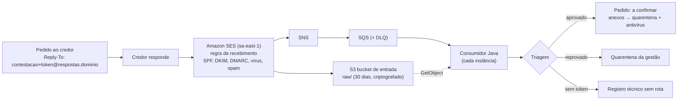

# Respostas do credor por e-mail — configuração e operação

Como ligar a leitura automática das respostas do credor aos pedidos de contestação (aprovada pelo responsável em 05/11/2026; decisões 820–836 em [decisoes-autonomas.md](../../negocio/decisoes-autonomas.md)). Regras de negócio em [contestacoes.md §4](../../negocio/contestacoes.md); desenho do módulo em [collection.md §7.6](../desenho/collection.md).

## 1. Como funciona

- Cada pedido sai com `Reply-To: contestacao+<token>@<subdomínio>` (token de 130 bits; no banco só o hash) e o responsável em cópia.
- O SES grava o e-mail no bucket e publica a notificação (com os veredictos) no SNS, que entrega na fila. Cada instância lê a fila em leitura longa; a mensagem só sai da fila depois do registro. Cinco falhas seguidas levam a mensagem à DLQ.
- **Região:** o SES recebe e-mail em **sa-east-1** (São Paulo). Bucket, tópico e fila ficam lá: não há transferência internacional (a decisão 371 não muda).

## 2. O que configurar (uma vez por ambiente)

| Passo | Onde | O quê |
| --- | --- | --- |
| 1. Subdomínio | DNS do domínio | Escolha um subdomínio **só para isso**, ex.: `respostas.gestorcobranca.com.br`. Nunca o domínio dos e-mails da equipe. |
| 2. Verificação no SES | Console SES (sa-east-1) → Identities | Crie a identidade de domínio do subdomínio e publique os registros DKIM pedidos. Aguarde "Verified". |
| 3. Terraform | `infra/terraform/envs/<env>/terraform.tfvars` | `enable_inbound_mail = true` e `inbound_mail_domain = "respostas.…"`; opcional `inbound_mail_raw_retention_days` (padrão 30). `terraform apply`. |
| 4. MX | DNS do subdomínio | Registro **MX** `10 inbound-smtp.sa-east-1.amazonaws.com` (a saída `inbound_mail_mx_record` mostra o valor). |
| 5. Aplicação | `user-data` (automático) | Com o módulo ligado, as instâncias recebem `INBOUND_MAIL_MODE=ses`, `INBOUND_MAIL_DOMAIN`, `INBOUND_MAIL_BUCKET` e `INBOUND_MAIL_QUEUE_URL`. Faça um *instance refresh* para valer. |
| 6. Alarme | CloudWatch | Alarme na métrica `ApproximateNumberOfMessagesVisible` da **DLQ** (`…-inbound-mail-dlq`) > 0, e no `ApproximateAgeOfOldestMessage` da fila > 15 min. |

O módulo `infra/terraform/modules/mail_inbound` cria:

| Recurso | Configuração |
| --- | --- |
| Bucket `…-inbound-mail-<conta>` | sem acesso público, dono único, SSE-S3 (ou KMS do cliente com `data_kms_key_arn`), TLS obrigatório, **expira o bruto em 30 dias**; só o SES grava (`aws:SourceAccount` + `aws:SourceArn` da regra). |
| Conjunto e regra de recebimento | regra `creditor-replies` para o subdomínio, **varredura de spam e vírus ligada**, TLS exigido na entrega, ação S3 em `raw/` com notificação no SNS. O conjunto fica **ativo** (há um só por conta e região: confira antes se a conta já usa outro). |
| SNS `…-inbound-mail` | só o SES publica (`aws:SourceAccount`). |
| SQS `…-inbound-mail` + DLQ | SSE-SQS, visibilidade 300 s, leitura longa 20 s, retenção 4 dias; DLQ após 5 recebimentos, retenção 14 dias; só o tópico envia. |
| Política no papel das instâncias | `sqs:ReceiveMessage`, `DeleteMessage`, `ChangeMessageVisibility`, `GetQueueAttributes` na fila; `s3:GetObject` em `raw/*` (e `kms:Decrypt` se houver chave do cliente). Nada mais. |

### Variáveis da aplicação

| Variável | Padrão | Uso |
| --- | --- | --- |
| `INBOUND_MAIL_MODE` | `disabled` | `ses` (produção), `local` (desenvolvimento/sandbox; recusado no perfil prod) ou `disabled`. |
| `INBOUND_MAIL_DOMAIN` | — | subdomínio de entrada (obrigatório se ligado). |
| `INBOUND_MAIL_QUEUE_URL`, `INBOUND_MAIL_BUCKET` | — | fila e bucket do módulo (modo `ses`). |
| `INBOUND_MAIL_REGION` | a do SDK (`AWS_REGION`) | região do SES, se diferente. |
| `INBOUND_MAIL_LOCAL_DIR` | — | pasta dos `.eml` (modo `local`). |

Limites em `app.collection.inbound-mail.*` (`application.yml`): `max-message-bytes` (25 MB), `max-attachments` (10), `per-sender-per-hour` (20), `route-validity` (P180D depois do prazo pedido). O tamanho de cada anexo segue `app.collection.disputes.api-max-document-bytes` (10 MB).

## 3. Triagem e quarentena

| Ordem | Verificação | Falhou → motivo | Liberável |
| --- | --- | --- | --- |
| 1 | MIME legível e com remetente | `MALFORMED` | não |
| 2 | Vírus (SES) = PASS | `VIRUS` | não |
| 3 | DMARC PASS (ou, sem política DMARC, SPF e DKIM PASS) | `AUTHENTICATION_FAILED` | não |
| 4 | Contestação aberta | `DISPUTE_CLOSED` | não |
| 5 | Endereço de resposta dentro da validade | `ROUTE_EXPIRED` | sim |
| 6 | Remetente é contato de contestação ativo do credor | `SENDER_NOT_REGISTERED` | sim |
| 7 | Spam (SES) diferente de FAIL | `SPAM` | sim |
| 8 | Até 20 e-mails do remetente por hora | `RATE_LIMITED` | sim |
| 9 | Até 25 MB | `TOO_LARGE` | sim |
| 10 | Até 10 anexos | `TOO_MANY_ATTACHMENTS` | sim |

Aprovado, o e-mail fica **a confirmar** no pedido; os anexos PDF, PNG ou JPEG de até 10 MB vão para a quarentena de documentos e o antivírus (decisões 815–816) e viram evidências "do credor, por e-mail"; os demais ficam só no original. A quarentena de e-mails é decidida pela gestão (Contestações → Configuração → E-mails em quarentena). Nada é descartado em silêncio: e-mail sem token conhecido vai para `collection.inbound_mail_unrouted` (só metadados e a chave do original no bucket, que expira com o ciclo de vida).

## 4. Operação

- **Fila parada ou DLQ com mensagens:** veja o log técnico `SesInboundMailConsumer` (falha de leitura da fila ou do S3) e a métrica `integration.calls{provider=sqs|s3,operation=inbound_mail}`. Corrigida a causa, reenvie as mensagens da DLQ para a fila (*redrive* no console SQS): o registro é idempotente.
- **Muitos `AUTHENTICATION_FAILED` de um credor:** o domínio dele pode estar sem DMARC/DKIM; peça ao credor que ajuste ou que use a API pública. Não há liberação manual desse motivo.
- **Muitos `SENDER_NOT_REGISTERED`:** cadastre os novos contatos de contestação no credor; os já recebidos podem ser liberados pela gestão.
- **E-mail sem rota:** `select * from collection.inbound_mail_unrouted order by received_at desc` (usuário de operação). O original fica em `s3://<bucket>/raw/…` até expirar.
- **Desligar:** `enable_inbound_mail = false` remove a regra, a fila e o bucket (o bucket precisa estar vazio — o ciclo de vida esvazia em até 30 dias). A aplicação volta a pôr só o responsável como resposta nos novos pedidos; endereços já enviados deixam de receber.

## 5. Desenvolvimento e sandbox

- `INBOUND_MAIL_MODE=local` e `INBOUND_MAIL_LOCAL_DIR=<pasta>`: cada `*.eml` colocado na pasta entra pelo mesmo caso de uso do SES e vai para `processados/` (ou `falhas/`). Os veredictos vêm dos cabeçalhos `X-Sandbox-Spf`, `-Dkim`, `-Dmarc`, `-Virus` e `-Spam` (ausente = PASS).
- Sandbox: ligado por padrão com o domínio `respostas.sandbox.test`. O endereço de resposta do pedido aparece no Mailpit (`Reply-To`); `./scripts/sandbox/credor-responde.sh <endereço> [--de <e-mail>] [--falha-dmarc] [--virus] [--sem-anexo]` simula a resposta do credor. A carga já deixa uma resposta a confirmar e uma em quarentena na contestação "aguardando o credor".
