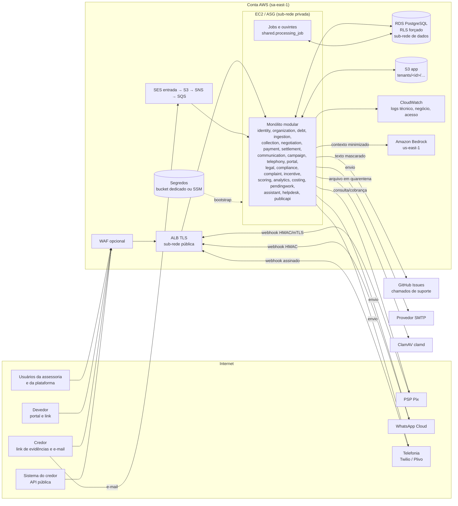

# Modelo de ameaças

Versão inicial (auditoria de 24/11/2026, `engenheiro-seguranca`). Revisar a cada módulo novo, integração externa nova
ou mudança de fronteira (ADR). Controles implementados: [seguranca.md](seguranca.md); riscos e vulnerabilidades
abertas: [seguranca-riscos.md](seguranca-riscos.md). Este documento não contém segredos nem dados pessoais.

## 1. Escopo e premissas

- CRM SaaS multi-tenant para assessorias de cobrança: monólito modular Spring Boot (Java 21, Spring Modulith) com o
  frontend Angular embutido (ADR-0007), PostgreSQL 16 no RDS com RLS forçado (ADR-0002), S3, CloudWatch, EC2 em Auto
  Scaling atrás de um ALB, em `sa-east-1`.
- A plataforma **não custodia recursos**: nenhum fluxo move dinheiro. O risco financeiro está em **confirmar** ou
  **registrar** pagamento, acordo, desconto, repasse ou comissão sem autenticidade.
- O pior incidente é **dado de uma assessoria (ou de um credor) visível para outra**.
- Repositório público até a produção: todo segredo fica fora do Git; o registro de vulnerabilidades abertas é
  versionado por decisão do responsável (decisão 1383, R-09).

## 2. Mapa da arquitetura

**Entradas** (todas atrás do ALB; endpoints anônimos declarados por `PublicEndpoint` e listados na subida):

| Entrada | Caminho | Autenticação |
| --- | --- | --- |
| Aplicação interna | `/api/v1/**` | JWT RS256 de usuário (10 min) + sessão validada no servidor; MFA por perfil |
| Autenticação | `POST /api/v1/auth/**` | anônimo, limite por IP, bloqueio progressivo, refresh em cookie `SameSite=Strict` |
| Portal do devedor | `/api/portal/v1/**` (`sites/*`, `sites/*/logo`, `sites/*/access/**`) | link de uso único ou documento + código; JWT `typ=portal` |
| API pública | `/public-api/v1/**` | token `gck_` por credor, escopos, IPs permitidos |
| Webhooks | `/api/v1/webhooks/{whatsapp,pix,telephony}/{routingKey}` | rota aleatória + assinatura sobre o corpo bruto (mTLS no Pix pendente, R-05) |
| Canal com o credor | `GET /api/v1/dispute-files/*` | token de 256 bits, validade e limite de downloads |
| E-mail de entrada | SES → SQS | token no endereço de resposta + DMARC/SPF/DKIM + antivírus |
| Tempo real | SSE da caixa de entrada | bearer no cabeçalho, revalidado a cada minuto |
| Operação | SSM Run Command e Session Manager | IAM da conta AWS |

**Armazenamentos:** RDS (dados de negócio, trilhas append-only, `shared.access_log`, `shared.audit_event`); S3
`app` (arquivos por tenant: importações, PDFs, evidências, termos, gravações, exportações, comprovantes); S3 `logs`
(ALB, S3 e arquivo de 5 anos do log de acesso); bucket de e-mail bruto (30 dias); CloudWatch Logs (técnico, negócio,
acesso, Run Command, VPC); cofre de segredos (bucket dedicado hoje; SSM + KMS quando aprovado).

## 3. Ativos e classificação dos dados

| Classe | Exemplos | Onde | Proteção esperada |
| --- | --- | --- | --- |
| **Restrito — segredos** | chaves JWT, chaves de campo AES e blind index, chave HMAC dos tokens, senhas do banco, credenciais e certificados de PSP, telefonia, WhatsApp e SMTP, token do GitHub | cofre, `/etc/gestor-cobranca` (0600), colunas cifradas | nunca em Git, log, evento, resposta ou auditoria; leitura só pelo papel de runtime (`app/*`) |
| **Restrito — autenticação** | hashes Argon2id, refresh tokens (hash), códigos e links do portal (hash/HMAC), segredos TOTP, tokens de ação | RDS | só hash ou HMAC; tempo constante; uso único |
| **Pessoal sensível** (LGPD art. 11 e dado financeiro) | marcador de vulnerabilidade/saúde, superendividamento, gravações de chamadas, conteúdo de mensagens, documentos de contestação e reclamação | RDS cifrado, S3 | permissão específica, `SENSITIVE_DATA_VIEWED`/`FILE_DOWNLOADED`, retenção e anonimização |
| **Pessoal do devedor** | CPF/CNPJ, nome, contatos, endereço, dívidas, histórico e comportamento de pagamento, acordos, aceites (IP/agente) | RDS (campos cifrados + blind index), S3 | escopo por credor, mascaramento por padrão, revelação auditada |
| **Confidencial do credor/assessoria** | contratos, carteiras, política e envelope de negociação, alçadas, regras de comissão, demonstrativos, repasses, margem, faturamento da plataforma | RDS, S3 | escopo por credor, RLS, segregação de funções, append-only |
| **Pessoal dos usuários** | e-mail, nome, perfis, remuneração variável, sessões e IPs | RDS, logs de acesso | `USER_VIEW`, escopo próprio/equipe/tudo, minimização |
| **Interno** | logs técnicos mascarados, métricas, eventos de negócio sem dado pessoal | CloudWatch | mascaramento automático; nenhum dado pessoal |
| **Público** | marca e logotipo do portal, contrato OpenAPI da API pública | aplicação | sem dado de devedor; anti-enumeração |

## 4. Atores

| Ator | Confiança | Pode | Não pode |
| --- | --- | --- | --- |
| Usuário da assessoria (operador, supervisor, gestor, financeiro, jurídico, auditor, compliance, administrador) | autenticado, com permissões e escopo de credores | o que o perfil e o escopo permitem | ver outro tenant; aprovar o que propôs; conceder o que não tem |
| Advogado parceiro | autenticado, externo à assessoria | casos atribuídos ao escritório | parâmetros, outros casos |
| Administrador da plataforma (`PLATFORM_ADMIN`) | autenticado no tenant da plataforma, MFA | tenants, faturamento, controle de tokens (`Permission.PLATFORM_ONLY`), via `TenantSwitch` auditado | operar a cobrança da assessoria |
| Devedor | anônimo até a verificação; sessão de portal | os próprios dados, simular, propor e pagar no canal | outro devedor; o envelope da política; `/api/**` interno |
| Credor (pessoa) | possuidor de link ou de e-mail autorizado | baixar evidências e responder contestação | qualquer outro recurso |
| Integração (`INTEGRATION`) | token por credor e escopos | API pública do próprio credor | dado sem máscara, aprovação, estorno, outro credor |
| Assistente de IA (`ASSISTANT`) | **não confiável quanto à intenção**; ator por turno com permissões mínimas | ferramentas validadas no servidor, escopo da conversa | autorizar, aprovar, ver o envelope, inventar valores |
| Chat de suporte (helpdesk) | age como o próprio usuário | ferramentas somente leitura com as permissões do usuário | ampliar o acesso do usuário |
| Provedores (PSP, WhatsApp, telefonia, SMTP, SES, Bedrock, GitHub, ClamAV) | autenticidade só pela assinatura, mTLS ou consulta | notificar e receber o mínimo | ser prova de pagamento por si (notificação ≠ confirmação) |
| Operador de infraestrutura (AWS) | privilégio alto | Run Command, Session Manager, deploy, migrations | (o controle depende de IAM e de rastreabilidade) |
| Atacante externo | anônimo | qualquer entrada pública | — |

## 5. Fronteiras de confiança

1. **Internet ↔ ALB/WAF**: TLS, limite de taxa (WAF pendente, R-01). Cabeçalhos de proxy só valem vindos das sub-redes
   do ALB (`TrustedProxyFilter`).
2. **ALB ↔ aplicação**: cadeias de segurança separadas para `/api/**` (usuário), `/api/portal/v1/**` (devedor) e
   `/public-api/**` (integração); um token de uma cadeia nunca vale na outra.
3. **Aplicação ↔ banco**: papel `app_runtime_login` sem `BYPASSRLS` e sem DDL; `app.tenant_id` por transação. Sem RLS,
   por desenho, só as tabelas globais de roteamento e da fila (`*_route`, `shared.processing_job`, lida por view
   filtrada, `shared.consumed_event`) e as sem `tenant_id` (`organization.tenant`, `shedlock`, `event_publication`).
4. **Tenant ↔ tenant**: RLS + AAD com a assessoria na criptografia de campo + prefixo `tenants/<id>/` no S3 (o IAM
   alcança todos os tenants: o isolamento no S3 é da aplicação).
5. **Credor ↔ credor dentro da assessoria**: `AccessScope` (`requireVisible`/`requireCreditor`/`restrictCreditors`),
   sem apoio do banco — **a fronteira mais frágil**.
6. **Aplicação ↔ provedores externos**: saída 443 pela NAT; URLs de PSP com lista de hosts e DNS público;
   webhooks autenticados antes de processar.
7. **Aplicação ↔ IA (Bedrock, fora do Brasil)**: contexto minimizado e mascarado; a saída do modelo é dado não
   confiável, validado de forma determinística.
8. **Runtime ↔ migração e administração do banco**: segredos `app/*` × `migration/*`, janela temporária
   (achado SEG-20261124-E01 no modo SSM).
9. **Operador AWS ↔ instância**: SSM sem SSH; o registro de sessão está pendente (SEG-20261124-E04).
10. **Sandbox/dev ↔ internet**: só `127.0.0.1`; túnel opcional com senha pública e dados fictícios.

## 6. Superfícies de ataque e controles existentes

| Superfície | Controles (detalhe em seguranca.md) | Lacunas conhecidas |
| --- | --- | --- |
| Login, MFA, refresh, reset | Argon2id, bloqueio progressivo, tempo equalizado, refresh rotativo com detecção de reuso, link no fragmento, verificação de Origin | WAF (R-01) |
| Portal do devedor | link de uso único, código HMAC de 6 dígitos (5 tentativas), bloqueio por documento e IP, sessão separada, `DebtorSelfScope` | — |
| API pública | token HMAC, escopos por credor, IPs permitidos, limite por instância, 404 fora do credor | limite global entre instâncias (R-01, #18) |
| Webhooks | rota aleatória, assinatura no corpo bruto, recibo contra reentrega, janela de replay, idempotência; Pix confirmado por consulta ao PSP | mTLS no ALB (R-05) |
| Uploads (carteira, PDF, evidências, logotipo, e-mail) | tipo pelo conteúdo, limites, anti zip bomb e XXE, fórmulas recusadas, PDF sem JavaScript, quarentena | antivírus (R-04) |
| Downloads e exportações | escopo, `FILE_DOWNLOADED`/`DATA_EXPORTED`, SHA-256, neutralização de fórmulas | — |
| Assistente e importação PDF com IA | ator mínimo, ferramentas validadas, `NegotiationGuard`, contexto mascarado, guarda de transferência internacional | — |
| Chat de suporte | ferramentas como o próprio usuário, referências opacas | chamados em repositório público (SEG-20261124-D04, inclui o E05) |
| Jobs, ouvintes, SSE | `TenantExecution`, filtros por tenant e escopo capturados na abertura | sem teste de catálogo de RLS global (recomendação, frente A) |
| Infraestrutura | grupos em cadeia, IMDSv2, criptografia, bloqueio público, IAM mínimo, segredos fora do Git | SEG-20261124-E01..E07; GuardDuty (R-03); cofre e rotação (R-02); CloudTrail (R-10) |

## 7. Ameaças STRIDE priorizadas por área

Prioridade: **P1** = impacto crítico (outro tenant ou credor, dinheiro, exposição em massa); **P2** = alto;
**P3** = complementar. A coluna "Frente" indica quem aprofunda.

### 7.1 Isolamento (frente A)

| # | STRIDE | Ameaça | Controle | O que verificar | P |
| --- | --- | --- | --- | --- | --- |
| AM-A1 | I, E | IDOR entre credores: id vindo do cliente sem `requireVisible`/`requireCreditor` em um dos ~180 controllers | `AccessScope`, `CaseAccess`, `ConversationAccess`… | amostrar todo `@PathVariable`/corpo com id por módulo, inclusive sub-recursos (anexos, termos, parcelas) e endpoints de lote | P1 |
| AM-A2 | I | listagem, contagem, relatório ou exportação sem `restrictCreditors` | views `security_invoker`, `AnalyticsAccess` | filtros livres, ordenação, paginação por cursor e totais que revelam existência | P1 |
| AM-A3 | I, E | job, ouvinte ou consumidor de evento rodando sem tenant ou no tenant errado; payload de `shared.processing_job` (sem RLS) com dado pessoal ou de outro tenant | `TenantExecution`, ADR-0002 | conteúdo dos payloads e de `consumed_event`; jobs de plataforma com `TenantSwitch` | P1 |
| AM-A4 | I | cache, SSE, notificação ou e-mail misturando assessorias ou credores | `InboxChangeHub`, cache de 15 s do `UserAccessTokenResolver` | chave de cache inclui tenant e usuário; filtro do SSE quando o escopo muda | P1 |
| AM-A5 | E | ator `INTEGRATION` ou `ASSISTANT` alcançando outro credor, ou permissão `PLATFORM_ONLY` em perfil de assessoria | `TokenScope`, `AssistantActors`, `Role` | ITs de acesso cruzado por ator | P1 |
| AM-A6 | T, I | regressão: tabela nova com `tenant_id` sem RLS forçado | `enable_tenant_rls` nas migrations | criar IT de catálogo: toda tabela com `tenant_id` tem `relrowsecurity` e `relforcerowsecurity`, exceto lista explícita de globais | P2 |
| AM-A7 | I | arquivo no S3 de outro tenant por chave montada com entrada do cliente | prefixo `tenants/<id>/`, URLs temporárias | geração da chave só no servidor; validade das URLs | P2 |

### 7.2 Identidade e entradas públicas (frente B)

| # | STRIDE | Ameaça | Controle | O que verificar | P |
| --- | --- | --- | --- | --- | --- |
| AM-B1 | S | forja ou confusão de JWT (algoritmo, `kid`, audiência, `typ` portal × usuário) | `JwtKeyConfig#audienceMatchesType` | testes negativos por campo; chave de teste nunca aceita fora do teste | P1 |
| AM-B2 | S | webhook forjado (WhatsApp, Pix, telefonia), replay ou assinatura calculada sobre o corpo já interpretado | HMAC no corpo bruto, recibo, janela | todos os provedores; tamanho; 429; rota vazando em log | P1 |
| AM-B3 | S, I | enumeração no portal, no login e no reset (resposta, tempo, código de status) | tempo equalizado, desafio fictício | medir tempos; mensagens de erro; limites por IP com proxy confiável | P2 |
| AM-B4 | S | token de API pública: prefixo vazando, rotação e carência, IP permitido contornado por cabeçalho | `TrustedProxyFilter`, HMAC | cabeçalhos de proxy fora do ALB | P2 |
| AM-B5 | T | CSRF no refresh por cookie; CORS amplo; open redirect em links de retorno | `SameSite=Strict`, Origin, CORS por lista | rotas com `redirect`/`returnUrl`; `preserve_host_header` no ALB × origem própria | P2 |
| AM-B6 | E | escalada por administração de perfis e usuários (hierarquia, último administrador, MFA) | `AdministrationHierarchy` | corridas (dois administradores ao mesmo tempo) | P2 |
| AM-B7 | D | esgotamento de recursos nas entradas públicas sem WAF | limites por instância | soma entre instâncias (R-01) | P3 |

### 7.3 Dinheiro e automações (frente C)

| # | STRIDE | Ameaça | Controle | O que verificar | P |
| --- | --- | --- | --- | --- | --- |
| AM-C1 | T, S | pagamento confirmado sem autenticidade (notificação tratada como prova, simulador fora do sandbox) | consulta ao PSP, `PaymentSandboxGuard` | todos os caminhos que mudam parcela para paga (Pix, externo, conciliação, API pública) | P1 |
| AM-C2 | T | corrida e duplicidade em acordo, baixa, estorno, repasse, comissão e correção de valor | locks consultivos, índices únicos, idempotência | requisições paralelas; reprocessamento de evento fora de ordem | P1 |
| AM-C3 | E, R | segregação de funções só na tela (proponente aprova, quem calcula aprova), alçada contornada pelo assistente ou pelo portal | `NegotiationGuard`, `check` no banco | todos os caminhos de aprovação, inclusive o administrador e a API pública | P1 |
| AM-C4 | T | valor ou desconto calculado no cliente, ou oferta do modelo usada como valor | referências opacas ao motor | parâmetros monetários aceitos do cliente | P1 |
| AM-C5 | D, R | campanha, régua ou discador em massa sem limite, sem política de contato ou com duplicidade | `ContactGate#authorizeAndRecord` | disparo concorrente; reprocessamento; horário e vulnerabilidade | P2 |
| AM-C6 | S | SSRF ou PSP falso pela URL da conta Pix | `PixEndpointGuard`, troca exige outra pessoa | redirecionamentos HTTP; DNS rebinding entre checagem e conexão | P2 |

### 7.4 Arquivos, IA e LGPD (frente D)

| # | STRIDE | Ameaça | Controle | O que verificar | P |
| --- | --- | --- | --- | --- | --- |
| AM-D1 | E, T | prompt injection direta (devedor) ou indireta (PDF, e-mail, documento) levando a ferramenta fora do escopo | ferramentas validadas, ator mínimo | cada ferramenta do `AssistantToolbox`/`HelpdeskToolbox` repete permissão, escopo e guarda | P1 |
| AM-D2 | I | dado de um tenant ou devedor no contexto de outro; dado pessoal ao Bedrock além do necessário | `ContextBuilder`, `PersonalDataRedactor`, `PromptText` | montagem do contexto em sessões reabertas e transferidas | P1 |
| AM-D3 | E, D | upload malicioso (XLSX/PDF, zip bomb, XXE, polyglot, path traversal no nome) | parsing endurecido, quarentena | nomes de arquivo no S3 e em `Content-Disposition`; limites de memória | P2 |
| AM-D4 | I | exportação e relatório com dado pessoal além do necessário; download sem `FILE_DOWNLOADED` | `SettlementExportService`, `AnalyticsExportService` | todos os downloads; URLs assinadas | P2 |
| AM-D5 | I | dado pessoal em log, evento, métrica, exceção ou URL | `SensitiveDataMasker`, regras de eventos | termos de busca, nomes de arquivo, mensagens do provedor | P2 |
| AM-D6 | I, R | retenção, anonimização e solicitação de titular incompletas (S3 versionado, backups, trilhas) | políticas de retenção, ciclo de vida do S3 | versões antigas no S3; arquivos derivados | P2 |
| AM-D7 | I | chamado de suporte público com e-mail e resíduo de mascaramento | `TicketRedactor`, trava de repositório privado | SEG-20261124-D04 (inclui o E05) | P2 |

### 7.5 Infraestrutura, segredos e dependências (frente E)

| # | STRIDE | Ameaça | Controle | Situação | P |
| --- | --- | --- | --- | --- | --- |
| AM-E1 | E | runtime comprometido obtém a senha do dono do schema e contorna o RLS | separação `app/*` × `migration/*` | SEG-20261124-E01 (modo SSM) | P2 |
| AM-E2 | I, R | operador copia as chaves pela sessão na instância sem rastro | SSM sem SSH | SEG-20261124-E04; R-10 | P2 |
| AM-E3 | T | artefato ou imagem base adulterados | hash dos scripts fixado; versões imutáveis | SEG-20261124-E06/E07; R-07 | P3 |
| AM-E4 | I | segredo versionado | `.gitignore`, revisão | nenhum achado no histórico em 24/11/2026; sem varredura automática (R-07) | P3 |
| AM-E5 | I, E | ambiente local ou sandbox exposto | `127.0.0.1`, guardas de perfil | SEG-20261124-E02/E03/E08 | P3 |
| AM-E6 | D | perda de dados por comprometimento da conta | deletion protection, backups de 14 dias | sem cópia isolada (R-10) | P3 |

## 8. Foco das frentes da auditoria

- **A — Isolamento:** AM-A1 a AM-A4 primeiro; criar o IT de catálogo de RLS (AM-A6); revisar o conteúdo das tabelas
  globais sem RLS.
- **B — Identidade e entradas públicas:** AM-B1 e AM-B2 primeiro (forja de JWT e de webhook); depois anti-enumeração e
  CSRF/CORS.
- **C — Dinheiro e automações:** AM-C1 a AM-C4 (confirmação de pagamento, corridas, segregação de funções, valores do
  cliente); depois os limites de automação.
- **D — Arquivos, IA e LGPD:** AM-D1 e AM-D2 (a IA nunca autoriza; contexto sem vazamento entre tenants); depois uploads,
  exportações e retenção.
- **E — Infraestrutura:** fechar SEG-20261124-E01 antes de ligar o SSM e D04 (inclui o E05) antes de ligar os chamados; acompanhar
  R-01 a R-10.

## 9. Manutenção

Atualizar este modelo quando entrar módulo, integração ou entrada pública nova, quando mudar uma fronteira (ADR) e
após cada auditoria (`seguranca-auditorias/`). Ameaças com controle implementado e validado vão para
[seguranca.md](seguranca.md); lacunas, para [seguranca-riscos.md](seguranca-riscos.md).
